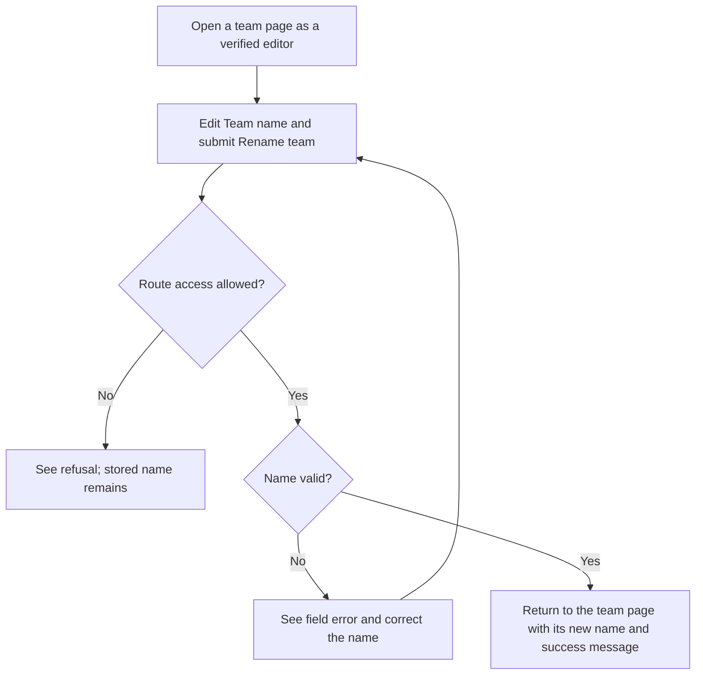
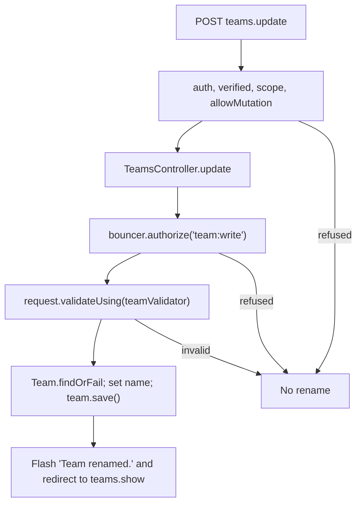

# Story format

A story records one meaningful application, integration or operator action and why it matters. Use
actual permission roles, visible control names and current form fields or command options. Keep
implementation contracts in accepted repository decision records, instructions in guides and
runnable scenarios in the test suite.

Copy the story example below into a stable path such as
`user-stories/teams/us-team-03-rename-team.md`; replace its sample content with source-backed
details. The `../../` links resolve from that copied story path. Keep the writing and maintenance
guidance in this `TEMPLATE.md`, outside individual stories. Omit the optional Coverage line when
there is no useful test link. The field table is for form/API input actions; use the controls/results
alternative below for actions without input fields. Adapt both diagrams to the actual action rather
than retaining the sample save flow.

## Story example

````markdown
# US-TEAM-03 — Rename a team

As a team editor, I want to rename a team so that its members see the current name.

**Status:** Current; source-reviewed route, not runtime-tested.
**Access:** Authenticated, verified effective team member with `team:write` (editors and above). During Masquerade, the edit policy and route's `allowMutation()` marker must permit the write, and the effective target must have `team:write`.
**Entry:** On the Hypermedia team page, use the **Rename team** form (`POST /teams/:scopeId`).
**Documentation:** [Masquerade with Access Control](../../docs/cookbook/masquerade-with-access-control.md).
**Source:** [Hypermedia team page](../../apps/hypermedia/resources/views/pages/teams/show.edge), [teams route](../../apps/hypermedia/start/routes.ts), [TeamsController.update](../../apps/hypermedia/app/controllers/teams_controller.ts).
**Coverage:** [Team route tests](../../apps/hypermedia/tests/functional/teams.spec.ts).

## Acceptance criteria

| Field     | Control                                  | Required/default/conditions                                  |
| --------- | ---------------------------------------- | ------------------------------------------------------------ |
| Team name | Required text input labelled “Team name” | Starts with the current team name; trimmed; 1–100 characters |

- A successful rename returns to the team page with the updated name and “Team renamed.” success message.
- Missing membership or permission is refused; an invalid name returns with a field error. Neither path changes the existing name.

## User flow



## Code flow

Scope: Hypermedia route, controller, authorization, validation, Lucid persistence and redirect response.



**Code references:** [Hypermedia team page](../../apps/hypermedia/resources/views/pages/teams/show.edge), [route and middleware](../../apps/hypermedia/start/routes.ts), [controller](../../apps/hypermedia/app/controllers/teams_controller.ts), [validator](../../apps/hypermedia/app/validators/team.ts), [flash messages](../../apps/hypermedia/resources/views/partials/flash_alerts.edge), [functional tests](../../apps/hypermedia/tests/functional/teams.spec.ts).
````

## Actions without input fields

Replace the field table with a short list of controls and their visible results. Do not create empty
or artificial field rows. For example, an action that reviews deleted accounts could use:

```markdown
## Acceptance criteria

- **Restore <email>** restores the selected record and returns to the deleted-account list.
```

Use actual controls and behavior in the product. Include confirmation controls and relevant
cancellation or failure results when they affect the action. Keep both diagrams in these stories.

## Writing and maintenance rules

- Use one story per meaningful outcome. An inseparable set of controls may share a story;
  independently useful actions deserve their own. Create and edit are distinct actions.
  Keep inputs, decisions and recovery focused on that one action; do not create stories for its
  internal guards, helpers or technical variants.
  When splitting, preserve the original ID/path for one outcome and give the other the next unused
  ID; update catalogue references and counts together.
- Include every relevant field, including conditional and read-only fields. Record exact labels,
  required/optional state, defaults, limits, available options and dependent choices. For dynamic
  choices, describe their source and filtering rules rather than listing transient data.
- Edit forms include current-value prefills. API/library/CLI actions document real argument names,
  required values, omission/null defaults, flag/prompt behavior and limits. Verify what callbacks
  receive before assigning host policy to them.
- Move repeated or lengthy field lists, technical schemas and protocol details to one cohesive
  repository guide/reference with a direct section link. Keep relevant controls, outcomes and
  action-specific differences clear locally; do not make readers chase several links for a form.
- Keep acceptance criteria concise and observable. Avoid detailed test scripts and exhaustive
  backend guarantees; keep those in tests and the authoritative decision record.
- Keep identifiers and filenames stable. Add the next unused identifier within the area. Retain
  intent and mark availability when a feature disappears, unless retirement is explicitly authorized.
- Use the availability definitions below. Explain unavailable entries and identify historical or
  intended controls clearly. Retention does not promise restoration or authorize new functionality.
  State opt-in capabilities and required hooks; trace account-state and permission requirements
  for this operation instead of copying them from a neighboring action.
- An optional **Coverage:** test link identifies supporting tests; it does not claim they were run.
  Keep runtime results separate from source-reviewed availability.
- Verify source rather than inheriting stale copy. Update the index (README.md), coverage matrix
  (COVERAGE.md), shared reference (REFERENCE.md) and decision gaps (GAPS.md) alongside affected stories.
  Adapt these names to the repository's established equivalents.
- Reconcile copied examples in TEMPLATE.md too. Close review findings with source evidence for
  each correction; green checks alone do not establish that an inaccurate claim is fixed.
- Record differences between agreed targets and current implementation in the gaps record without
  silently changing either. “New” in the coverage matrix means newly documented, not newly implemented.

## Availability definitions

| Status   | Meaning                                                                 |
| -------- | ----------------------------------------------------------------------- |
| Current  | Exposed, subject to stated roles, configuration and conditions          |
| Hidden   | Implementation remains but its ordinary entry or trigger is unavailable |
| Removed  | Historical capability has no current product entry                      |
| Demo     | Available only in the specified demo context                            |
| Operator | Installation, hosting or recovery outside the ordinary application UI   |
| Planned  | Agreed target without an ordinary implemented journey                   |

Read Status with Access and Entry. A configured feature switch is a condition, not proof of removal.
Current describes availability, not a browser test result. Preserve equivalent repository status
semantics and explain their mapping where an established scheme differs.

## Diagram conventions

- Every story has User flow and Code flow sections, each containing a Mermaid flowchart. The first
  uses screens, actions, decisions and outcomes a person understands; the second names the actual
  implementation. Link supporting files under Code references.
- Keep diagrams focused on the action. Include meaningful choices, cancellation, refusal, failure
  and recovery where they affect the journey; avoid repeating every validation or security rule.
  Use the owning handler/service/transaction as the default code-flow unit. Group routine field/proof
  validation into one boundary with one refusal path; field rules stay in criteria or a reference.
  Expand only for materially different access, persisted effects, commit/consumption or recovery.
  Preserve material ordering without making a node for each field, message or helper.
- Trace producers and consumers: entry, handler, state or service, persistence where applicable
  and resulting UI. A retained component or setter alone does not prove a reachable journey.
- Distinguish server writes, device preferences and read-only actions. Verify the demo's actual
  path. Do not infer server authorization from hidden controls.
- Trace each client and authentication strategy separately. Show actual response fields and
  prerequisite-token sources; browser rendering, API acknowledgements and audit events may differ.
  Keep real calls on the branches that execute them, including client-specific queries.
- Place guards and validation before the operations they govern. Include early no-op returns,
  scope/replacement effects and refusals that consume proof or leave committed state in place.
  Distinguish confirmation/completion recipients and attempted cleanup from guaranteed removal;
  show recovery when these differences affect the action. Bounded counts describe the current run.
- Code labels must name existing symbols or explicitly identify absent/intended controls. State
  the scope when a diagram stops at a shared boundary.
- For Hidden, Removed or Planned features, label the intended user flow as unavailable. Show the
  actual missing entry/trigger and retained support in the code flow without implying execution.
- Reconcile labels and branches against source. Parse changed Mermaid diagrams and inspect
  representative rendering; report any check that could not be completed. Syntax validation does
  not establish behavioral correctness or prove a browser journey was exercised.

## Verification and sign-off

Agree whether the task covers a catalogue baseline, named stories or an agreed finding list.
Sign off that scope only after reconciling it with source and obtaining the applicable checks and
required review. In the existing handoff or final response, record the reviewed scope/source and
content revision, supporting source references and finding dispositions, actual checks/skips/limits,
review outcome when required, and delivery/PR state. CI evidence must match the final published
head. Keep source review, documentation checks and runtime journeys distinct.

For correction rounds, verify the agreed items and affected guarantees; record unrelated new
observations separately. Recheck introduced defects and invalidated review evidence while retaining
acceptance for unaffected content. Closing the latest finding list establishes that list's closure;
a catalogue-wide baseline claim needs reconciliation of the agreed catalogue scope. Preserve the
requested merge boundary; catalogue work grants no merge permission.
