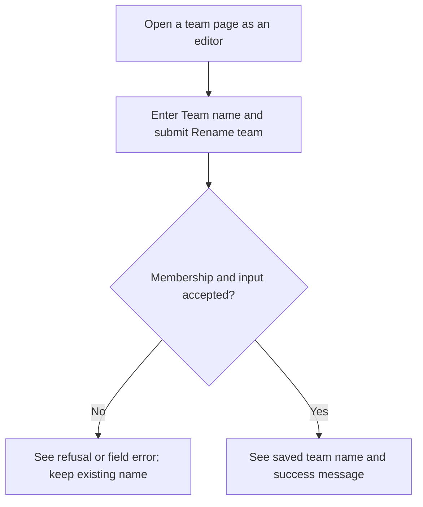
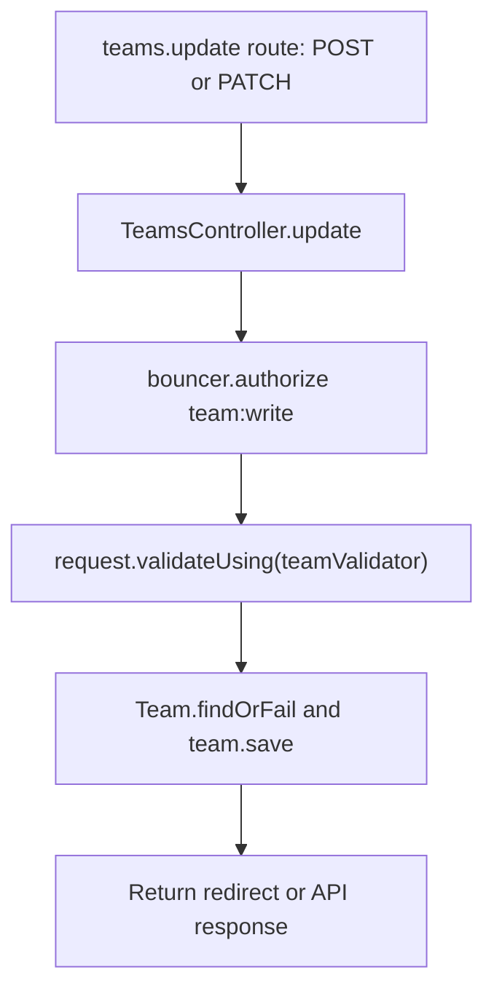

# Story format

A story records one meaningful application, integration or operator action and why it matters. Use
actual permission roles, visible control names and current form fields or command options. Keep
implementation contracts in accepted repository decision records, instructions in guides and
runnable scenarios in the test suite.

Copy the story example below into a stable path such as
`user-stories/teams/us-team-03-rename-team.md`; replace its sample content with source-backed
details. The `../../` links resolve from that copied story path. Keep the writing and maintenance
guidance in this `TEMPLATE.md`, outside individual stories. Omit the optional Coverage line when
there is no useful test link. The field table is for form/API input actions; use the controls/results
alternative below for actions without input fields. Adapt both diagrams to the actual action rather
than retaining the sample save flow.

## Story example

````markdown
# US-TEAM-03 — Rename a team

As a team editor, I want to rename a team so that its members see the current name.

**Status:** Current; source-reviewed route, not runtime-tested.
**Access:** Verified member with `team:write`; during Masquerade, the effective target must hold that permission and mode policy must permit mutation.
**Entry:** Hypermedia `POST /teams/:scopeId`; corresponding session/Inertia and API routes use their kit-specific methods.
**Documentation:** [Masquerade with Access Control](../../docs/cookbook/masquerade-with-access-control.md).
**Source:** [TeamsController.update](../../apps/hypermedia/app/controllers/teams_controller.ts), [React team form](../../apps/inertia-react/inertia/pages/teams/show.tsx).
**Coverage:** [Team route tests](../../apps/hypermedia/tests/functional/teams.spec.ts).

## Acceptance criteria

| Field     | Control                         | Required/default/conditions                                                               |
| --------- | ------------------------------- | ----------------------------------------------------------------------------------------- |
| Team name | Text input labelled “Team name” | Required; React editing form starts with the current team name; trimmed; 1–100 characters |

- The controller checks `team:write`, validates the name, saves the team and returns to its page with success feedback.
- Missing membership or permission is refused. Validation or authorization failure leaves the existing name unchanged.

## User flow



## Code flow

Scope: route, controller, authorization, validation and Lucid persistence. API and browser transports share the team outcome but use different guards and response formats.



**Code references:** [route](../../apps/hypermedia/start/routes.ts), [controller](../../apps/hypermedia/app/controllers/teams_controller.ts), [React form](../../apps/inertia-react/inertia/pages/teams/show.tsx), [validator](../../apps/hypermedia/app/validators/team.ts), [tests](../../apps/hypermedia/tests/functional/teams.spec.ts).
````

## Actions without input fields

Replace the field table with a short list of controls and their visible results. Do not create empty
or artificial field rows. For example, an action that reviews deleted accounts could use:

```markdown
## Acceptance criteria

- **Restore <email>** restores the selected record and returns to the deleted-account list.
```

Use actual controls and behavior in the product. Include confirmation controls and relevant
cancellation or failure results when they affect the action. Keep both diagrams in these stories.

## Writing and maintenance rules

- Use one story per meaningful outcome. An inseparable set of controls may share a story;
  independently useful actions deserve their own. Create and edit are distinct actions.
- Include every relevant field, including conditional and read-only fields. Record exact labels,
  required/optional state, defaults, limits, available options and dependent choices. For dynamic
  choices, describe their source and filtering rules rather than listing transient data.
- Link an identical shared field list and describe create/edit differences locally. Do not make
  readers chase several links to discover a form.
- Keep acceptance criteria concise and observable. Avoid detailed test scripts and exhaustive
  backend guarantees; keep those in tests and the authoritative decision record.
- Keep identifiers and filenames stable. Add the next unused identifier within the area. Retain
  intent and mark availability when a feature disappears, unless retirement is explicitly authorized.
- Use the availability definitions below. Explain unavailable entries and identify historical or
  intended controls clearly. Retention does not promise restoration or authorize new functionality.
- An optional **Coverage:** test link identifies supporting tests; it does not claim they were run.
  Keep runtime results separate from source-reviewed availability.
- Verify source rather than inheriting stale copy. Update the index (`README.md`), coverage matrix
  (`COVERAGE.md`), shared reference (`REFERENCE.md`) and decision gaps (`GAPS.md`) alongside
  affected stories. Adapt these names to established repository equivalents.
- Record differences between agreed targets and current implementation in the gaps record without
  silently changing either. “New” in the coverage matrix means newly documented, not newly implemented.

## Availability definitions

| Status   | Meaning                                                                 |
| -------- | ----------------------------------------------------------------------- |
| Current  | Exposed, subject to stated roles, configuration and conditions          |
| Hidden   | Implementation remains but its ordinary entry or trigger is unavailable |
| Removed  | Historical capability has no current product entry                      |
| Demo     | Available only in the specified demo context                            |
| Operator | Installation, hosting or recovery outside the ordinary application UI   |
| Planned  | Agreed target without an ordinary implemented journey                   |

Read Status with Access and Entry. A configured feature switch is a condition, not proof of removal.
Current describes availability, not a browser test result. Preserve equivalent repository status
semantics and explain their mapping where an established scheme differs.

## Diagram conventions

- Every story has User flow and Code flow sections, each containing a Mermaid flowchart. The first
  uses screens, actions, decisions and outcomes a person understands; the second names the actual
  implementation. Link supporting files under Code references.
- Keep diagrams focused on the action. Include meaningful choices, cancellation, refusal, failure
  and recovery where they affect the journey; avoid repeating every validation or security rule.
- Trace producers and consumers: entry, handler, state or service, persistence where applicable
  and resulting UI. A retained component or setter alone does not prove a reachable journey.
- Distinguish server writes, device-local state and read-only actions. Verify the demo's actual path.
  Do not infer server authorization from hidden controls.
- Code labels must name existing symbols or explicitly identify absent/intended controls. State
  the scope when a diagram stops at a shared boundary.
- For Hidden, Removed or Planned features, label the intended user flow as unavailable. Show the
  actual missing entry/trigger and retained support in the code flow without implying execution.
- Reconcile labels and branches against source. Parse changed Mermaid diagrams and inspect
  representative rendering; report any check that could not be completed. Syntax validation does
  not establish behavioral correctness or prove a browser journey was exercised.
