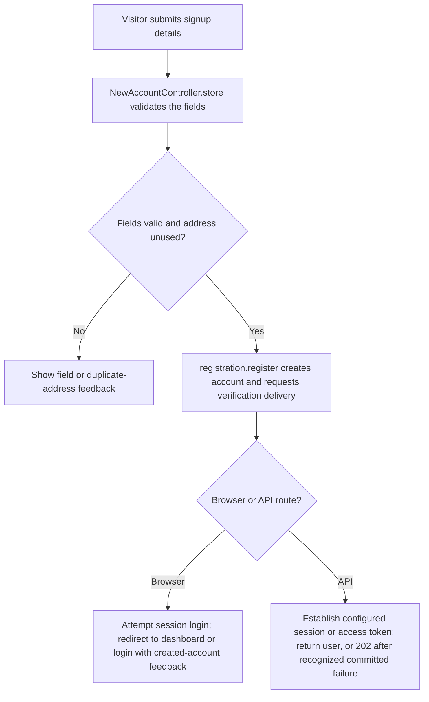
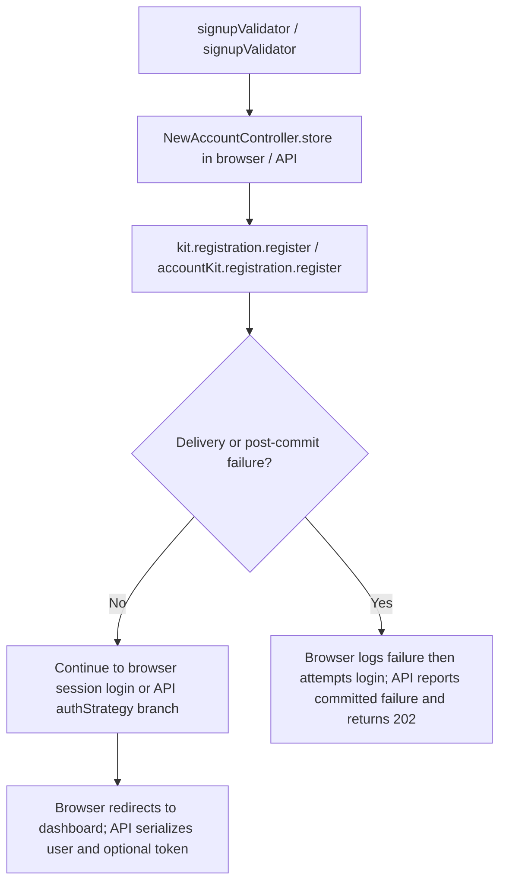

# US-ACCOUNT-01 — Register an account

As a visitor, I want to create an account so that I can sign in and use account features.

**Status:** Current; source-reviewed, not runtime-tested here.
**Access:** Public signup form or API endpoint; guest and account-kit account-blocker middleware apply.
**Entry:** Browser kits: `GET/POST /signup`; API: `POST /api/v1/auth/signup`.
**Documentation:** [Hypermedia signup guide](../../apps/hypermedia/README.md#try-it).
**Source:** [Hypermedia routes](../../apps/hypermedia/start/routes.ts), [API routes](../../apps/api/start/routes.ts).
**Coverage:** [Signup and login functional tests](../../apps/api/tests/functional/account_signup_login.spec.ts); these tests exercise source behavior, not this documentation change.

## Acceptance criteria

| Field            | Control                      | Required/default/conditions                                                         |
| ---------------- | ---------------------------- | ----------------------------------------------------------------------------------- |
| Full name        | Text input / JSON string     | Optional; trimmed; maximum 255 characters; null or blank is accepted as absent.     |
| Email            | Email input / JSON string    | Required; trimmed, lowercased, valid email; maximum 254 characters; must be unused. |
| Password         | Password input / JSON string | Required; 8–256 characters.                                                         |
| Confirm password | Password input / JSON string | Required; must match Password.                                                      |

- Both signup handlers allow at most five requests per client IP in 15 minutes. Invalid fields are returned as validation feedback.
- A duplicate address is refused. The browser returns to signup with an error; the API returns 422 with an `email` unique error.
- On success, the account is created before verification delivery and credential establishment. Browser signup signs the new account into a session and redirects to the dashboard; if initial session establishment fails, it redirects to login and says the account was created. If delivery follow-up fails, the account remains created, the failure is logged, and the browser directs the owner to request a fresh verification link.
- API signup returns the user and, when `ACCOUNT_KIT_AUTH_STRATEGY=access_tokens`, a token. With `session`, it establishes a session and returns the user. Delivery/post-commit or credential-establishment failure returns `202` with `accountCreated: true`; the response does not claim the follow-up succeeded.

## User flow

## Code flow

**Code references:** [Hypermedia signup route](../../apps/hypermedia/start/routes.ts), [Hypermedia controller](../../apps/hypermedia/app/controllers/new_account_controller.ts), [Hypermedia validator](../../apps/hypermedia/app/validators/user.ts), [API route](../../apps/api/start/routes.ts), [API controller](../../apps/api/app/controllers/new_account_controller.ts), [API validator](../../apps/api/app/validators/user.ts), [API strategy selection](../../apps/api/app/services/auth_strategy.ts), [Inertia React controller](../../apps/inertia-react/app/controllers/new_account_controller.ts), [Inertia Vue controller](../../apps/inertia-vue/app/controllers/new_account_controller.ts).
