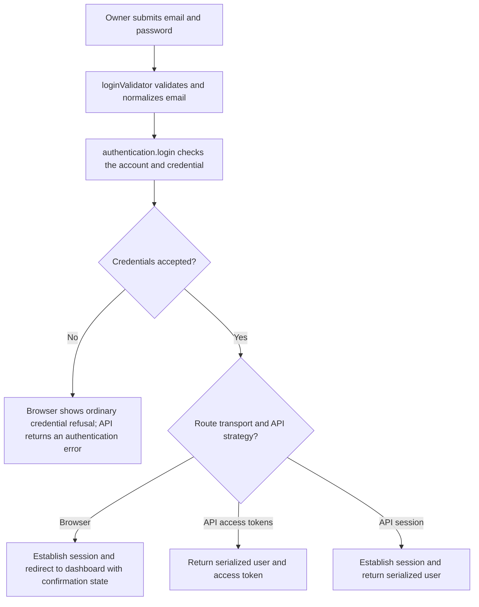
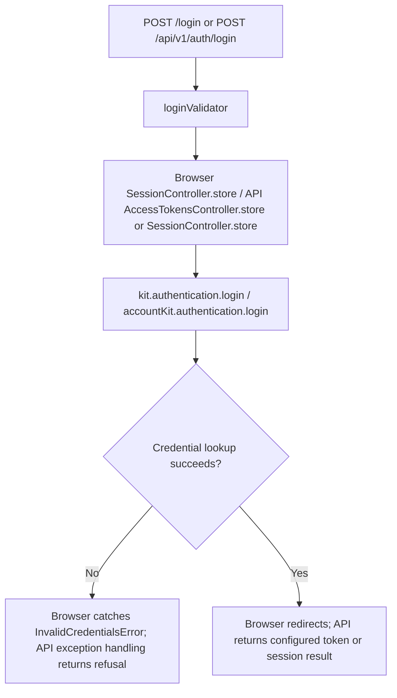

# US-ACCOUNT-02 — Sign in to an account

As an account owner, I want to authenticate with my email and password so that later requests use my account identity.

**Status:** Current; source-reviewed, not runtime-tested here.
**Access:** Public login route; browser routes apply guest plus account blocker; the API public route applies its account blocker without guest middleware.
**Entry:** Browser kits: `POST /login`; API: `POST /api/v1/auth/login`.
**Documentation:** [Hypermedia authentication guide](../../apps/hypermedia/README.md#try-it).
**Source:** [Hypermedia routes](../../apps/hypermedia/start/routes.ts), [API routes](../../apps/api/start/routes.ts).
**Coverage:** [Signup and login functional tests](../../apps/api/tests/functional/account_signup_login.spec.ts); these tests exercise source behavior, not this documentation change.

## Acceptance criteria

| Field    | Control                      | Required/default/conditions                                            |
| -------- | ---------------------------- | ---------------------------------------------------------------------- |
| Email    | Email input / JSON string    | Required; trimmed, lowercased, valid email; maximum 254 characters.    |
| Password | Password input / JSON string | Required; checked by the account kit against the submitted credential. |

- Valid credentials establish a browser session and redirect to the dashboard. An unconfirmed account can sign in, with a notice that confirmation is needed for protected account pages.
- API login uses the configured `ACCOUNT_KIT_AUTH_STRATEGY`: `access_tokens` returns the serialized user and token; `session` establishes a session and returns the user.
- Incorrect credentials are refused. A soft-deleted account is not returned by the `User` model's soft-delete scope and cannot authenticate. Browser invalid-credential feedback returns to the form; throttling errors are handled by the exception path.
- Validation errors remain field errors; the route does not turn invalid input into a successful session or token response.

## User flow

## Code flow

Scope: the implemented app routes and controllers delegate account persistence to the named Account Kit service, then reconcile the documented response.

**Code references:** [Hypermedia route](../../apps/hypermedia/start/routes.ts), [Hypermedia session controller](../../apps/hypermedia/app/controllers/session_controller.ts), [Hypermedia login validator](../../apps/hypermedia/app/validators/user.ts), [API route and strategy branch](../../apps/api/start/routes.ts), [API session controller](../../apps/api/app/controllers/session_controller.ts), [API token controller](../../apps/api/app/controllers/access_tokens_controller.ts), [API auth strategy](../../apps/api/app/services/auth_strategy.ts), [User model](../../apps/api/app/models/user.ts), [Inertia React controller](../../apps/inertia-react/app/controllers/session_controller.ts), [Inertia Vue controller](../../apps/inertia-vue/app/controllers/session_controller.ts).
