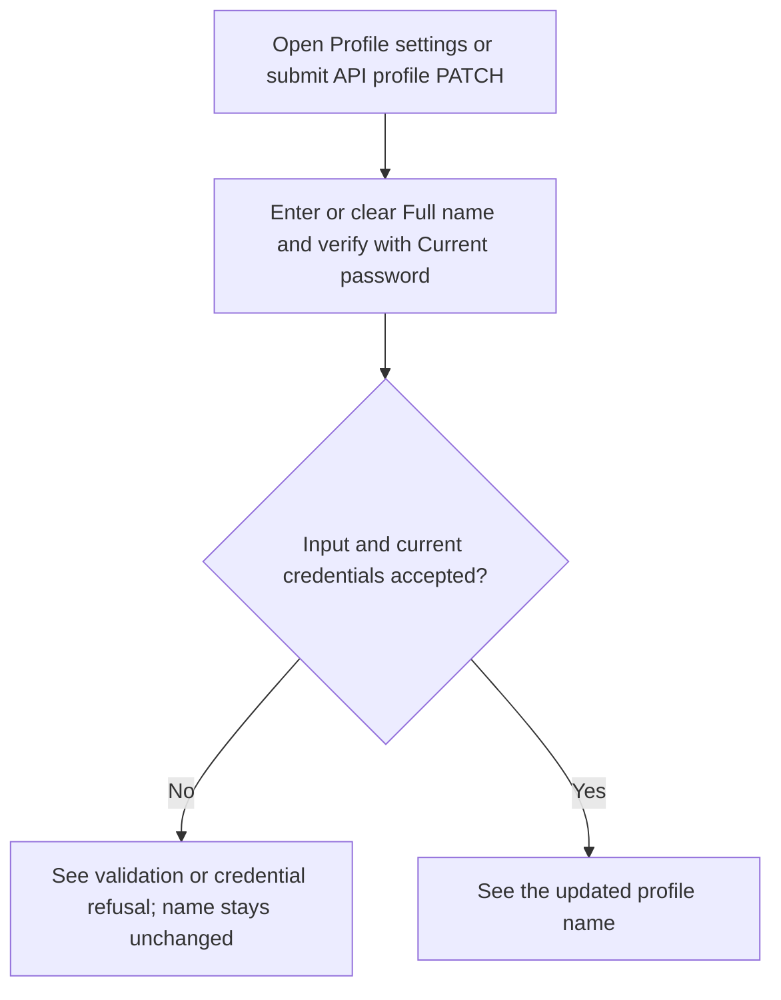
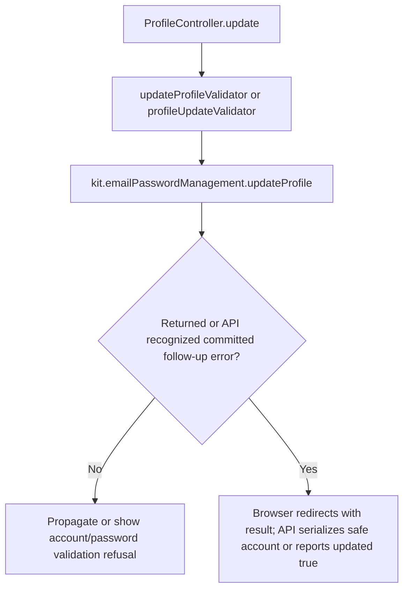

# US-ACCOUNT-03 — Update a profile name

As a signed-in account owner, I want to change or clear my profile name so that my account displays the name I chose.

**Status:** Current; source-reviewed, not runtime-tested.
**Access:** Authenticated raw account owner; browser account routes use `AccountKitAccountBlocker`, while API uses `accountAccess()` plus the blocker.
**Entry:** Browser kits: `GET/POST /settings/profile`; API: `GET/PATCH /api/v1/account/profile`.
**Documentation:** [Profile settings](../../apps/hypermedia/resources/views/pages/settings/profile.edge), [API account route](../../apps/api/start/routes.ts).
**Source:** [Hypermedia ProfileController.update](../../apps/hypermedia/app/controllers/profile_controller.ts), [API ProfileController.update](../../apps/api/app/controllers/profile_controller.ts).
**Coverage:** [API profile tests](../../apps/api/tests/functional/account_profile_email.spec.ts).

## Acceptance criteria

| Kit                    | Field or key                         | Control             | Required/default/conditions                                                                      |
| ---------------------- | ------------------------------------ | ------------------- | ------------------------------------------------------------------------------------------------ |
| Hypermedia, React, Vue | Full name (optional) (`fullName`)    | Text input          | Optional; trimmed; up to 255 characters; blank/null clears the name                              |
| Hypermedia             | Current email                        | Read-only text      | Shows the current address.                                                                       |
| React, Vue             | Signed in as                         | Read-only text      | Shows the current account identity.                                                              |
| Hypermedia, React, Vue | Current password (`currentPassword`) | Password input      | Required; verifies account ownership                                                             |
| API                    | `fullName`                           | JSON string or null | Optional; trimmed; up to 255 characters; null clears the name                                    |
| API                    | `currentPassword`                    | JSON string         | Required; verifies account ownership                                                             |
| API                    | `email`                              | Optional JSON field | A simultaneous email change is handled by [US-ACCOUNT-05](us-account-05-request-email-change.md) |

- Browser profile submission updates the raw account name. In API profile PATCH, `fullName` is optional and the response returns the safe account view.
- Invalid current password or field validation does not update the name; the account identity always comes from the authenticated account, not a Masquerade target.
- API email changes on this endpoint use the pending-confirmation behavior in US-ACCOUNT-05; a post-commit delivery failure is logged and reports `{ updated: true }`.

## User flow

## Code flow

Scope: browser name update and API profile PATCH. The API endpoint also accepts optional `email`, which is documented in US-ACCOUNT-05.

**Code references:** [Hypermedia route](../../apps/hypermedia/start/routes.ts), [Hypermedia form](../../apps/hypermedia/resources/views/pages/settings/profile.edge), [Hypermedia controller](../../apps/hypermedia/app/controllers/profile_controller.ts), [Hypermedia validator](../../apps/hypermedia/app/validators/profile.ts), [API route](../../apps/api/start/routes.ts), [API controller](../../apps/api/app/controllers/profile_controller.ts), [API validator](../../apps/api/app/validators/account_kit.ts), [React route/controller](../../apps/inertia-react/start/routes.ts), [React controller](../../apps/inertia-react/app/controllers/profile_controller.ts), [Vue route/controller](../../apps/inertia-vue/start/routes.ts), [Vue controller](../../apps/inertia-vue/app/controllers/profile_controller.ts), [API tests](../../apps/api/tests/functional/account_profile_email.spec.ts).
