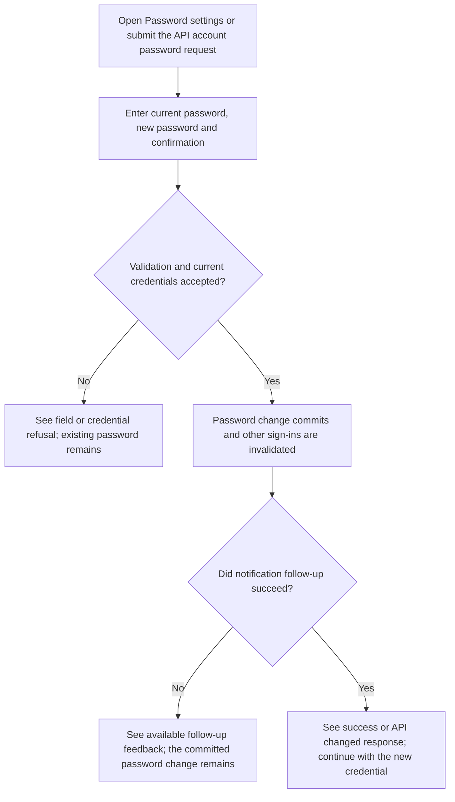
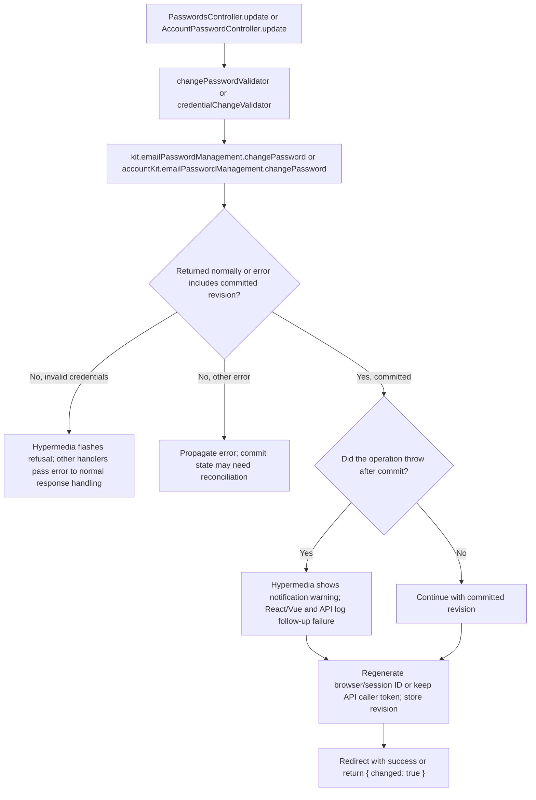

# US-ACCOUNT-04 — Change an account password

As a signed-in account owner, I want to replace my current password so that I can sign in with the replacement credential.

**Status:** Current; source-reviewed account operation, not runtime-tested.
**Access:** Authenticated raw account owner. Browser kits apply `AccountKitAccountBlocker`; API route applies the blocker and requires a verified account. API behavior follows its configured auth strategy.
**Entry:** Browser kits: `POST /settings/password`; API: `POST /api/v1/account/password`.
**Documentation:** [Hypermedia password settings](../../apps/hypermedia/resources/views/pages/settings/password.edge), [API account routes](../../apps/api/start/routes.ts).
**Source:** [PasswordsController.update](../../apps/hypermedia/app/controllers/passwords_controller.ts), [AccountPasswordController.update](../../apps/api/app/controllers/account_password_controller.ts).
**Coverage:** [API password-change tests](../../apps/api/tests/functional/account_password_change.spec.ts).

## Acceptance criteria

| Kit                    | Field or key                                  | Control        | Required/default/conditions                                       |
| ---------------------- | --------------------------------------------- | -------------- | ----------------------------------------------------------------- |
| Hypermedia, React, Vue | Current password                              | Password input | Required; submitted as `currentPassword`                          |
| Hypermedia, React, Vue | New password (`password`)                     | Password input | Required; 8–256 characters                                        |
| Hypermedia, React, Vue | Confirm new password (`passwordConfirmation`) | Password input | Required; must match `password`                                   |
| API                    | `currentPassword`                             | JSON string    | Required; at least 1 character and must match current credentials |
| API                    | `newPassword`                                 | JSON string    | Required; 8–256 characters                                        |
| API                    | `newPasswordConfirmation`                     | JSON string    | Required; must match `newPassword`                                |

- The browser fields are `currentPassword`, `password` and `passwordConfirmation`; API JSON uses `currentPassword`, `newPassword` and `newPasswordConfirmation`. Invalid credentials or field validation refuse the change. Hypermedia explicitly flashes incorrect-current-password feedback; React and Vue pass a noncommitted error to their normal error handler.
- Once the password update commits, a later notification/follow-up failure does not roll it back. Hypermedia shows committed success with a notification warning; React and Vue log the failure and distinguish delivery failure from another follow-up problem in success feedback; API logs the committed follow-up failure and returns `{ changed: true }`.
- Browser success regenerates its session ID and stores the new account revision, invalidating other sessions. API token mode keeps only the caller's token (`keepCurrent`); API session mode regenerates that session and records the revision. A response failure must not be treated as proof that the credential stayed unchanged.

- Delivery availability follows the [supplied proof-delivery boundary](../REFERENCE.md#proof-delivery-boundary): development proof links use server output, and the API also records notices in process memory; no supplied adapter proves inbox delivery.

## User flow

## Code flow

Scope: both implemented password-change handlers through their session/token reconciliation. The package operation may commit before throwing a follow-up failure; controllers reconcile session/token state only after normal return or recovery of a committed revision. Uncommitted refusals return or throw without that reconciliation.

**Code references:** [Hypermedia handler](../../apps/hypermedia/app/controllers/passwords_controller.ts), [Hypermedia validator](../../apps/hypermedia/app/validators/account.ts), [shared form password rules](../../apps/hypermedia/app/validators/user.ts), [API handler](../../apps/api/app/controllers/account_password_controller.ts), [API validator](../../apps/api/app/validators/account_kit.ts), [API password limits](../../apps/api/app/validators/password.ts), [Hypermedia route](../../apps/hypermedia/start/routes.ts), [API route](../../apps/api/start/routes.ts), [Inertia React handler](../../apps/inertia-react/app/controllers/passwords_controller.ts), [Inertia Vue handler](../../apps/inertia-vue/app/controllers/passwords_controller.ts), [API tests](../../apps/api/tests/functional/account_password_change.spec.ts).
