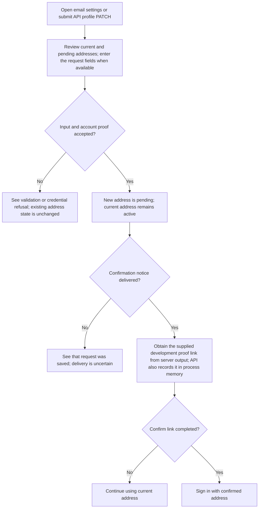
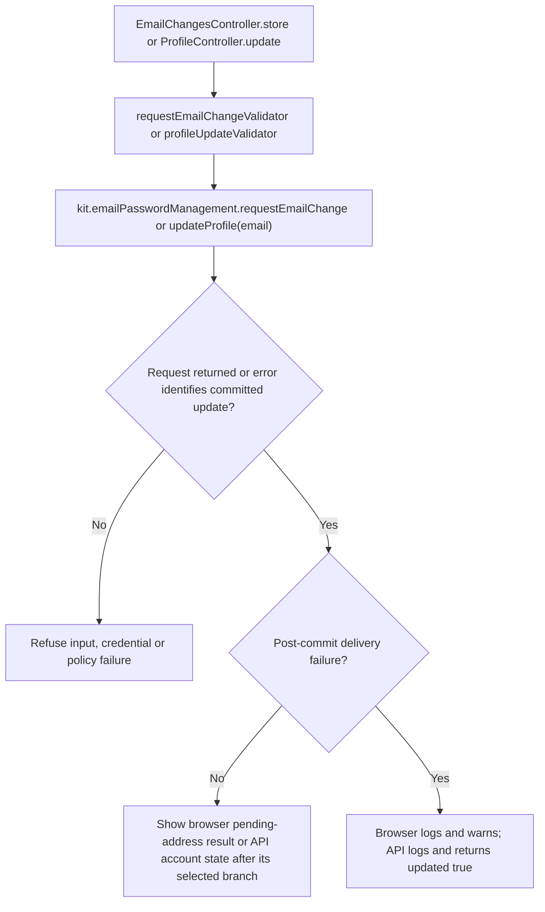

# US-ACCOUNT-05 — Request an email change

As a signed-in account owner, I want to request verification of a new email address so that I can begin using it after confirmation.

**Status:** Current in the three browser kits and API profile update; source-reviewed, not runtime-tested.
**Access:** Authenticated raw account owner. Browser email routes apply `AccountKitAccountBlocker`; API profile route uses `accountAccess()` and the blocker.
**Entry:** Browser kits: `POST /settings/email`; API: `PATCH /api/v1/account/profile` with `email`.
**Documentation:** [Email settings](../../apps/hypermedia/resources/views/pages/settings/email.edge), [API profile route](../../apps/api/start/routes.ts).
**Source:** [EmailChangesController.store](../../apps/hypermedia/app/controllers/email_changes_controller.ts), [ProfileController.update](../../apps/api/app/controllers/profile_controller.ts).
**Coverage:** [Browser account journey](../../apps/hypermedia/tests/browser/account_journey.spec.ts), [API profile/email tests](../../apps/api/tests/functional/account_profile_email.spec.ts).

## Acceptance criteria

| Kit                    | Field or key                           | Control                                  | Required/default/conditions                                                                                                                   |
| ---------------------- | -------------------------------------- | ---------------------------------------- | --------------------------------------------------------------------------------------------------------------------------------------------- |
| Hypermedia             | New email (`email`)                    | Email input labelled “New email”         | Required; normalized, valid, not already in use; maximum 254 characters.                                                                      |
| React, Vue             | New email (`email`)                    | Email input labelled “New email address” | Required; normalized, valid, not already in use; maximum 254 characters.                                                                      |
| Hypermedia, React, Vue | Current password (`currentPassword`)   | Password input                           | Required; confirms account ownership.                                                                                                         |
| Hypermedia             | Current email                          | Read-only text                           | Shows current address. A pending request shows its address and exposes cancellation instead of the request form.                              |
| React, Vue             | Current address / Pending confirmation | Read-only text                           | Shows current address and pending confirmation when present. Confirmed accounts retain the request form alongside cancellation while pending. |
| API                    | `email`                                | JSON string                              | Optional field on profile PATCH; when supplied, normalized, valid, at most 254 characters and not already in use                              |
| API                    | `currentPassword`                      | JSON string                              | Required for profile update; confirms account ownership                                                                                       |

- For a confirmed account, a valid request records a pending new address and attempts to send a confirmation link; the existing address stays active until confirmation. Browser routes reject an unconfirmed current address or requesting the current address. API `updateProfile({ email })` also handles its inactive-address activation state and a pending request may be canceled by supplying the confirmed current address. US-ACCOUNT-06 describes the separate browser cancellation form; API cancellation uses this profile PATCH.
- The API profile PATCH can also update `fullName`; the browser email form is a separate email-settings action. This story covers requesting a new address.
- Incorrect password, duplicate address or field-validation refusal leaves the existing state unchanged. The browser-only same-address and unconfirmed-address checks do not apply to the API profile PATCH.
- If browser email delivery fails after the request is saved, Hypermedia, React and Vue log the failure and show an error that says the request was saved but delivery is uncertain. API handles recognized post-commit delivery errors as `{ updated: true }` and logs them. Neither result guarantees a message arrived.

- Delivery availability follows the [supplied proof-delivery boundary](../REFERENCE.md#proof-delivery-boundary): development proof links use server output, and the API also records notices in process memory; no supplied adapter proves inbox delivery.

## User flow

This chart follows a confirmed account requesting a different address. The API cancellation and
inactive-address activation alternatives are described in the criteria above.

## Code flow

Scope: Hypermedia/Inertia request form and API profile update. API has no separate email-change-request endpoint; it uses optional `email` on profile PATCH.

**Code references:** [Hypermedia route](../../apps/hypermedia/start/routes.ts), [Hypermedia controller](../../apps/hypermedia/app/controllers/email_changes_controller.ts), [email validator](../../apps/hypermedia/app/validators/email_change.ts), [API route](../../apps/api/start/routes.ts), [API controller](../../apps/api/app/controllers/profile_controller.ts), [API validator](../../apps/api/app/validators/account_kit.ts), [React route/controller](../../apps/inertia-react/start/routes.ts), [React email handler](../../apps/inertia-react/app/controllers/email_changes_controller.ts), [Vue route/controller](../../apps/inertia-vue/start/routes.ts), [Vue email handler](../../apps/inertia-vue/app/controllers/email_changes_controller.ts), [browser tests](../../apps/hypermedia/tests/browser/account_journey.spec.ts), [API tests](../../apps/api/tests/functional/account_profile_email.spec.ts).
