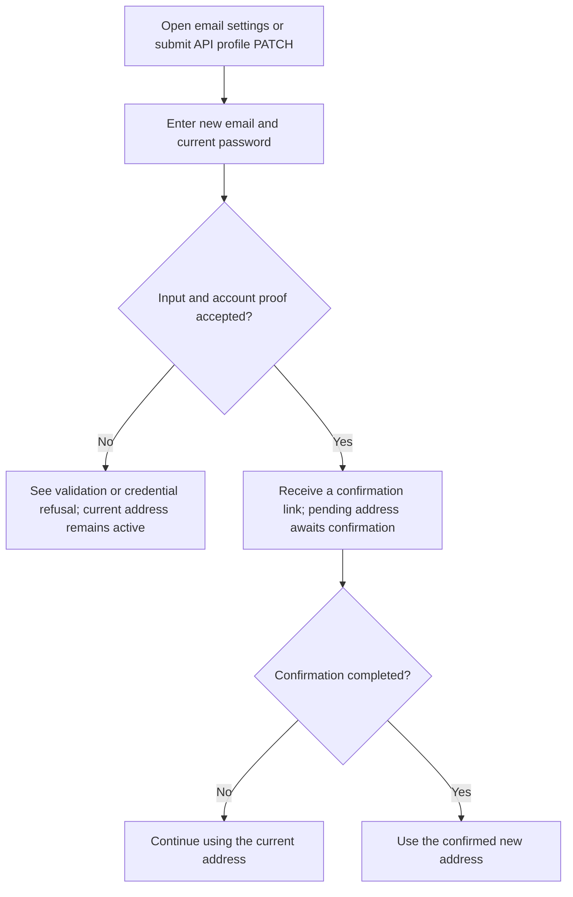
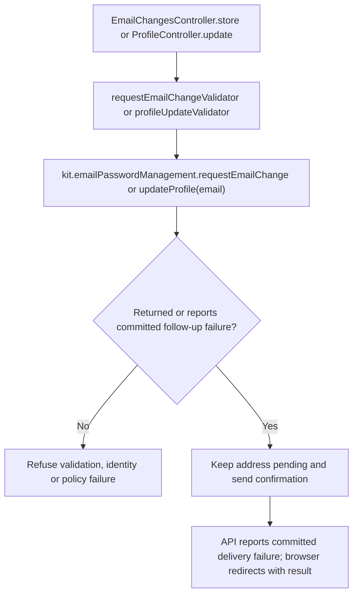

# US-ACCOUNT-05 — Request an email change

As a signed-in account owner, I want to request verification of a new email address so that I can begin using it after confirmation.

**Status:** Current in the three browser kits and API profile update; source-reviewed, not runtime-tested.
**Access:** Authenticated raw account owner. Browser routes apply `AccountKitAccountBlocker`; API profile route uses `accountAccess()` and the blocker.
**Entry:** Browser kits: `POST /settings/email`; API: `PATCH /api/v1/account/profile` with `email`.
**Documentation:** [Email settings](../../apps/hypermedia/resources/views/pages/settings/email.edge), [API profile route](../../apps/api/start/routes.ts).
**Source:** [EmailChangesController.store](../../apps/hypermedia/app/controllers/email_changes_controller.ts), [ProfileController.update](../../apps/api/app/controllers/profile_controller.ts).
**Coverage:** [Browser account journey](../../apps/hypermedia/tests/browser/account_journey.spec.ts), [API profile/email tests](../../apps/api/tests/functional/account_profile_email.spec.ts).

## Acceptance criteria

| Kit                    | Field or key                         | Control        | Required/default/conditions                                                              |
| ---------------------- | ------------------------------------ | -------------- | ---------------------------------------------------------------------------------------- |
| Hypermedia, React, Vue | New email (`email`)                  | Email input    | Required for this action; normalized, valid and not already in use                       |
| Hypermedia, React, Vue | Current password (`currentPassword`) | Password input | Required; confirms account ownership                                                     |
| API                    | `email`                              | JSON string    | Optional field on profile PATCH; when supplied, normalized, valid and not already in use |
| API                    | `currentPassword`                    | JSON string    | Required for profile update; confirms account ownership                                  |

- A valid request records a pending email change and sends a confirmation link; the existing address stays active until the link is completed.
- The API profile PATCH can also update `fullName`; the browser email form is a separate email-settings action. This story covers its email-change outcome.
- Incorrect password, same or duplicate address, validation refusal or an unconfirmed current address does not complete the address change.
- The API handles a recognized post-commit notification error as `{ updated: true }` and logs it; a later delivery failure does not undo the pending address change.

## User flow

## Code flow

Scope: Hypermedia/Inertia request form and API profile update. API has no separate email-change-request endpoint; it uses optional `email` on profile PATCH.

**Code references:** [Hypermedia route](../../apps/hypermedia/start/routes.ts), [Hypermedia controller](../../apps/hypermedia/app/controllers/email_changes_controller.ts), [email validator](../../apps/hypermedia/app/validators/email_change.ts), [API route](../../apps/api/start/routes.ts), [API controller](../../apps/api/app/controllers/profile_controller.ts), [API validator](../../apps/api/app/validators/account_kit.ts), [React route/controller](../../apps/inertia-react/start/routes.ts), [React email handler](../../apps/inertia-react/app/controllers/email_changes_controller.ts), [Vue route/controller](../../apps/inertia-vue/start/routes.ts), [Vue email handler](../../apps/inertia-vue/app/controllers/email_changes_controller.ts), [browser tests](../../apps/hypermedia/tests/browser/account_journey.spec.ts), [API tests](../../apps/api/tests/functional/account_profile_email.spec.ts).
