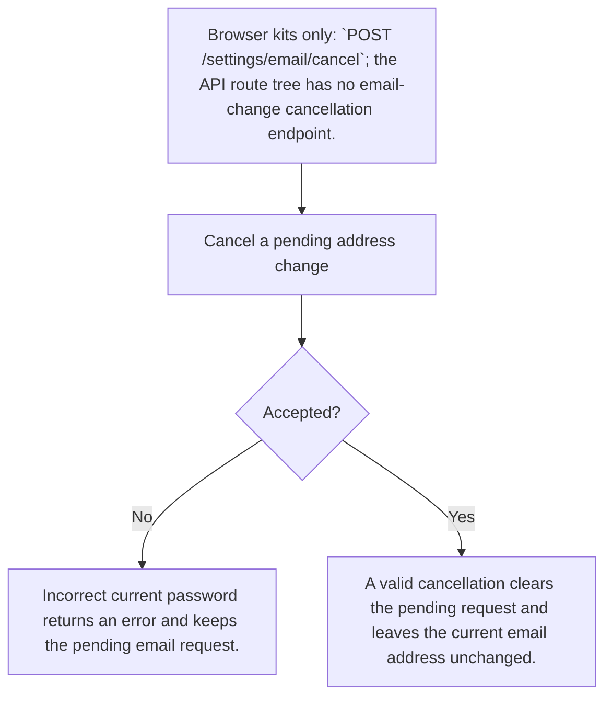
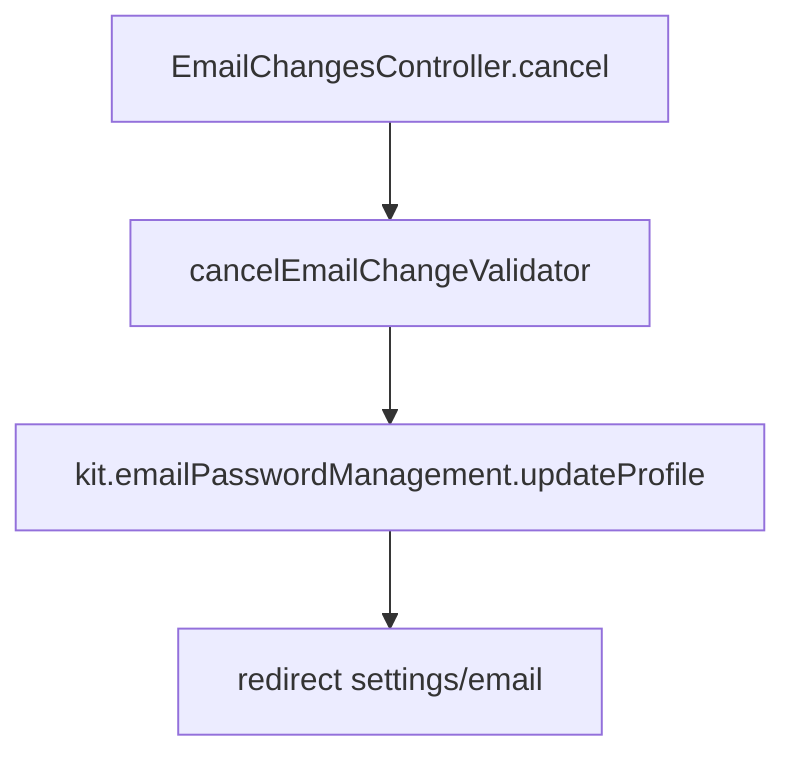

# US-ACCOUNT-06 — Cancel a pending email change

As a signed-in account owner, I want to cancel a pending address change so that my existing address remains active and the pending request is cleared.

**Status:** Current; source-reviewed, not runtime-tested here.
**Access:** Authenticated raw account owner with a pending email change; managed account blocker applies.
**Entry:** Browser kits only: `POST /settings/email/cancel`; the API route tree has no email-change cancellation endpoint.
**Documentation:** [apps/hypermedia/resources/views/pages/settings/email.edge](../../apps/hypermedia/resources/views/pages/settings/email.edge).
**Source:** [apps/hypermedia/start/routes.ts](../../apps/hypermedia/start/routes.ts).

## Acceptance criteria

| Field            | Control        | Required/default/conditions                                       |
| ---------------- | -------------- | ----------------------------------------------------------------- |
| Current password | Password input | Required; confirms account ownership via `cancelCurrentPassword`. |

- A valid cancellation clears the pending request and leaves the current email address unchanged.
- Incorrect password refuses cancellation; no pending change is cleared.

## User flow

## Code flow

Scope: source path for this action; browser/API transport differences are stated in Access, Entry and criteria.

**Code references:** [apps/hypermedia/start/routes.ts](../../apps/hypermedia/start/routes.ts), [apps/hypermedia/resources/views/pages/settings/email.edge](../../apps/hypermedia/resources/views/pages/settings/email.edge), [apps/hypermedia/app/controllers/email_changes_controller.ts](../../apps/hypermedia/app/controllers/email_changes_controller.ts), [apps/hypermedia/app/validators/email_change.ts](../../apps/hypermedia/app/validators/email_change.ts), [apps/api/tests/functional/account_profile_email.spec.ts](../../apps/api/tests/functional/account_profile_email.spec.ts). [Inertia React route](../../apps/inertia-react/start/routes.ts), [React controller](../../apps/inertia-react/app/controllers/email_changes_controller.ts), [Inertia Vue route](../../apps/inertia-vue/start/routes.ts), [Vue controller](../../apps/inertia-vue/app/controllers/email_changes_controller.ts).
