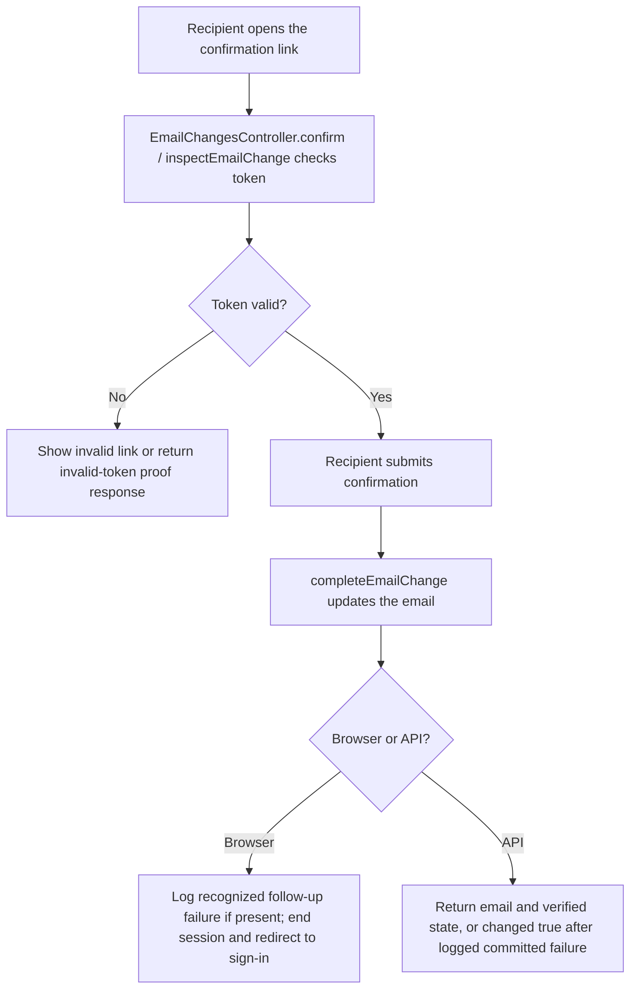
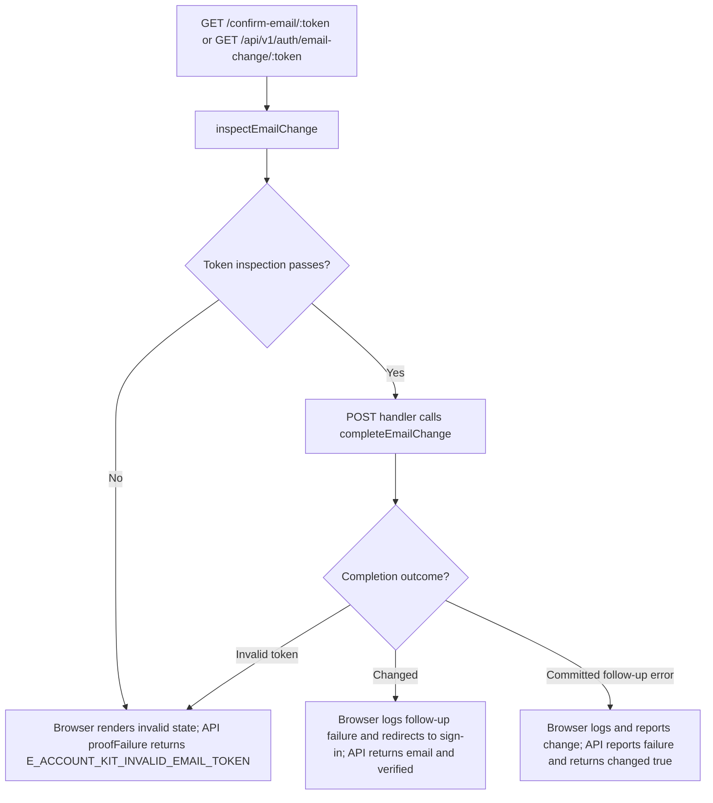

# US-ACCOUNT-07 — Confirm a pending email change

As the recipient of an email-change link, I want to confirm the requested address so that it becomes the account's confirmed email.

**Status:** Current; source-reviewed, not runtime-tested here.
**Access:** Anyone holding a valid, unexpired, unused email-change token; token pages and proof responses use no-store/no-referrer headers.
**Entry:** Browser kits: `GET/POST /confirm-email/:token`; API: `GET/POST /api/v1/auth/email-change/:token`.
**Documentation:** [Hypermedia confirmation page](../../apps/hypermedia/resources/views/pages/auth/confirm_email_change.edge).
**Source:** [Hypermedia routes](../../apps/hypermedia/start/routes.ts), [API routes](../../apps/api/start/routes.ts).
**Coverage:** [Email profile functional tests](../../apps/api/tests/functional/account_profile_email.spec.ts); this link identifies source behavior coverage, not runtime verification of these docs.

## Acceptance criteria

- The link itself supplies the token; no editable form fields are required. The browser first shows whether the link can be used; the API exposes `confirmation: true` for a valid token.
- Completing a valid link changes the account email and signs the browser owner out, who must then sign in with the new address. API success returns the changed email and its verification state.
- An invalid, expired, or used token does not change the address. Browser redirects to login with a request-new-link message; API returns the invalid-token proof response.
- If a recognized delivery or post-commit follow-up fails after the email change is committed, the browser logs the failure and still reports the changed address; the API logs it and returns `{ changed: true }`.

## User flow

## Code flow

**Code references:** [Hypermedia routes](../../apps/hypermedia/start/routes.ts), [Hypermedia controller](../../apps/hypermedia/app/controllers/email_changes_controller.ts), [API routes](../../apps/api/start/routes.ts), [API controller](../../apps/api/app/controllers/email_changes_controller.ts), [Email profile functional tests](../../apps/api/tests/functional/account_profile_email.spec.ts), [Inertia React controller](../../apps/inertia-react/app/controllers/email_changes_controller.ts), [Inertia Vue controller](../../apps/inertia-vue/app/controllers/email_changes_controller.ts).
