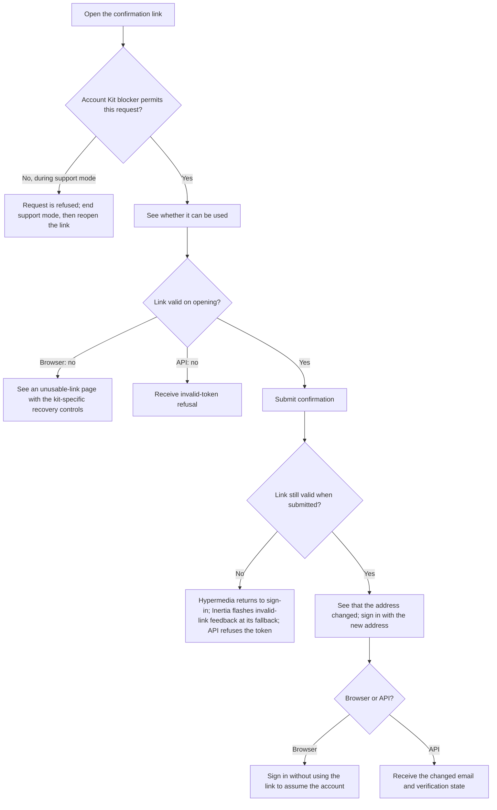
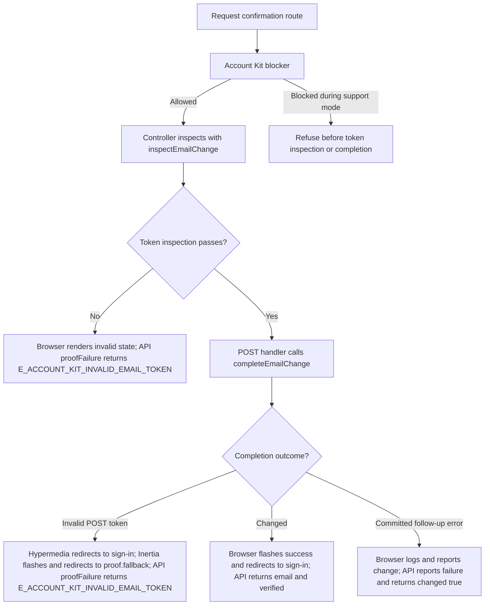

# US-ACCOUNT-07 — Confirm a pending email change

As the recipient of an email-change link, I want to confirm the requested address so that it becomes the account's confirmed email.

**Status:** Current; source-reviewed, not runtime-tested here.
**Access:** Anyone holding a valid, unexpired, unused email-change token, unless the Account Kit blocker refuses the request during support mode; token pages and proof responses use no-store/no-referrer headers.
**Entry:** Browser kits: `GET/POST /confirm-email/:token`; API: `GET/POST /api/v1/auth/email-change/:token`.
**Documentation:** [Hypermedia confirmation page](../../apps/hypermedia/resources/views/pages/auth/confirm_email_change.edge).
**Source:** [Hypermedia routes](../../apps/hypermedia/start/routes.ts), [API routes](../../apps/api/start/routes.ts).
**Coverage:** [Email profile functional tests](../../apps/api/tests/functional/account_profile_email.spec.ts); this link identifies source behavior coverage, not runtime verification of these docs.

## Acceptance criteria

- The link itself supplies the token; no editable form fields are required. The browser first shows whether the link can be used; the API exposes `confirmation: true` for a valid token.
- Completing a valid link changes the target account email and invalidates that account's sign-ins; sign in with the new address. The browser handler redirects without authenticating as the token's account. Inertia terminates the current raw web session on success; Hypermedia only redirects. API success returns the changed email and its verification state.
- An invalid, expired, or used token does not change the address. Browser GET renders an unusable-link page; API GET returns the invalid-token proof response; Hypermedia invalid POST redirects to sign-in with a request-new-link message, and Inertia POST follows the proof-recovery fallback and flashes invalid-link feedback; API returns the invalid-token proof response.
- Invalid-page recovery: Hypermedia offers **Sign in**. React offers **Email settings** when signed in, otherwise **Sign in**. Vue always offers **Email settings** and **Sign in**.
- If a recognized delivery or post-commit follow-up fails after the email change is committed, the browser logs the failure and still reports the changed address; the API logs it and returns `{ changed: true }`.

- Delivery availability follows the [supplied proof-delivery boundary](../REFERENCE.md#proof-delivery-boundary): development proof links use server output, and the API also records notices in process memory; no supplied adapter proves inbox delivery.

## User flow

## Code flow

Scope: the implemented app routes and controllers delegate account persistence to the named Account Kit service, then reconcile the documented response.

**Code references:** [Hypermedia routes](../../apps/hypermedia/start/routes.ts), [Hypermedia controller](../../apps/hypermedia/app/controllers/email_changes_controller.ts), [API routes](../../apps/api/start/routes.ts), [API controller](../../apps/api/app/controllers/email_changes_controller.ts), [Email profile functional tests](../../apps/api/tests/functional/account_profile_email.spec.ts), [Inertia React controller](../../apps/inertia-react/app/controllers/email_changes_controller.ts), [Inertia Vue controller](../../apps/inertia-vue/app/controllers/email_changes_controller.ts), [Hypermedia token page](../../apps/hypermedia/resources/views/pages/auth/confirm_email_change.edge), [React token page](../../apps/inertia-react/inertia/pages/auth/confirm_email_change.tsx), [Vue token page](../../apps/inertia-vue/inertia/pages/auth/confirm_email_change.vue), [Inertia invalid-proof fallback](../../apps/inertia-react/app/services/token_page_headers.ts), [React exception handler](../../apps/inertia-react/app/exceptions/handler.ts), [Vue exception handler](../../apps/inertia-vue/app/exceptions/handler.ts).
