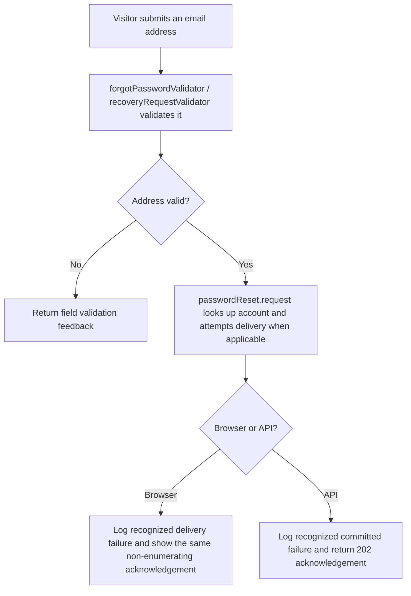
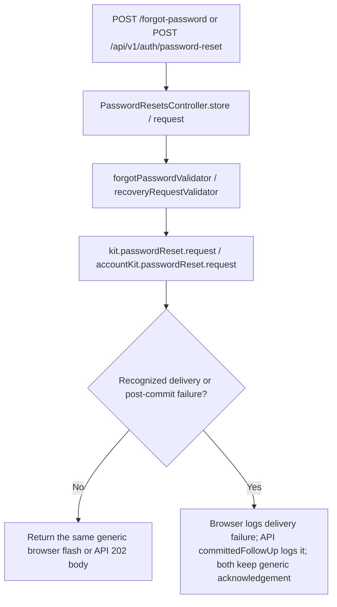

# US-ACCOUNT-08 — Request a password reset

As a person who may own an account, I want to request a password-reset link so that I can recover access without revealing whether an address is registered.

**Status:** Current; source-reviewed, not runtime-tested here.
**Access:** Public recovery form or API endpoint; browser routes apply guest plus account blocker; the API public route applies its account blocker without guest middleware.
**Entry:** Browser kits: `POST /forgot-password`; API: `POST /api/v1/auth/password-reset`.
**Documentation:** [Hypermedia recovery form](../../apps/hypermedia/resources/views/pages/auth/forgot_password.edge).
**Source:** [Hypermedia routes](../../apps/hypermedia/start/routes.ts), [API routes](../../apps/api/start/routes.ts).
**Coverage:** [Password-reset functional tests](../../apps/api/tests/functional/account_password_reset.spec.ts); this link identifies source behavior coverage, not runtime verification of these docs.

## Acceptance criteria

| Field | Control                   | Required/default/conditions                                         |
| ----- | ------------------------- | ------------------------------------------------------------------- |
| Email | Email input / JSON string | Required; trimmed, lowercased, valid email; maximum 254 characters. |

- A valid request gives the same public acknowledgement whether or not the address has an account. The browser flashes, “If an account exists for that address, we have sent a reset link.” The API returns `202` with “If the account exists, instructions will be sent.”
- Browser delivery failure is logged but keeps the same acknowledgement. The API logs recognized delivery/post-commit failure while keeping the accepted response, so clients cannot use the result to enumerate accounts.
- Invalid email input is returned as validation feedback; it does not start a recovery request.

## User flow

## Code flow

Scope: the implemented app routes and controllers delegate account persistence to the named Account Kit service, then reconcile the documented response.

**Code references:** [Hypermedia route](../../apps/hypermedia/start/routes.ts), [Hypermedia controller](../../apps/hypermedia/app/controllers/password_resets_controller.ts), [Hypermedia form validator](../../apps/hypermedia/app/validators/account.ts), [API route](../../apps/api/start/routes.ts), [API controller](../../apps/api/app/controllers/password_resets_controller.ts), [API validator](../../apps/api/app/validators/account_kit.ts), [Committed-failure handling](../../apps/api/app/services/committed_failure_diagnostic.ts), [Password-reset functional tests](../../apps/api/tests/functional/account_password_reset.spec.ts), [Inertia React controller](../../apps/inertia-react/app/controllers/password_resets_controller.ts), [Inertia Vue controller](../../apps/inertia-vue/app/controllers/password_resets_controller.ts).
