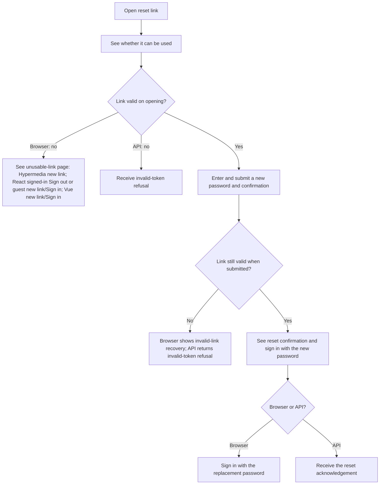
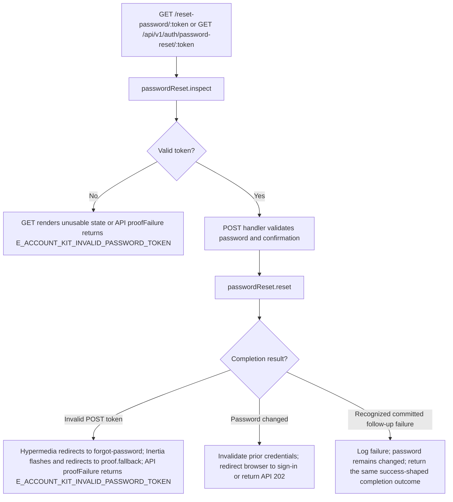

# US-ACCOUNT-09 — Complete a password reset

As the recipient of a reset link, I want to choose a new password so that I can sign in with a replacement credential.

**Status:** Current; source-reviewed, not runtime-tested here.
**Access:** Anyone holding a valid, unexpired, unused reset token; API proof responses and browser token page use no-store/no-referrer headers.
**Entry:** Browser kits: `GET/POST /reset-password/:token`; API: `GET/POST /api/v1/auth/password-reset/:token`.
**Documentation:** [Hypermedia reset form](../../apps/hypermedia/resources/views/pages/auth/reset_password.edge).
**Source:** [Hypermedia routes](../../apps/hypermedia/start/routes.ts), [API routes](../../apps/api/start/routes.ts).
**Coverage:** [Password-reset functional tests](../../apps/api/tests/functional/account_password_reset.spec.ts); this link identifies source behavior coverage, not runtime verification of these docs.

## Acceptance criteria

| Field                                                                                     | Control                                              | Required/default/conditions               |
| ----------------------------------------------------------------------------------------- | ---------------------------------------------------- | ----------------------------------------- |
| New password (`password`)                                                                 | Password input in all browser kits / API JSON string | Required; 8–256 characters.               |
| Confirm password (Hypermedia) / Confirm new password (React, Vue), `passwordConfirmation` | Password input / API JSON string                     | Required; must match `password`.          |
| Token                                                                                     | Link / URL parameter                                 | Required; valid, unexpired, unused token. |

- The browser inspects the link before showing the form. API clients can inspect it with `GET`; a valid token returns `valid: true`.
- A valid token and matching password replace the credential. Browser redirects to sign-in; API returns `202` with a password-reset acknowledgement. Recognized delivery or post-commit failures after the reset are logged and do not report the reset as uncommitted.
- Invalid or expired tokens do not reset the password. Browser GET renders an unusable-link page; API GET returns the invalid-token proof response. Hypermedia offers **Request a new link**. React offers **Sign out** when signed in; otherwise **Request a new link** and **Sign in**. Vue always offers **Request a new link** and **Sign in**. Hypermedia invalid POST redirects to forgot-password; Inertia invalid POST follows the proof-recovery fallback: the token-page handler redirects to its safe fallback and flashes invalid-link feedback. API returns the invalid-token proof response. Password and confirmation validation errors do not change the credential.
- The API limits reset completion requests through `accountPublicLimit('password-reset')`.

- Delivery availability follows the [supplied proof-delivery boundary](../REFERENCE.md#proof-delivery-boundary): development proof links use server output, and the API also records notices in process memory; no supplied adapter proves inbox delivery.

## User flow

## Code flow

Scope: the implemented app routes and controllers delegate account persistence to the named Account Kit service, then reconcile the documented response.

**Code references:** [Hypermedia routes](../../apps/hypermedia/start/routes.ts), [Hypermedia controller](../../apps/hypermedia/app/controllers/password_resets_controller.ts), [Hypermedia validator](../../apps/hypermedia/app/validators/account.ts), [API routes](../../apps/api/start/routes.ts), [API controller](../../apps/api/app/controllers/password_resets_controller.ts), [API validator](../../apps/api/app/validators/account_kit.ts), [Proof response headers](../../apps/api/app/services/http_responses.ts), [Password-reset functional tests](../../apps/api/tests/functional/account_password_reset.spec.ts), [Inertia React controller](../../apps/inertia-react/app/controllers/password_resets_controller.ts), [Inertia Vue controller](../../apps/inertia-vue/app/controllers/password_resets_controller.ts), [Hypermedia token page](../../apps/hypermedia/resources/views/pages/auth/reset_password.edge), [React token page](../../apps/inertia-react/inertia/pages/auth/reset_password.tsx), [Vue token page](../../apps/inertia-vue/inertia/pages/auth/reset_password.vue), [Inertia invalid-proof fallback](../../apps/inertia-react/app/services/token_page_headers.ts), [React exception handler](../../apps/inertia-react/app/exceptions/handler.ts), [Vue exception handler](../../apps/inertia-vue/app/exceptions/handler.ts).
