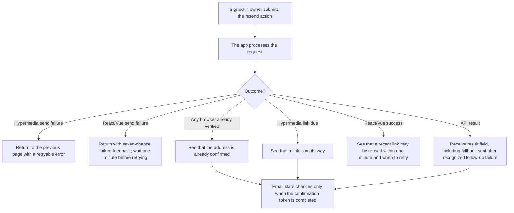
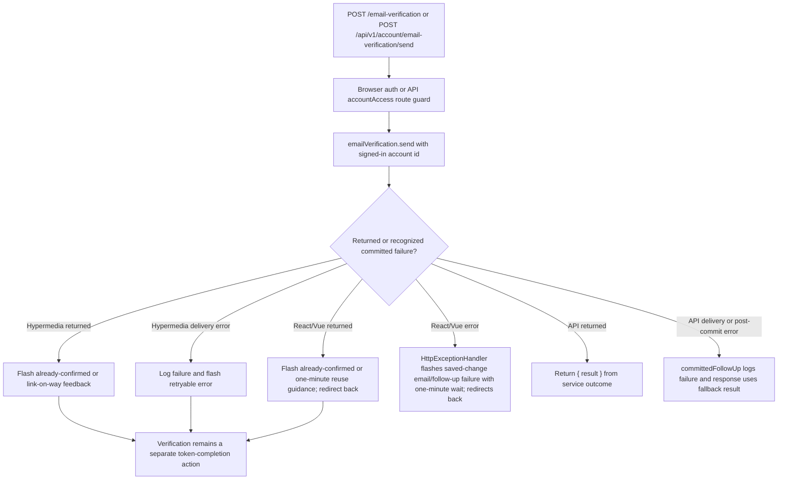

# US-ACCOUNT-10 — Request an email verification link

As a signed-in account owner, I want to request a verification link so that I can confirm my address and use protected account features.

**Status:** Current; source-reviewed, not runtime-tested here.
**Access:** Signed-in account owner; account-kit account blocker applies. The API route also checks account access.
**Entry:** Browser kits: `POST /email-verification`; API: `POST /api/v1/account/email-verification/send`.
**Documentation:** [Hypermedia email settings](../../apps/hypermedia/resources/views/pages/settings/email.edge).
**Source:** [Hypermedia routes](../../apps/hypermedia/start/routes.ts), [API routes](../../apps/api/start/routes.ts).
**Coverage:** [Email-verification functional tests](../../apps/api/tests/functional/account_email_verification.spec.ts); this link identifies source behavior coverage, not runtime verification of these docs.

## Acceptance criteria

- There are no editable fields; an authenticated owner invokes the action from email settings or sends the API request.
- The account kit may reuse a recent link instead of sending another message. All three browser controllers distinguish `already_verified` with **Your email address is already confirmed.** Other React/Vue results explain the one-minute reuse window and retry wait. API returns `{ result: ... }`, defaulting a missing follow-up result to `sent`.
- Hypermedia catches delivery failure, logs it, flashes a retryable error and redirects back. React/Vue controllers await the send without a local catch; the shared exception handler flashes that the change was saved but email delivery or a follow-up failed, advises waiting one minute before another verification request, and redirects back. API recognized delivery/post-commit failure is logged by `committedFollowUp`. No response proves inbox delivery; see the [supplied proof-delivery boundary](../REFERENCE.md#proof-delivery-boundary).
- Requesting a link does not itself mark the email verified; verification requires completing the token flow.

## User flow

## Code flow

Scope: the implemented app routes and controllers delegate account persistence to the named Account Kit service, then reconcile the documented response.

**Code references:** [Hypermedia route](../../apps/hypermedia/start/routes.ts), [Hypermedia controller](../../apps/hypermedia/app/controllers/email_verifications_controller.ts), [API route and accountAccess middleware](../../apps/api/start/routes.ts), [API controller](../../apps/api/app/controllers/email_verifications_controller.ts), [Committed-failure handling](../../apps/api/app/services/committed_failure_diagnostic.ts), [Email-verification functional tests](../../apps/api/tests/functional/account_email_verification.spec.ts), [Inertia React controller](../../apps/inertia-react/app/controllers/email_verifications_controller.ts), [Inertia Vue controller](../../apps/inertia-vue/app/controllers/email_verifications_controller.ts), [React exception handler](../../apps/inertia-react/app/exceptions/handler.ts), [Vue exception handler](../../apps/inertia-vue/app/exceptions/handler.ts).
