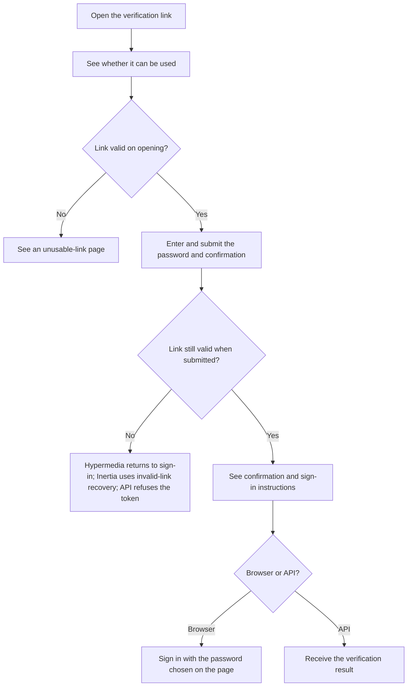
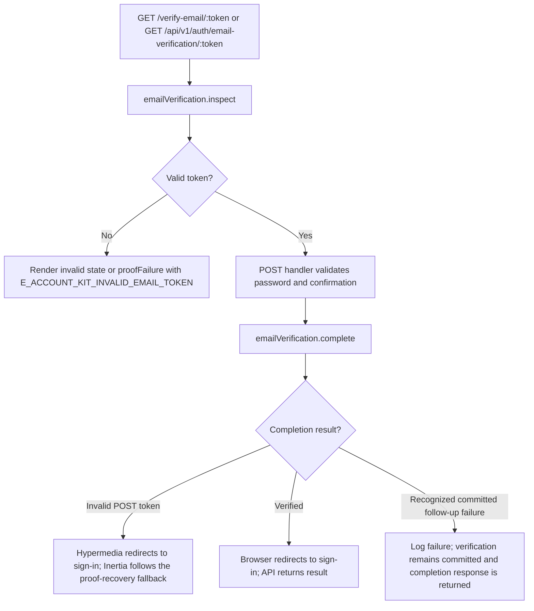

# US-ACCOUNT-11 — Confirm an email address

As the recipient of an email-verification link, I want to prove control of the address so that it becomes confirmed for account access.

**Status:** Current; source-reviewed, not runtime-tested here.
**Access:** Anyone holding a valid, unexpired, unused verification token; token page and API proof responses use no-store/no-referrer headers.
**Entry:** Browser kits: `GET/POST /verify-email/:token`; API: `GET/POST /api/v1/auth/email-verification/:token`.
**Documentation:** [Hypermedia verification form](../../apps/hypermedia/resources/views/pages/auth/verify_email.edge).
**Source:** [Hypermedia routes](../../apps/hypermedia/start/routes.ts), [API routes](../../apps/api/start/routes.ts).
**Coverage:** [Email-verification functional tests](../../apps/api/tests/functional/account_email_verification.spec.ts); this link identifies source behavior coverage, not runtime verification of these docs.

## Acceptance criteria

| Field                                                                      | Control                      | Required/default/conditions                            |
| -------------------------------------------------------------------------- | ---------------------------- | ------------------------------------------------------ |
| Choose a password (Hypermedia) / Password (React, Vue), API key `password` | Password input / JSON string | Required; 8–256 characters.                            |
| Confirm password (`passwordConfirmation`)                                  | Password input / JSON string | Required; must match Password.                         |
| Token                                                                      | Link / URL parameter         | Required; valid, unexpired, unused verification token. |

- The browser inspects the link before showing the form. API clients can inspect it with `GET`; valid proof returns `confirmation: true`.
- Completing a valid token with the password and confirmation activates the address. The browser then asks the owner to sign in with the password entered in this form; API returns the operation result.
- Invalid, expired, or used token does not verify the address. GET renders an unusable-link page; Hypermedia invalid POST redirects to sign-in with a fresh-link message, and Inertia POST follows the proof-recovery fallback and flashes invalid-link feedback; API returns `E_ACCOUNT_KIT_INVALID_EMAIL_TOKEN` proof failure.
- A recognized delivery or post-commit failure after verification is logged. The browser still reports verification and redirects to sign-in; API still returns the result-shaped response, whose fallback value is `verified` when follow-up handling returns no result.

## User flow

## Code flow

Scope: the implemented app routes and controllers delegate account persistence to the named Account Kit service, then reconcile the documented response.

**Code references:** [Hypermedia route](../../apps/hypermedia/start/routes.ts), [Hypermedia controller](../../apps/hypermedia/app/controllers/email_verifications_controller.ts), [Hypermedia validator](../../apps/hypermedia/app/validators/account.ts), [API routes](../../apps/api/start/routes.ts), [API controller](../../apps/api/app/controllers/email_verifications_controller.ts), [API validator](../../apps/api/app/validators/account_kit.ts), [Proof response headers](../../apps/api/app/services/http_responses.ts), [Email-verification functional tests](../../apps/api/tests/functional/account_email_verification.spec.ts), [Inertia React controller](../../apps/inertia-react/app/controllers/email_verifications_controller.ts), [Inertia Vue controller](../../apps/inertia-vue/app/controllers/email_verifications_controller.ts).
