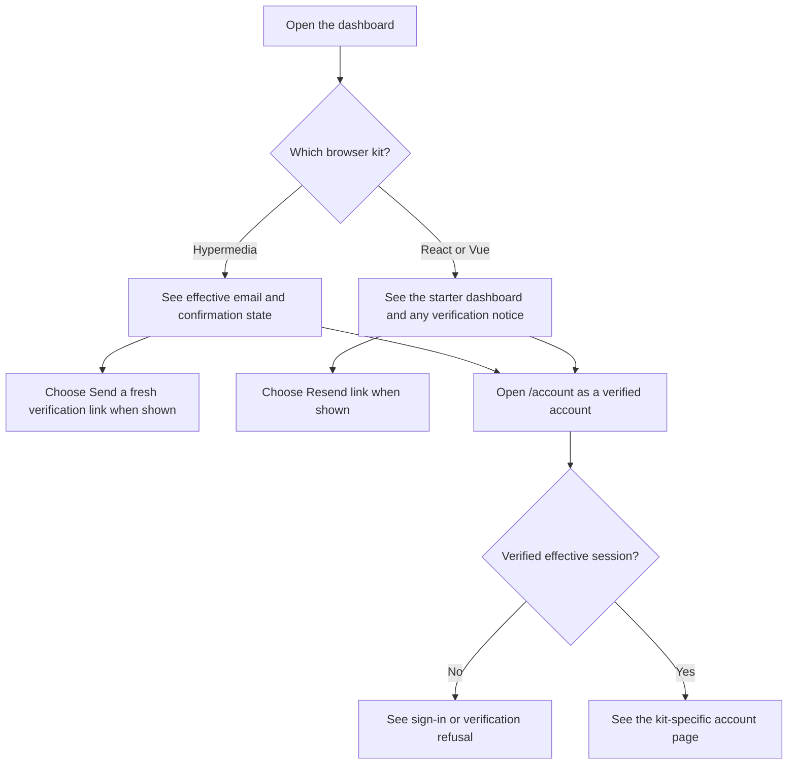
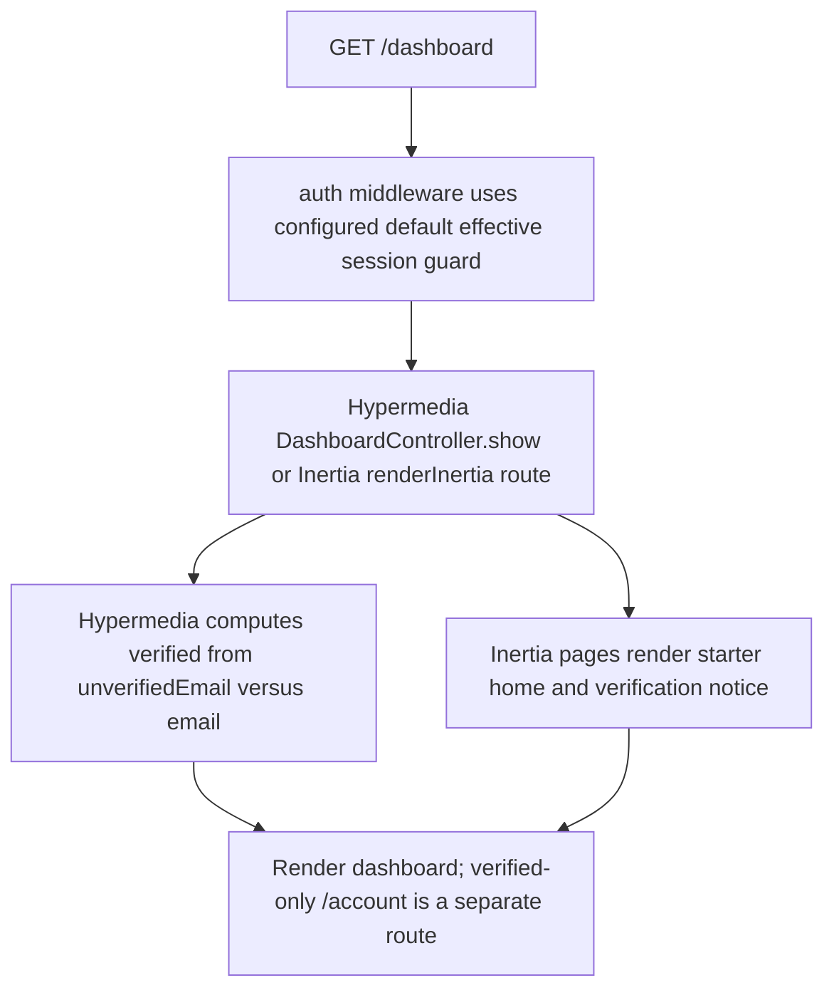

# US-ACCOUNT-12 — Open the signed-in dashboard

As a signed-in account owner, I want to open my dashboard so that I can see my account home and whether email confirmation is complete.

**Status:** Current; source-reviewed, not runtime-tested here.
**Access:** Browser dashboard uses the default effective session guard. `/account` in Hypermedia, React and Vue additionally requires the effective account to be verified.
**Entry:** Browser kits: `GET /dashboard` and verified-only `GET /account`.
**Documentation:** [Hypermedia dashboard view](../../apps/hypermedia/resources/views/pages/dashboard.edge).
**Source:** [Hypermedia routes](../../apps/hypermedia/start/routes.ts), [Hypermedia dashboard controller](../../apps/hypermedia/app/controllers/dashboard_controller.ts), [Inertia React routes](../../apps/inertia-react/start/routes.ts), [Inertia Vue routes](../../apps/inertia-vue/start/routes.ts).
**Coverage:** [Hypermedia Masquerade browser test](../../apps/hypermedia/tests/browser/masquerade.spec.ts), [Inertia React Masquerade browser test](../../apps/inertia-react/tests/browser/masquerade.spec.ts), [Inertia Vue Masquerade browser test](../../apps/inertia-vue/tests/browser/masquerade.spec.ts); these links identify source behavior coverage, not runtime verification of these docs.

## Acceptance criteria

- There are no editable fields; an authenticated account opens `/dashboard`.
- All three kits show the account dashboard and effective identity during support mode. Unconfirmed owners see a verification notice. The protected `/account` page is separate: all kits require an authenticated, verified effective session account.
- All three kits provide a separate `/account` page for verified effective session accounts. React and Vue render their account page; Hypermedia renders its account page. Dashboard access alone does not establish this protected-page journey.
- Unauthenticated requests are sent through the configured authentication response. Hypermedia `/account` additionally requires a verified effective account.
- The API has no dashboard route; its account profile read is documented separately.

## User flow

## Code flow

**Code references:** [Hypermedia routes](../../apps/hypermedia/start/routes.ts), [Hypermedia controller](../../apps/hypermedia/app/controllers/dashboard_controller.ts), [Hypermedia dashboard](../../apps/hypermedia/resources/views/pages/dashboard.edge), [Inertia React route](../../apps/inertia-react/start/routes.ts), [React dashboard](../../apps/inertia-react/inertia/pages/dashboard.tsx), [Inertia Vue route](../../apps/inertia-vue/start/routes.ts), [Vue dashboard](../../apps/inertia-vue/inertia/pages/dashboard.vue), [Vue shared Inertia props](../../apps/inertia-vue/app/middleware/inertia_middleware.ts).
