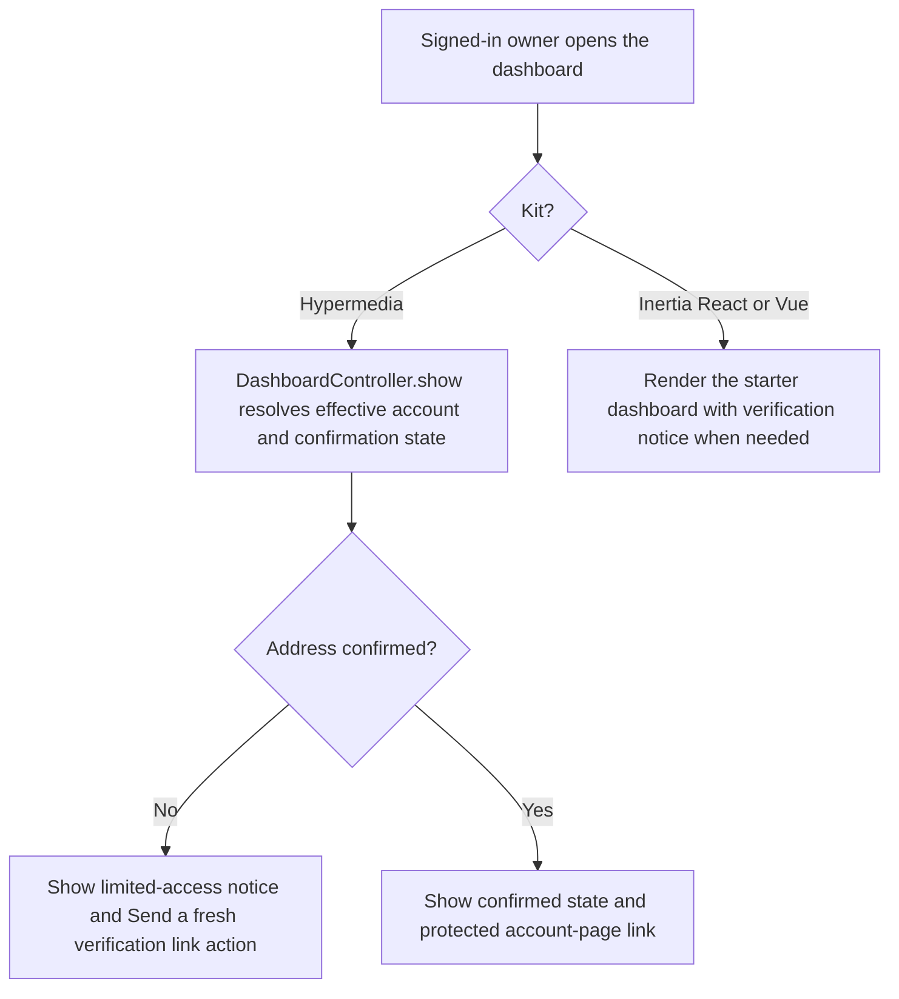
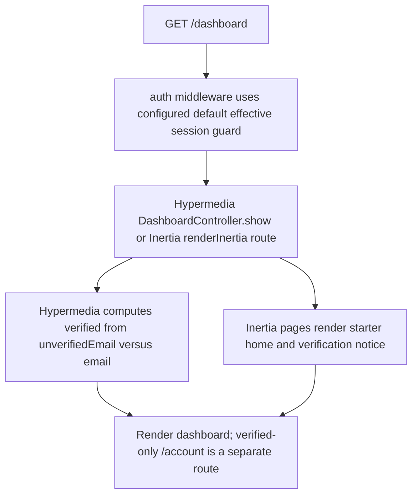

# US-ACCOUNT-12 — Open the signed-in dashboard

As a signed-in account owner, I want to open my dashboard so that I can see my account home and whether email confirmation is complete.

**Status:** Current; source-reviewed, not runtime-tested here.
**Access:** Browser kits use their default effective session guard; account identity shown during support mode follows effective-account behavior.
**Entry:** Browser kits: `GET /dashboard`; Hypermedia also provides verified-only `GET /account`.
**Documentation:** [Hypermedia dashboard view](../../apps/hypermedia/resources/views/pages/dashboard.edge).
**Source:** [Hypermedia routes](../../apps/hypermedia/start/routes.ts), [Hypermedia dashboard controller](../../apps/hypermedia/app/controllers/dashboard_controller.ts), [Inertia React routes](../../apps/inertia-react/start/routes.ts), [Inertia Vue routes](../../apps/inertia-vue/start/routes.ts).
**Coverage:** [Hypermedia Masquerade browser test](../../apps/hypermedia/tests/browser/masquerade.spec.ts), [Inertia React Masquerade browser test](../../apps/inertia-react/tests/browser/masquerade.spec.ts), [Inertia Vue Masquerade browser test](../../apps/inertia-vue/tests/browser/masquerade.spec.ts); these links identify source behavior coverage, not runtime verification of these docs.

## Acceptance criteria

- There are no editable fields; an authenticated account opens `/dashboard`.
- Hypermedia shows the effective account email and whether its address is confirmed. An unconfirmed owner can select **Send a fresh verification link**; a confirmed owner can open the protected `/account` page.
- Inertia React and Vue render the starter dashboard. Their verification notice appears for an unconfirmed account with **Resend link**, disabled while the form is processing; the Vue page receives email-verification state through shared props.
- Unauthenticated requests are sent through the configured authentication response. Hypermedia `/account` additionally requires a verified effective account.
- The API has no dashboard route; its account profile read is documented separately.

## User flow

## Code flow

**Code references:** [Hypermedia routes](../../apps/hypermedia/start/routes.ts), [Hypermedia controller](../../apps/hypermedia/app/controllers/dashboard_controller.ts), [Hypermedia dashboard](../../apps/hypermedia/resources/views/pages/dashboard.edge), [Inertia React route](../../apps/inertia-react/start/routes.ts), [React dashboard](../../apps/inertia-react/inertia/pages/dashboard.tsx), [Inertia Vue route](../../apps/inertia-vue/start/routes.ts), [Vue dashboard](../../apps/inertia-vue/inertia/pages/dashboard.vue), [Vue shared Inertia props](../../apps/inertia-vue/app/middleware/inertia_middleware.ts).
