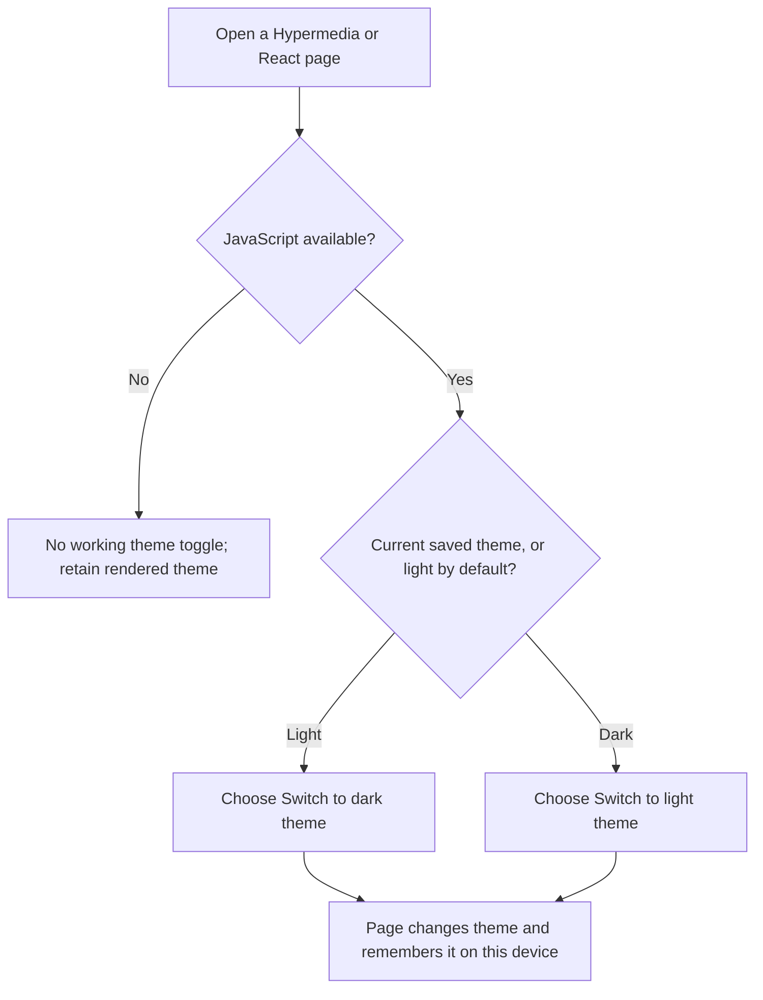
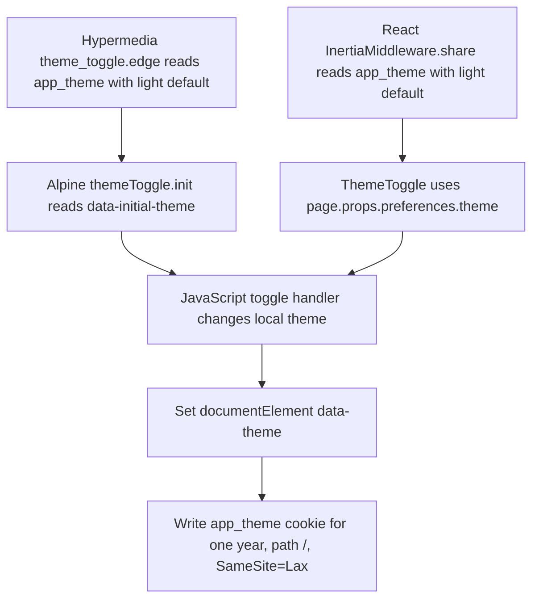

# US-ACCOUNT-13 — Change my theme preference

As a visitor, I want to switch between light and dark themes so that the interface matches my preference.

**Status:** Current in Hypermedia and Inertia React; source-reviewed, not runtime-tested here.
**Access:** Anyone who can open a page with the Hypermedia or React theme control and JavaScript enabled.
**Entry:** Use the theme toggle in Hypermedia or React app and marketing layouts.
**Documentation:** [Hypermedia app](../../apps/hypermedia/README.md), [React app](../../apps/inertia-react/README.md).
**Source:** [Hypermedia toggle](../../apps/hypermedia/resources/views/components/theme_toggle.edge), [theme persistence](../../apps/hypermedia/resources/js/app.js), [React toggle](../../apps/inertia-react/inertia/components/theme_toggle.tsx).

## Acceptance criteria

- The control label is **Switch to dark theme** in light mode and **Switch to light theme** in dark mode. Initial state comes from the saved `app_theme` cookie, defaulting to light when absent.
- Selecting it updates document `data-theme` and stores `app_theme` in a one-year, path-wide, SameSite=Lax cookie. This is a device-local preference, not an account setting.
- The toggle requires JavaScript: Hypermedia hides its Alpine control with `x-cloak` until initialized; React requires its client click handler. No account record is written.
- Hypermedia and React expose this toggle. Vue reads the cookie for its theme but does not expose the toggle.

## User flow

## Code flow

**Code references:** [Hypermedia toggle](../../apps/hypermedia/resources/views/components/theme_toggle.edge), [Hypermedia JS](../../apps/hypermedia/resources/js/app.js), [React toggle](../../apps/inertia-react/inertia/components/theme_toggle.tsx), [React shared preference producer](../../apps/inertia-react/app/middleware/inertia_middleware.ts), [React layout](../../apps/inertia-react/inertia/layouts/app.tsx), [Vue layout cookie reader](../../apps/inertia-vue/resources/views/inertia_layout.edge).
