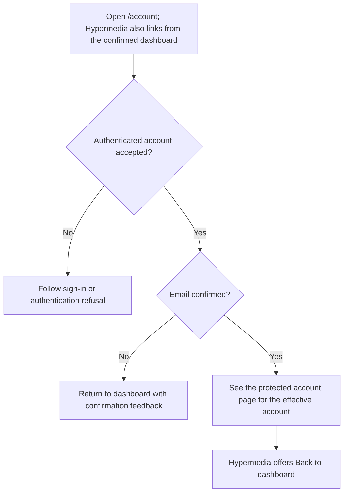
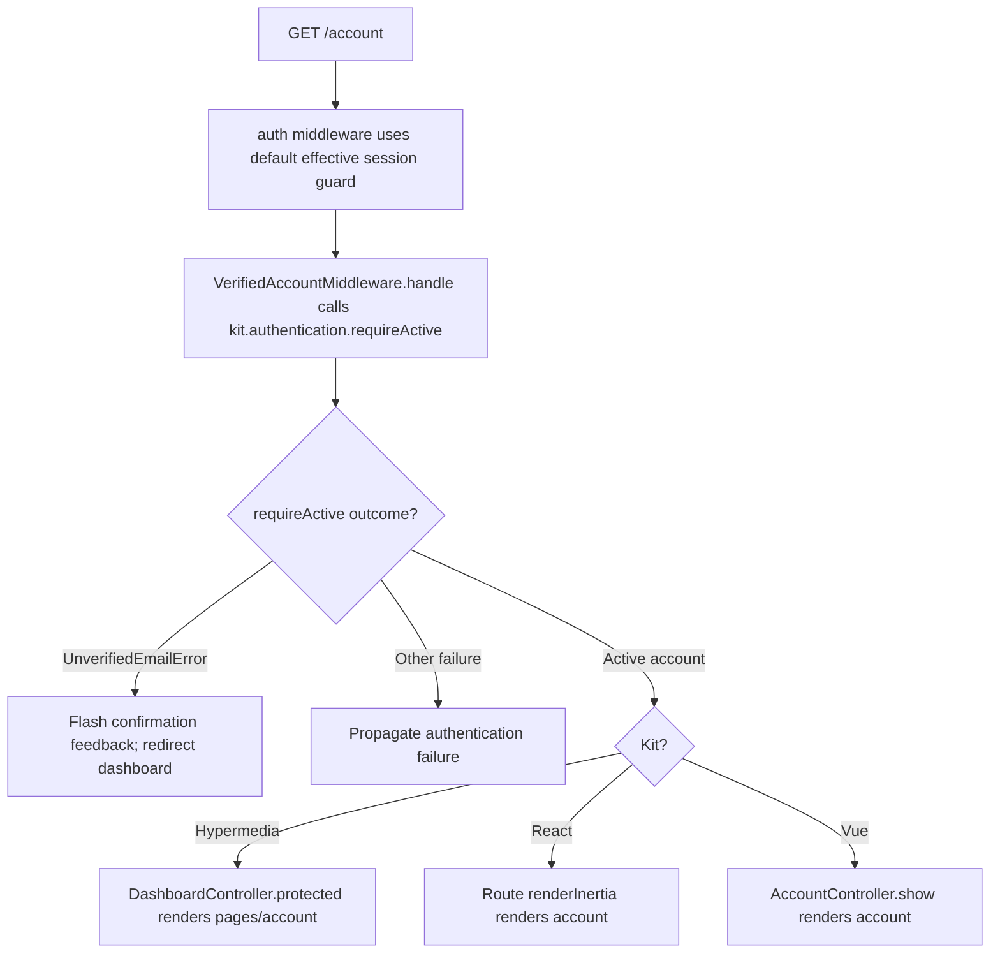

# US-ACCOUNT-14 — Open the protected account page

As a signed-in account owner, I want to open the protected account page so that I can access the application area reserved for confirmed accounts.

**Status:** Current in Hypermedia, Inertia React and Inertia Vue; source-reviewed, not runtime-tested here.
**Access:** Default effective session authentication, followed by the kit's verified-account middleware. During support mode the route resolves the effective account, subject to Masquerade admission and policy.
**Entry:** `GET /account` in all three browser kits; Hypermedia offers **Open the protected account page** on its confirmed-account dashboard. React and Vue expose the route without that dashboard link.
**Documentation:** [Hypermedia protected page](../../apps/hypermedia/resources/views/pages/account.edge), [dashboard journey](us-account-12-open-account-dashboard.md).
**Source:** [Hypermedia route](../../apps/hypermedia/start/routes.ts), [React route](../../apps/inertia-react/start/routes.ts), [Vue route](../../apps/inertia-vue/start/routes.ts).
**Coverage:** [Hypermedia account journey](../../apps/hypermedia/tests/browser/account_journey.spec.ts), [React account journeys](../../apps/inertia-react/tests/browser/account_journeys.spec.ts), [Vue account journeys](../../apps/inertia-vue/tests/browser/account_journeys.spec.ts).

## Acceptance criteria

- No editable fields are required. Open `/account`; dashboard access alone does not establish permission for this page.
- Authentication resolves the default effective session account. A valid confirmed account sees **Protected account page** in Hypermedia or **Your account is confirmed** in React/Vue.
- The verified-account middleware calls `authentication.requireActive` for the resolved account and session revision. An unconfirmed account is redirected to the dashboard with email-confirmation feedback; unauthenticated requests follow the authentication response. Other authentication failures are not converted into a successful page render.
- Hypermedia offers **Back to dashboard** on the protected page. The Inertia pages display the protected content within their application layout.

## User flow

## Code flow

**Code references:** [Hypermedia route](../../apps/hypermedia/start/routes.ts), [Hypermedia verified middleware](../../apps/hypermedia/app/middleware/verified_account_middleware.ts), [Hypermedia controller](../../apps/hypermedia/app/controllers/dashboard_controller.ts), [Hypermedia view](../../apps/hypermedia/resources/views/pages/account.edge), [React route](../../apps/inertia-react/start/routes.ts), [React verified middleware](../../apps/inertia-react/app/middleware/verified_account_middleware.ts), [React page](../../apps/inertia-react/inertia/pages/account.tsx), [Vue route](../../apps/inertia-vue/start/routes.ts), [Vue verified middleware](../../apps/inertia-vue/app/middleware/verified_account_middleware.ts), [Vue controller](../../apps/inertia-vue/app/controllers/account_controller.ts), [Vue page](../../apps/inertia-vue/inertia/pages/account.vue).
