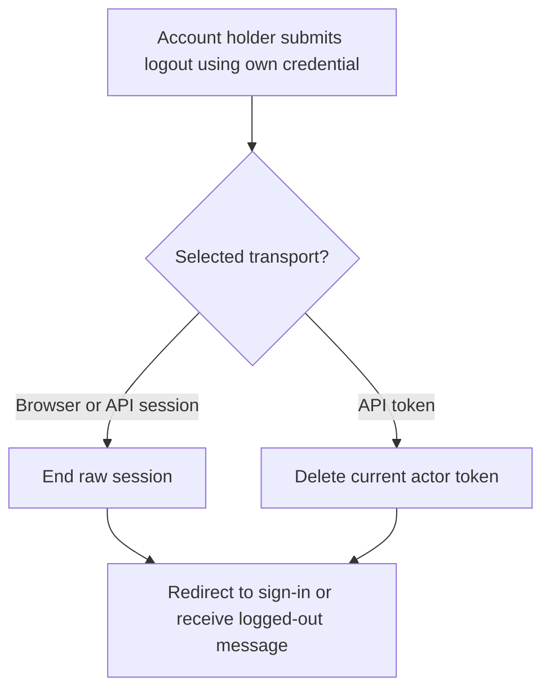
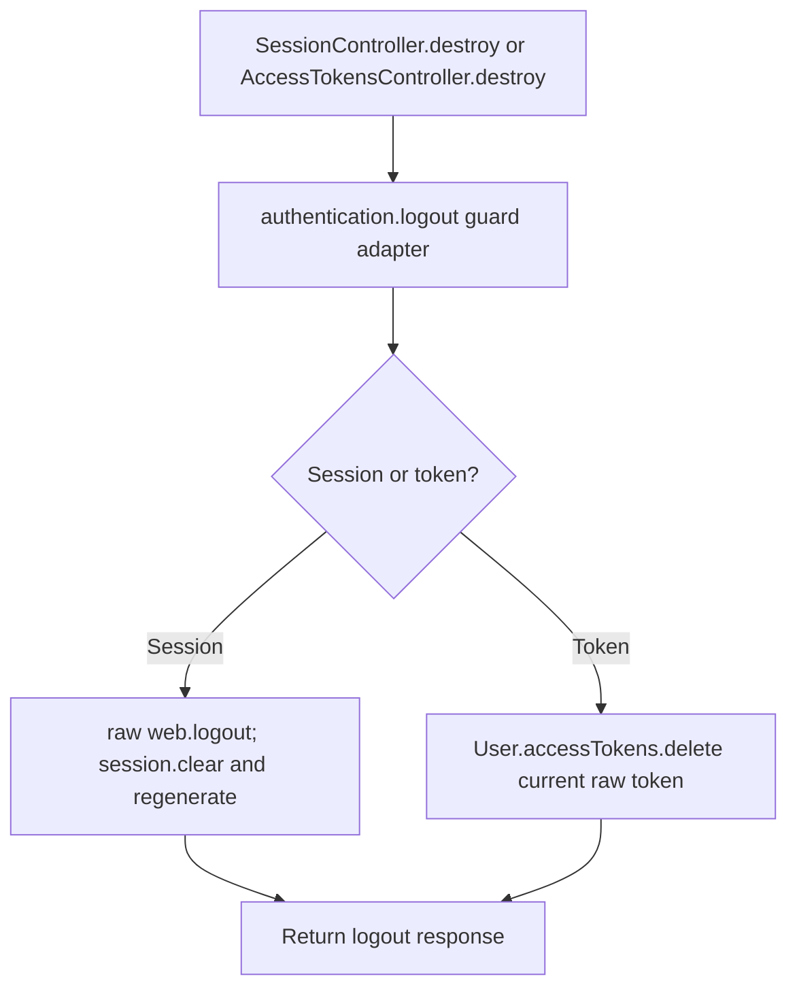

# US-API-01 — Sign out the raw account

As an authenticated account holder, I want to end my current session or token so that this credential can no longer authenticate requests.

**Status:** Current under the stated kit and configuration conditions; source-reviewed availability.
**Access:** Raw authenticated account; logout stays reachable during masquerade. Browser kits use raw web sessions; API selects session or access-token strategy.
**Entry:** Browser kits: `POST /logout`; API: `POST /api/v1/account/logout`.
**Documentation:** [API app instructions](../../apps/api/README.md#api).
**Source:** [API routes](../../apps/api/start/routes.ts), [API SessionController](../../apps/api/app/controllers/session_controller.ts).

## Acceptance criteria

- There is no operation-specific editable input. Cookie-authenticated clients retain normal host CSRF requirements.
- Browser controllers call `authentication.logout` with their session guard and redirect to sign-in. API session logout ends raw `web`, clears and regenerates session, then returns “Logged out successfully”.
- API token logout deletes only the authenticated raw user's current access-token identifier when present; it does not mint or delete the target's credential. It returns the same message.
- Logout is outside the Account Kit blocker group. Authentication still applies; a database/guard failure propagates rather than promising that the credential ended.

## User flow

## Code flow

Scope: API route and controller through the named Account Kit service boundary; the package owns its records and the handler maps the result. No runtime journey was exercised.

**Code references:** [API routes](../../apps/api/start/routes.ts), [API SessionController](../../apps/api/app/controllers/session_controller.ts), [AccessTokensController](../../apps/api/app/controllers/access_tokens_controller.ts), [Browser SessionController](../../apps/hypermedia/app/controllers/session_controller.ts), [API strategy](../../apps/api/app/services/auth_strategy.ts).
