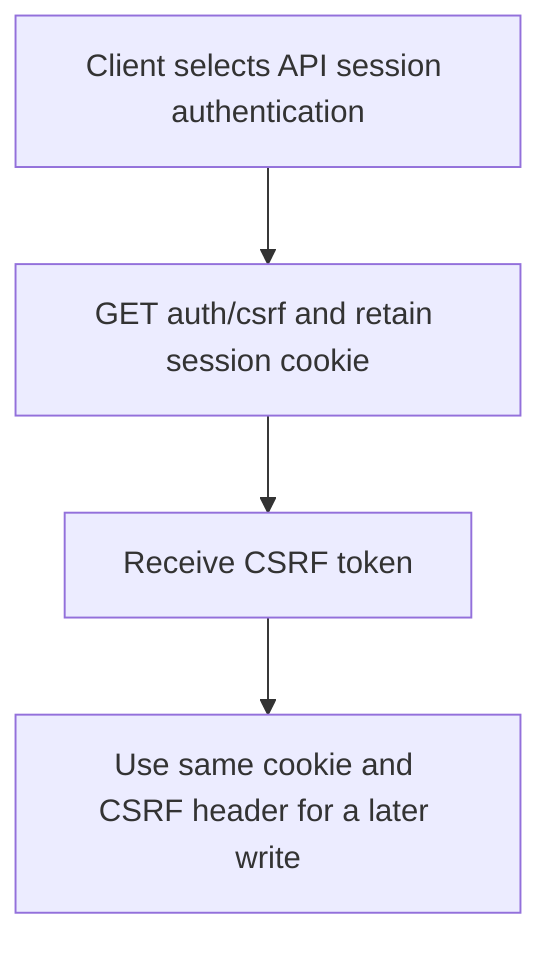
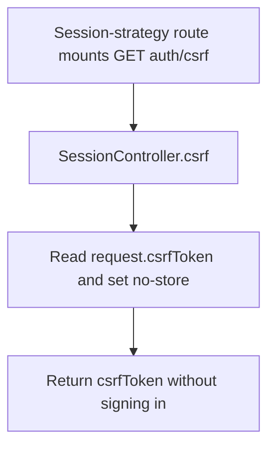

# US-API-02 — Bootstrap an API session CSRF token

As an API session client, I want to obtain the session CSRF token so that I can submit cookie-authenticated writes.

**Status:** Current under the stated kit and configuration conditions; source-reviewed availability.
**Access:** Available before sign-in in the API session reference (`ACCOUNT_KIT_AUTH_STRATEGY=session`).
**Entry:** `GET /api/v1/auth/csrf`.
**Documentation:** [API app instructions](../../apps/api/README.md#session-reference).
**Source:** [API routes](../../apps/api/start/routes.ts), [SessionController.csrf](../../apps/api/app/controllers/session_controller.ts).
**Coverage:** [Session reference routes](../../apps/api/tests/functional/reference_session.spec.ts), [session social tests](../../apps/api/tests/functional/social_session.spec.ts).

## Acceptance criteria

- The action has no editable fields. It returns `{ csrfToken: request.csrfToken }` with `Cache-Control: no-store`.
- The client retains the same session cookie and supplies the host CSRF header on subsequent writes. A token from a different session does not establish authorization.
- The session reference mounts this route alongside its cookie-authenticated account routes. Each later request still passes the account and business-route checks for that action.

## User flow

## Code flow

Scope: Session-only bootstrap controller and host Shield/session boundary; this action establishes no account credential.

**Code references:** [API routes](../../apps/api/start/routes.ts), [SessionController.csrf](../../apps/api/app/controllers/session_controller.ts), [Session social tests](../../apps/api/tests/functional/social_session.spec.ts).
