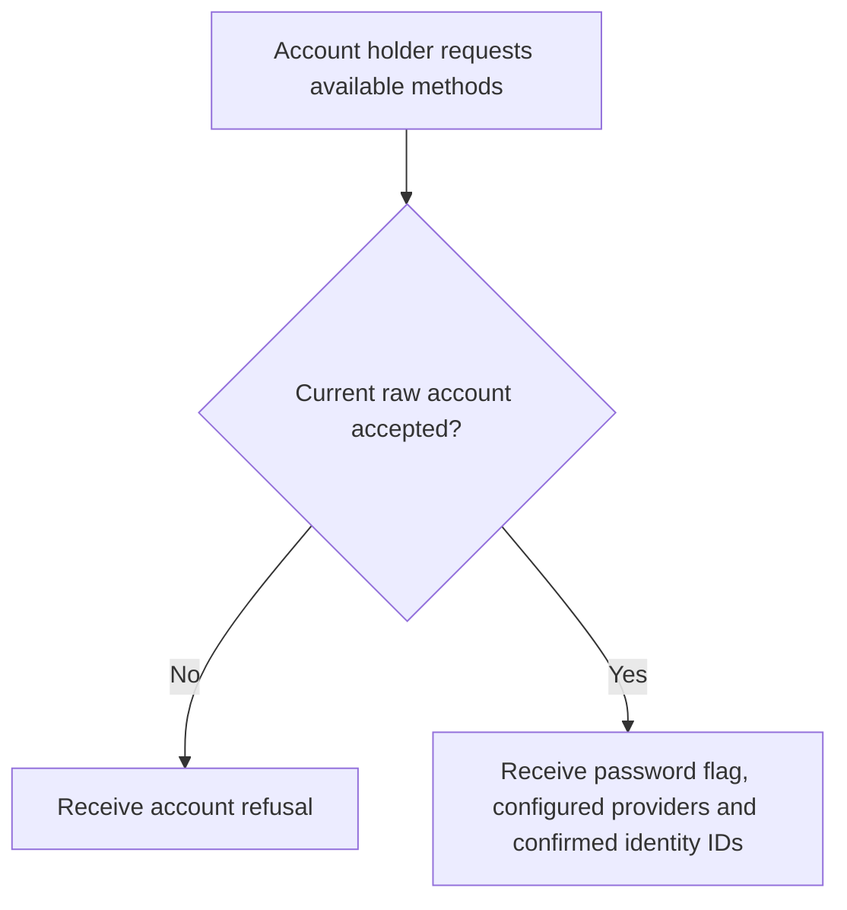
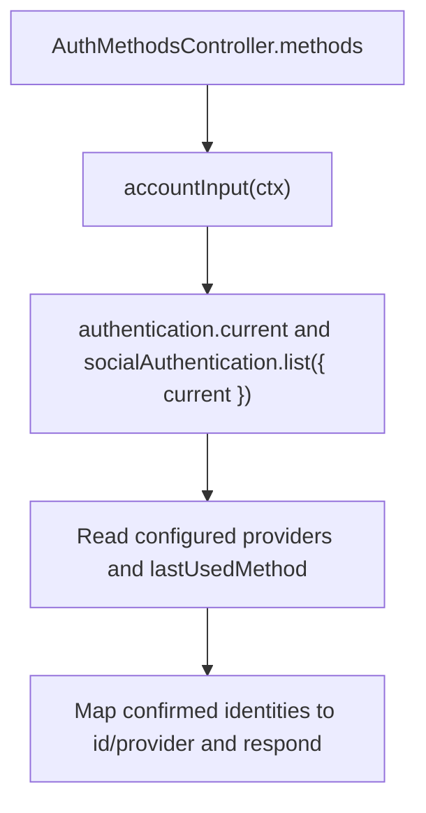

# US-API-03 — Read available sign-in methods

As an API account holder, I want to inspect my password and confirmed social methods so that I can choose a sign-in or linking action.

**Status:** Current under the stated kit and configuration conditions; source-reviewed availability.
**Access:** Raw authenticated API account passing `accountAccess()`; active masquerade is blocked.
**Entry:** `GET /api/v1/account/methods`.
**Documentation:** [API app instructions](../../apps/api/README.md#api).
**Source:** [API routes](../../apps/api/start/routes.ts), [AuthMethodsController](../../apps/api/app/controllers/auth_methods_controller.ts).
**Coverage:** [Existing scenario source](../../apps/api/tests/functional/social_reference.spec.ts).

## Acceptance criteria

- No editable input exists. The controller returns password availability, configured provider names, a last-used-method hint, and confirmed identities as `{ id, provider }`.
- `accountInput` derives identity and credential context from the selected raw guard. The controller calls both `authentication.current(current)` and `socialAuthentication.list({ current })`; a stale/refused credential does not expose another account's methods.
- The last-used-method hint is filtered against currently available password/provider methods; it is presentation data and does not grant authentication.

## User flow

## Code flow

Scope: API route and controller through the named Account Kit service boundary; the package owns its records and the handler maps the result. No runtime journey was exercised.

**Code references:** [API routes](../../apps/api/start/routes.ts), [AuthMethodsController](../../apps/api/app/controllers/auth_methods_controller.ts), [Account gate](../../apps/api/app/middleware/account_access_middleware.ts), [Last-used hint](../../apps/api/app/services/last_used_method.ts), [Social configuration](../../apps/api/config/account_kit.ts).
