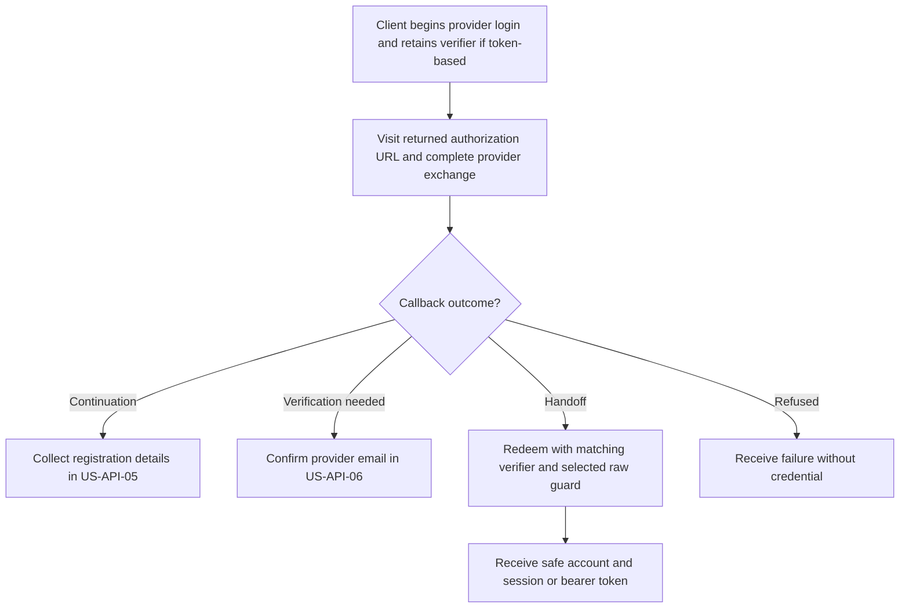
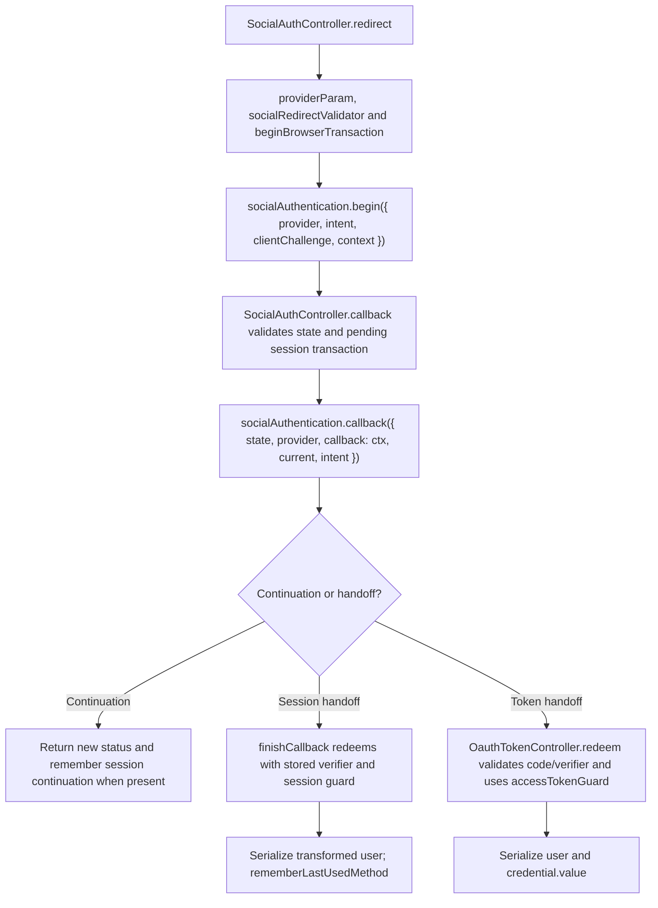

# US-API-04 — Sign in using a configured social provider

As an API client user, I want to complete a provider sign-in and redeem its bound result so that I receive my own raw credential.

**Status:** Current under the stated kit and configuration conditions; source-reviewed availability.
**Access:** API social routes with configured Google/GitHub adapter; this login action is public but blocked during active masquerade.
**Entry:** `POST /api/v1/auth/oauth/:provider/redirect` with login intent, then provider callback (`GET` in session mode, `POST` in token mode); token clients redeem at `POST /api/v1/auth/oauth/token`.
**Documentation:** [API app instructions](../../apps/api/README.md#api).
**Source:** [API routes](../../apps/api/start/routes.ts), [SocialAuthController](../../apps/api/app/controllers/social_auth_controller.ts).
**Coverage:** [Existing scenario source](../../apps/api/tests/functional/social_reference.spec.ts).

## Acceptance criteria

| Input                       | Location/type       | Required/default/conditions                                                                                                            |
| --------------------------- | ------------------- | -------------------------------------------------------------------------------------------------------------------------------------- |
| `provider`                  | Route choice        | `google` or `github`; unknown providers are refused                                                                                    |
| `intent`                    | Begin JSON choice   | Optional; default `login` for this outcome                                                                                             |
| `clientChallenge`           | Begin string        | Required for access-token clients: a 43-character base64url S256 challenge; session mode creates and stores its own verifier/challenge |
| `state` and provider `code` | Callback input      | Nonempty state; provider exchange requires its code and matching provider; optional callback intent must be a recognized social intent |
| `code`, `verifier`          | Token-exchange JSON | Both required; verifier is 43–128 characters from the PKCE unreserved alphabet; code must match that original verifier                 |

- Begin returns `{ authorizationUrl }`; it does not authenticate the user. Callback can return a registration continuation or another explicit package outcome without a credential.
- For a completed session flow, `finishCallback` redeems a returned handoff with the server-held verifier and `accountKitSessionGuard`, then returns a safe transformed user. Token-mode clients keep their verifier and explicitly redeem a handoff through `OauthTokenController` to receive a user and token.
- A registration continuation follows US-API-05; an unverified provider-email outcome follows US-API-06. Invalid state, provider exchange or verifier is refused rather than issuing a credential.
- The API config enables Google and GitHub adapters; real exchanges require host Ally provider configuration. Test fixtures are selected only in app test mode and do not establish production provider access.
- Public social routes use the Account Kit blocker and operation-specific social throttle. Session writes require the host CSRF token. `ACCOUNT_KIT_AUTH_STRATEGY` selects transport; the browser starter kits do not expose these social endpoints.

## User flow

## Code flow

Scope: API route and controller through the named Account Kit service boundary; the package owns its records and the handler maps the result. No runtime journey was exercised.

**Code references:** [API routes](../../apps/api/start/routes.ts), [SocialAuthController](../../apps/api/app/controllers/social_auth_controller.ts), [OauthTokenController](../../apps/api/app/controllers/oauth_token_controller.ts), [Social validators](../../apps/api/app/validators/social.ts), [Browser transaction binding](../../apps/api/app/services/social_browser_transaction.ts), [Raw guard adapters](../../apps/api/app/services/account_kit_guards.ts), [Provider adapter](../../apps/api/app/services/social_provider.ts).
