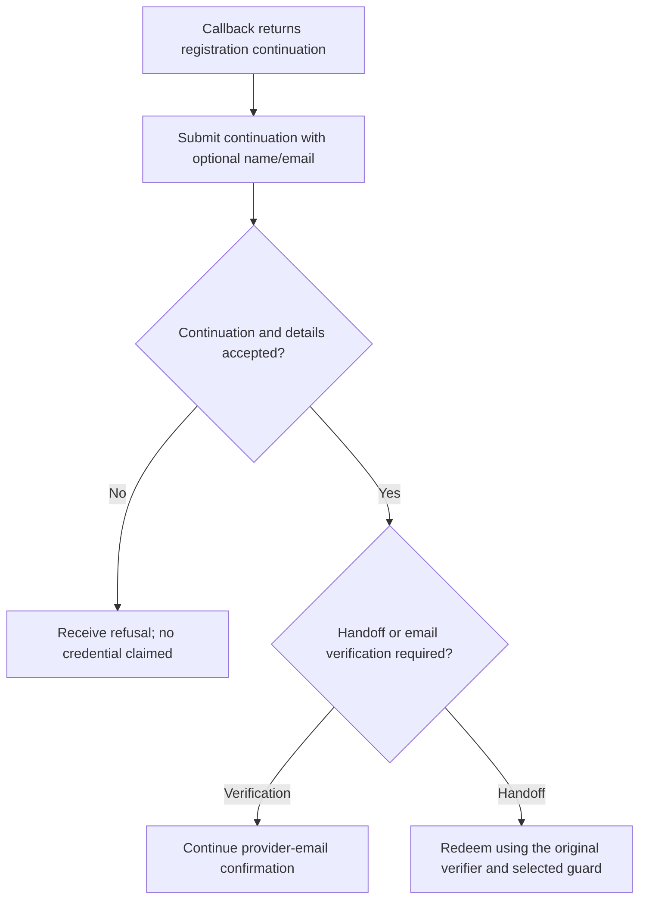
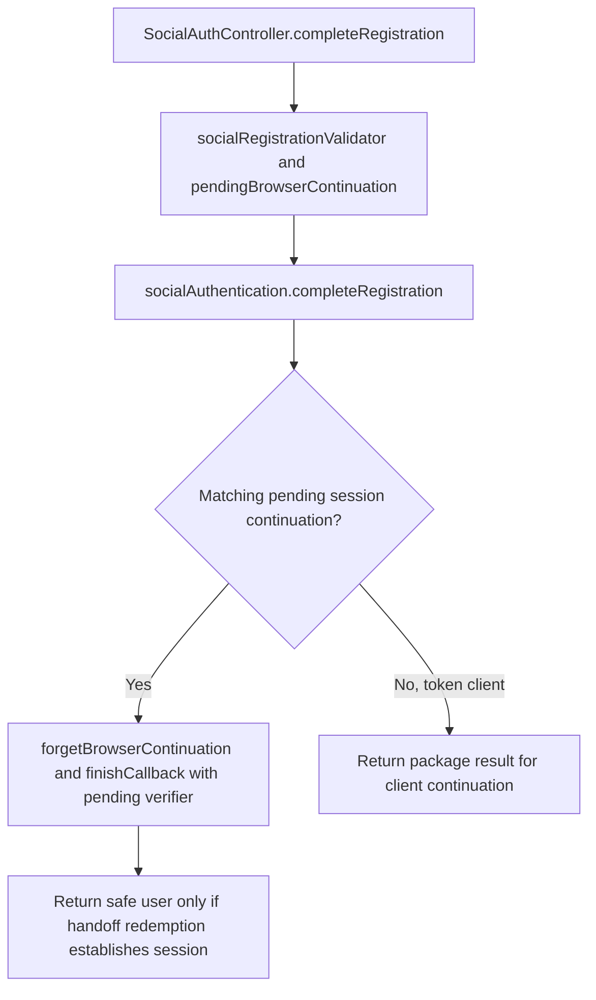

# US-API-05 — Complete a social registration continuation

As a new API social user, I want to supply registration details for a provider continuation so that an eligible account can be created.

**Status:** Current under the stated kit and configuration conditions; source-reviewed availability.
**Access:** Valid continuation from the social callback; API public route has Account Kit blocker and registration throttle.
**Entry:** `POST /api/v1/auth/oauth/registration`.
**Documentation:** [API app instructions](../../apps/api/README.md#api).
**Source:** [API routes](../../apps/api/start/routes.ts), [SocialAuthController.completeRegistration](../../apps/api/app/controllers/social_auth_controller.ts).
**Coverage:** [Existing scenario source](../../apps/api/tests/functional/social_reference.spec.ts).

## Acceptance criteria

| Input          | Type         | Required/default/conditions                                                                                   |
| -------------- | ------------ | ------------------------------------------------------------------------------------------------------------- |
| `continuation` | String       | Required/nonempty; session clients must match the stored session continuation                                 |
| `fullName`     | String/null  | Optional; trimmed, up to 255 characters; used as application registrationData                                 |
| `email`        | Email string | Optional at validator; normalized/valid, up to 254 characters; package decides when provider data requires it |

- The controller calls `completeRegistration({ continuation, email, registrationData: { fullName } })`; it does not trust the provider's display name as the app's submitted name.
- A matching pending session continuation is forgotten and its verifier is passed to `finishCallback`; a handoff can then establish a session. Token clients receive the result and redeem a returned handoff separately with their original verifier.
- A verification-needed or refused result does not promise a credential. Invalid continuation, session mismatch or field validation cannot be treated as completed registration.

## User flow

## Code flow

Scope: API route and controller through the named Account Kit service boundary; the package owns its records and the handler maps the result. No runtime journey was exercised.

**Code references:** [API routes](../../apps/api/start/routes.ts), [SocialAuthController.completeRegistration](../../apps/api/app/controllers/social_auth_controller.ts), [Registration validator](../../apps/api/app/validators/user.ts), [Continuation storage](../../apps/api/app/services/social_browser_transaction.ts).
