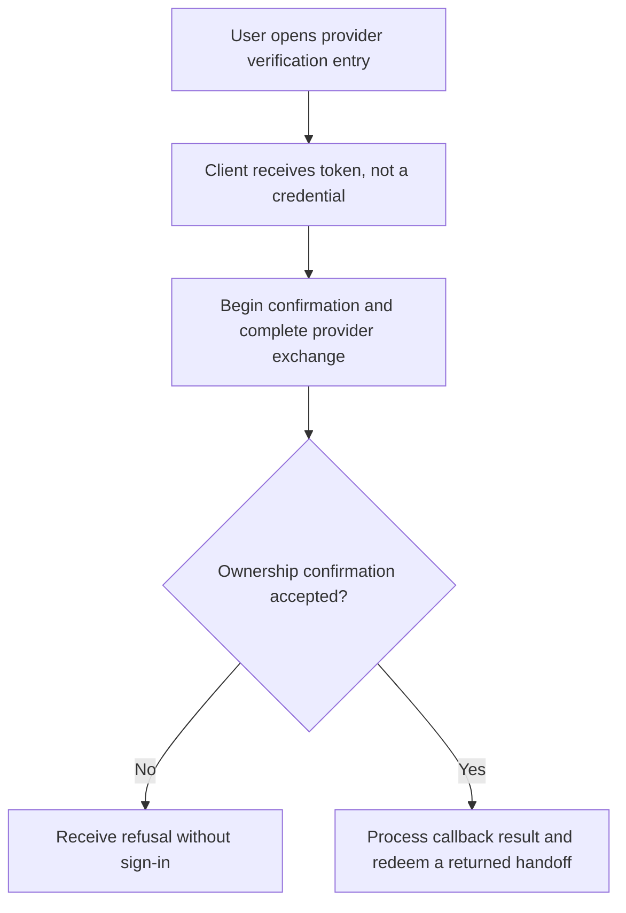
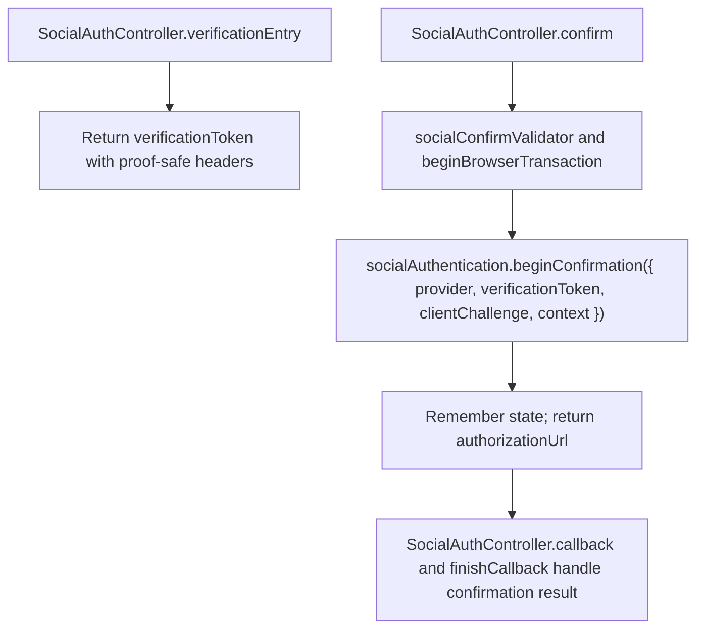

# US-API-06 — Confirm provider ownership after an unverified-email outcome

As an API social user, I want to continue provider confirmation using an emailed verification token so that matching ownership can be established.

**Status:** Current under the stated kit and configuration conditions; source-reviewed availability.
**Access:** API configured provider and valid verification token; no credential is granted merely by opening the token entry.
**Entry:** `GET /api/v1/auth/social-verification/:token`, then `POST /api/v1/auth/oauth/:provider/confirm` and the provider callback.
**Documentation:** [API app instructions](../../apps/api/README.md#api).
**Source:** [API routes](../../apps/api/start/routes.ts), [Verification and confirm handlers](../../apps/api/app/controllers/social_auth_controller.ts).
**Coverage:** [Existing scenario source](../../apps/api/tests/functional/social_reference.spec.ts).

## Acceptance criteria

| Input               | Type         | Required/default/conditions                                                                                               |
| ------------------- | ------------ | ------------------------------------------------------------------------------------------------------------------------- |
| `verificationToken` | JSON string  | Required/nonempty; from verification entry/email                                                                          |
| `provider`          | Route choice | `google` or `github` and must match the confirmation flow                                                                 |
| `clientChallenge`   | String       | Required for token clients: a 43-character base64url S256 challenge; session clients get a server-held verifier/challenge |

- `verificationEntry` only returns the route token, with no-store/no-referrer headers. It does not activate an account, verify a provider or establish a session.
- `beginConfirmation` returns an authorization URL and records the new state. Complete provider callback with that state; the package decides the confirmation result.
- A returned handoff uses the same verifier/redemption boundary as US-API-04. Invalid, expired or mismatched proof/provider results are refused without treating the token-entry GET as successful confirmation.

## User flow

## Code flow

Scope: API route and controller through the named Account Kit service boundary; the package owns its records and the handler maps the result. No runtime journey was exercised.

**Code references:** [API routes](../../apps/api/start/routes.ts), [Verification and confirm handlers](../../apps/api/app/controllers/social_auth_controller.ts), [Confirm/callback validator](../../apps/api/app/validators/social.ts), [Provider exchange](../../apps/api/app/services/social_provider.ts).
