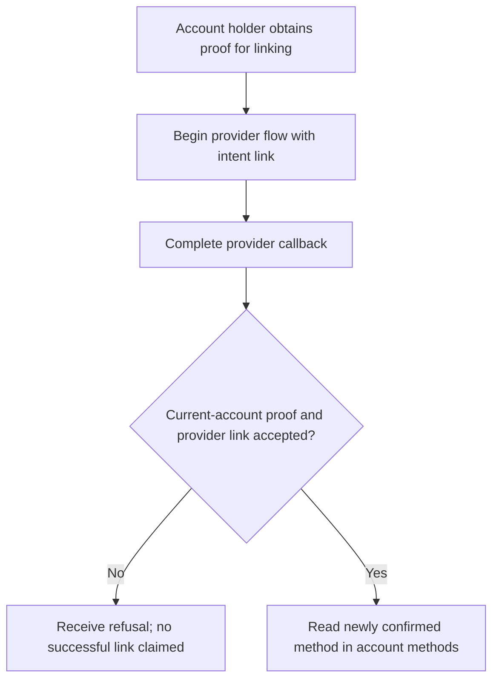
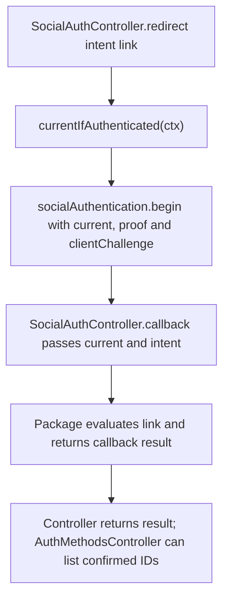

# US-API-07 — Link a provider identity to the current account

As an API account holder, I want to link a provider after proving current-account control so that I can use that confirmed method later.

**Status:** Current under the stated kit and configuration conditions; source-reviewed availability.
**Access:** Current raw account plus suitable proof; public social route is blocked during masquerade.
**Entry:** Begin `POST /api/v1/auth/oauth/:provider/redirect` with `intent: link`, then complete the provider callback.
**Documentation:** [API app instructions](../../apps/api/README.md#api).
**Source:** [API routes](../../apps/api/start/routes.ts), [Social handlers](../../apps/api/app/controllers/social_auth_controller.ts).
**Coverage:** [Existing scenario source](../../apps/api/tests/functional/social_reference_policy.spec.ts).

## Acceptance criteria

| Input             | Type         | Required/default/conditions                                                                                             |
| ----------------- | ------------ | ----------------------------------------------------------------------------------------------------------------------- |
| `provider`        | Route choice | Google/GitHub configured adapter                                                                                        |
| `intent`          | JSON choice  | Use `link`; omitted intent is login and does not select this outcome                                                    |
| `proof`           | String       | Proof expected by the linking policy; obtain a current-account sensitive proof first                                    |
| `clientChallenge` | String       | Required for token clients: a 43-character base64url S256 challenge; session flow generates and stores its own verifier |

- `currentIfAuthenticated` derives current credentials for link/reauth intents; linking is not authorized by a caller-supplied user ID.
- The package callback handles the confirmed link. A link response is not a new target credential, and an invalid proof/provider or conflicting identity is refused.
- The caller can read confirmed identity IDs through US-API-03 after completion. This route does not provide a browser-kit linking form.

## User flow

## Code flow

Scope: API route and controller through the named Account Kit service boundary; the package owns its records and the handler maps the result. No runtime journey was exercised.

**Code references:** [API routes](../../apps/api/start/routes.ts), [Social handlers](../../apps/api/app/controllers/social_auth_controller.ts), [Current credential resolver](../../apps/api/app/services/social_request.ts), [Validators](../../apps/api/app/validators/social.ts), [Method read](../../apps/api/app/controllers/auth_methods_controller.ts).
