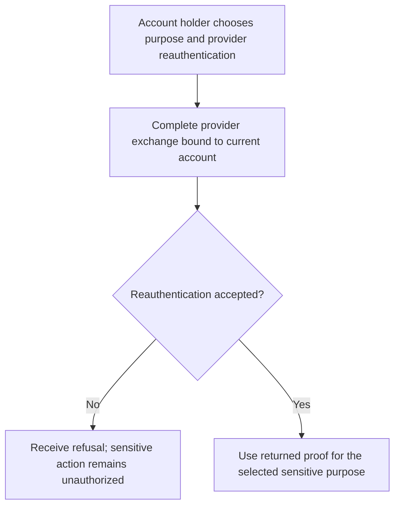
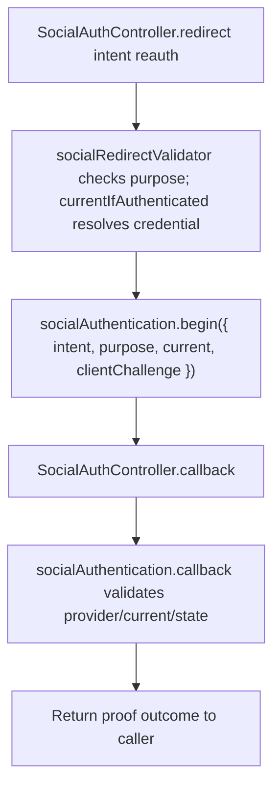

# US-API-08 — Prove a sensitive action through a provider

As an API account holder, I want to reauthenticate with a linked provider for one sensitive purpose so that the app can authorize that purpose without a password.

**Status:** Current under the stated kit and configuration conditions; source-reviewed availability.
**Access:** Current raw account and appropriate linked provider; Account Kit blocker and social begin/callback throttle apply.
**Entry:** Begin social redirect with `intent: reauth` and `purpose`, then complete the provider callback.
**Documentation:** [API app instructions](../../apps/api/README.md#api).
**Source:** [API routes](../../apps/api/start/routes.ts), [Social flow controller](../../apps/api/app/controllers/social_auth_controller.ts).
**Coverage:** [Existing scenario source](../../apps/api/tests/functional/social_reference_policy.spec.ts).

## Acceptance criteria

- Supply configured `provider`, `intent: reauth`, and one `purpose`: `social_link`, `social_unlink`, `password_change`, `email_change`, `account_export`, or `account_delete`. Token clients supply a 43-character base64url S256 `clientChallenge`; session clients use server-held verifier state.
- `currentIfAuthenticated` binds the current raw account. The package callback decides whether the provider proves that account/purpose; a callback result for reauthentication is not permission to act as another account.
- Return the resulting proof to the intended sensitive API. A refused/mismatched callback does not authorize the action; the proof remains purpose-bound according to the package contract.

## User flow

## Code flow

Scope: API route and controller through the named Account Kit service boundary; the package owns its records and the handler maps the result. No runtime journey was exercised.

**Code references:** [API routes](../../apps/api/start/routes.ts), [Social flow controller](../../apps/api/app/controllers/social_auth_controller.ts), [Sensitive-purpose enum](../../apps/api/app/validators/social.ts), [Current raw input](../../apps/api/app/services/social_request.ts).
