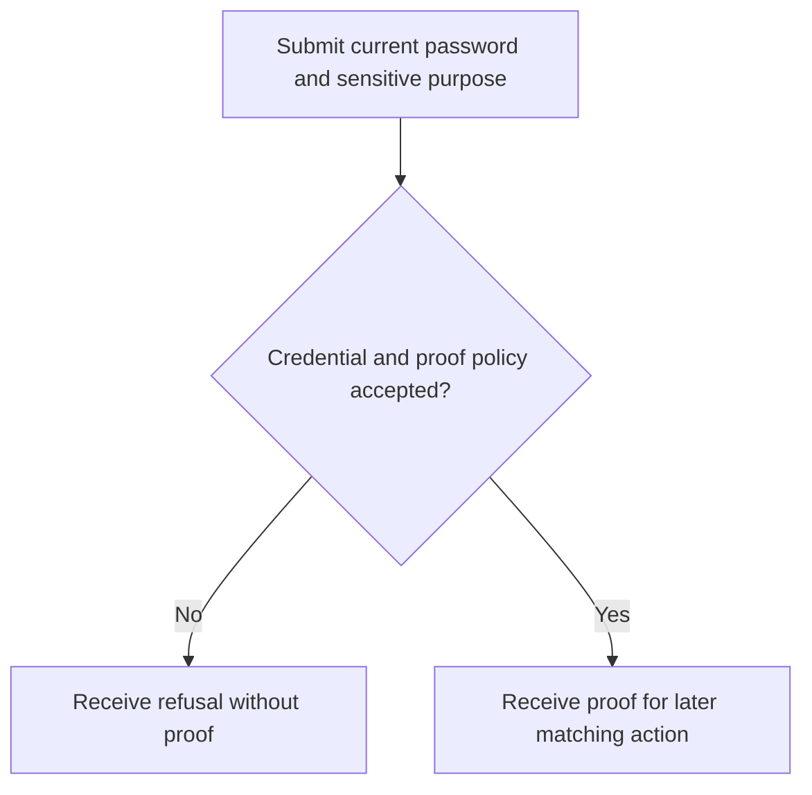
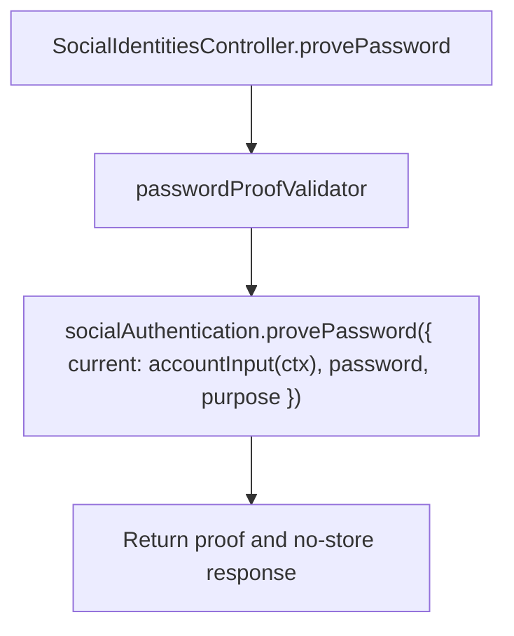

# US-API-09 — Prove a sensitive action with the current password

As an API account holder, I want to obtain a password proof for a sensitive purpose so that a later account action can verify my control.

**Status:** Current under the stated kit and configuration conditions; source-reviewed availability.
**Access:** Raw authenticated account passing accountAccess; blocker and actor-bound proof throttle apply.
**Entry:** `POST /api/v1/account/social/proof`.
**Documentation:** [API app instructions](../../apps/api/README.md#api).
**Source:** [API routes](../../apps/api/start/routes.ts), [Proof handler](../../apps/api/app/controllers/social_identities_controller.ts).
**Coverage:** [Existing scenario source](../../apps/api/tests/functional/social_reference_policy.spec.ts).

## Acceptance criteria

| Input      | Type        | Required/default/conditions                                                                         |
| ---------- | ----------- | --------------------------------------------------------------------------------------------------- |
| `password` | JSON string | Required/nonempty; verified by Account Kit                                                          |
| `purpose`  | JSON choice | Required: social_link, social_unlink, password_change, email_change, account_export, account_delete |

- `provePassword` receives `current: accountInput(ctx)`, not a caller-supplied account. Success returns `{ proof }` with no-store headers.
- Incorrect password, stale credential, invalid purpose or throttle refusal does not grant a proof. Issuing proof alone does not perform the later sensitive action.

## User flow

## Code flow

Scope: API route and controller through the named Account Kit service boundary; the package owns its records and the handler maps the result. No runtime journey was exercised.

**Code references:** [API routes](../../apps/api/start/routes.ts), [Proof handler](../../apps/api/app/controllers/social_identities_controller.ts), [Validator](../../apps/api/app/validators/social.ts), [Account input](../../apps/api/app/services/account_input.ts).
