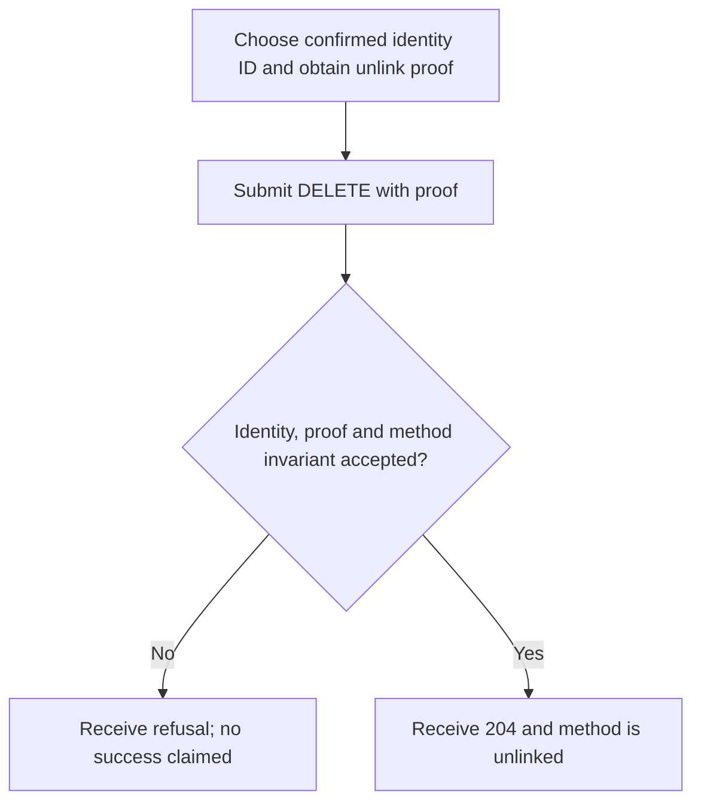
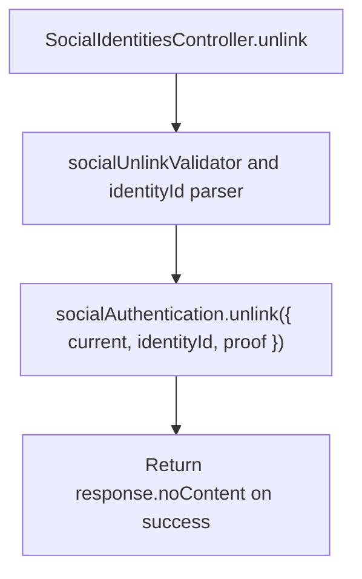

# US-API-10 — Unlink a confirmed social identity

As an API account holder, I want to remove a selected confirmed provider identity so that it is no longer a sign-in method.

**Status:** Current under the stated kit and configuration conditions; source-reviewed availability.
**Access:** Raw account passing accountAccess, suitable unlink proof, blocker and actor-bound unlink throttle.
**Entry:** `DELETE /api/v1/account/social/:id`.
**Documentation:** [API app instructions](../../apps/api/README.md#api).
**Source:** [API routes](../../apps/api/start/routes.ts), [Unlink handler](../../apps/api/app/controllers/social_identities_controller.ts).
**Coverage:** [Existing scenario source](../../apps/api/tests/functional/social_reference_policy.spec.ts).

## Acceptance criteria

- `id` is a positive safe integer identity ID, not a provider name. Supply nonempty JSON `proof`; read the confirmed ID via US-API-03.
- The controller passes `{ current: accountInput(ctx), identityId, proof }` to `socialAuthentication.unlink` and returns 204 only on success.
- The package enforces identity ownership, proof purpose and last-usable-method protection. Refusal is not a successful unlink; this endpoint does not remove another account's method.

## User flow

## Code flow

Scope: API route and controller through the named Account Kit service boundary; the package owns its records and the handler maps the result. No runtime journey was exercised.

**Code references:** [API routes](../../apps/api/start/routes.ts), [Unlink handler](../../apps/api/app/controllers/social_identities_controller.ts), [Unlink validator](../../apps/api/app/validators/social.ts), [Method IDs](../../apps/api/app/controllers/auth_methods_controller.ts).
