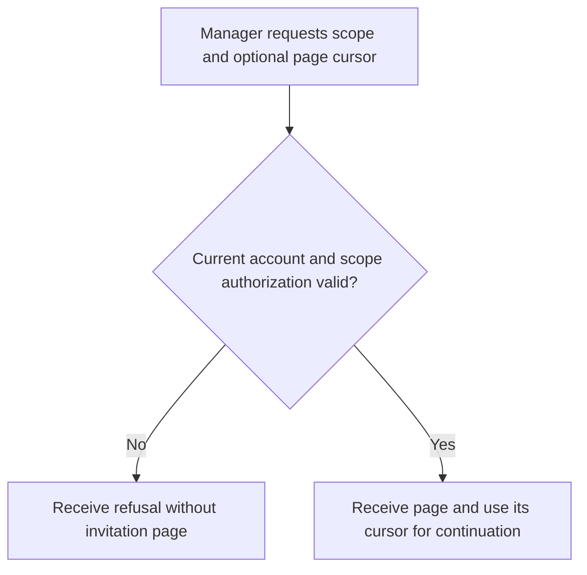
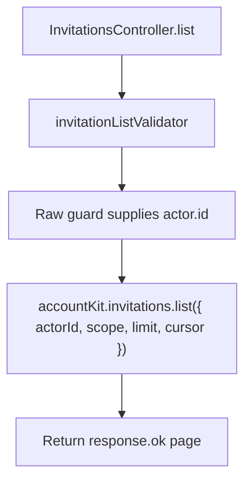

# US-API-11 — List scoped pending invitations

As an API scope manager, I want to read a page of scoped invitations so that I can select pending invitations to manage.

**Status:** Current under the stated kit and configuration conditions; source-reviewed availability.
**Access:** Raw authenticated verified account; blocker applies and Access Control callbacks enforce canonical scope/permission.
**Entry:** `GET /api/v1/account/invitations` with scope and optional pagination.
**Documentation:** [API app instructions](../../apps/api/README.md#api).
**Source:** [API routes](../../apps/api/start/routes.ts), [Invitation list handler](../../apps/api/app/controllers/invitations_controller.ts).
**Coverage:** [Existing scenario source](../../apps/api/tests/functional/account_invitations.spec.ts).

## Acceptance criteria

| Input    | Type   | Required/default/conditions                                  |
| -------- | ------ | ------------------------------------------------------------ |
| `scope`  | String | Required; trimmed positive decimal integer spelling          |
| `limit`  | Number | Optional; 1–100; defaults to 25 when omitted                 |
| `cursor` | String | Optional opaque continuation cursor from the previous result |

- `InvitationsController.list` derives `actorId` from the raw guard and returns the package's invitation page. A client's chosen scope does not bypass invitation-list authorization.
- Invalid scope/cursor/limit, unverified account or missing scope authority is refused before any invitation page is promised. Listing alone does not resend or revoke an invitation.

## User flow

## Code flow

Scope: API route and controller through the named Account Kit service boundary; the package owns its records and the handler maps the result. No runtime journey was exercised.

**Code references:** [API routes](../../apps/api/start/routes.ts), [Invitation list handler](../../apps/api/app/controllers/invitations_controller.ts), [Scope/page validator](../../apps/api/app/validators/account_kit.ts), [Access Control callbacks configuration](../../apps/api/config/account_kit.ts).
