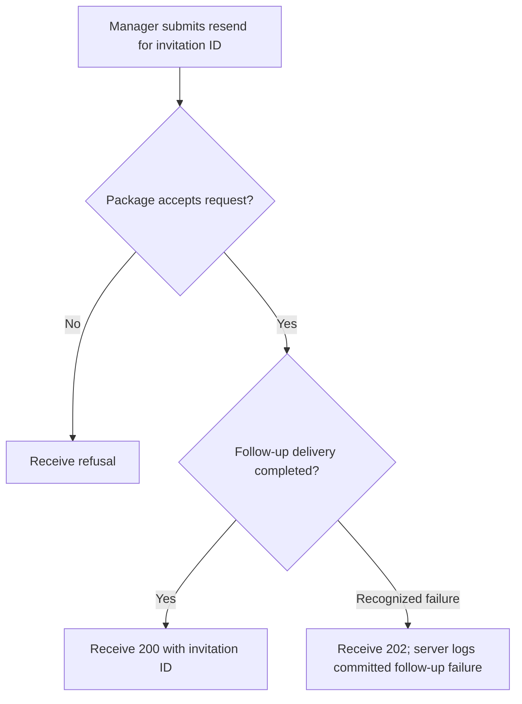
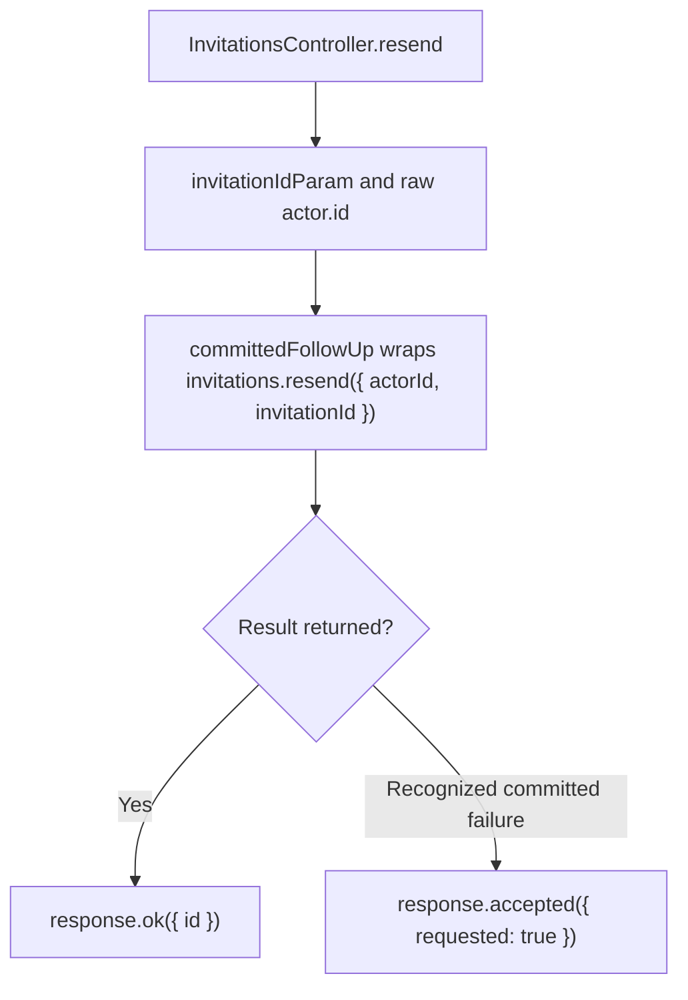

# US-API-12 — Resend a scoped invitation

As an API scope manager, I want to resend an existing invitation so that the recipient can receive a replacement link.

**Status:** Current under the stated kit and configuration conditions; source-reviewed availability.
**Access:** Raw authenticated verified account and invitation-management policy; blocker applies.
**Entry:** `POST /api/v1/account/invitations/:id/resend`.
**Documentation:** [API app instructions](../../apps/api/README.md#api).
**Source:** [API routes](../../apps/api/start/routes.ts), [Resend handler](../../apps/api/app/controllers/invitations_controller.ts).
**Coverage:** [Existing scenario source](../../apps/api/tests/functional/account_invitations.spec.ts).

## Acceptance criteria

- The route ID must convert to a positive safe integer. No recipient/role replacement field is accepted by this handler; it resends the selected invitation under package authorization.
- On normal completion, return 200 `{ id }`. A recognized delivery/post-commit failure is logged by `committedFollowUp` and returns 202 `{ requested: true }`; this acknowledges committed work without claiming delivery.
- Invalid identity, authorization or other unexpected failure propagates. Resend does not allow the caller to manage a foreign scope merely by knowing an ID.

## User flow

## Code flow

Scope: API route and controller through the named Account Kit service boundary; the package owns its records and the handler maps the result. No runtime journey was exercised.

**Code references:** [API routes](../../apps/api/start/routes.ts), [Resend handler](../../apps/api/app/controllers/invitations_controller.ts), [Committed follow-up mapper](../../apps/api/app/services/committed_failure_diagnostic.ts).
