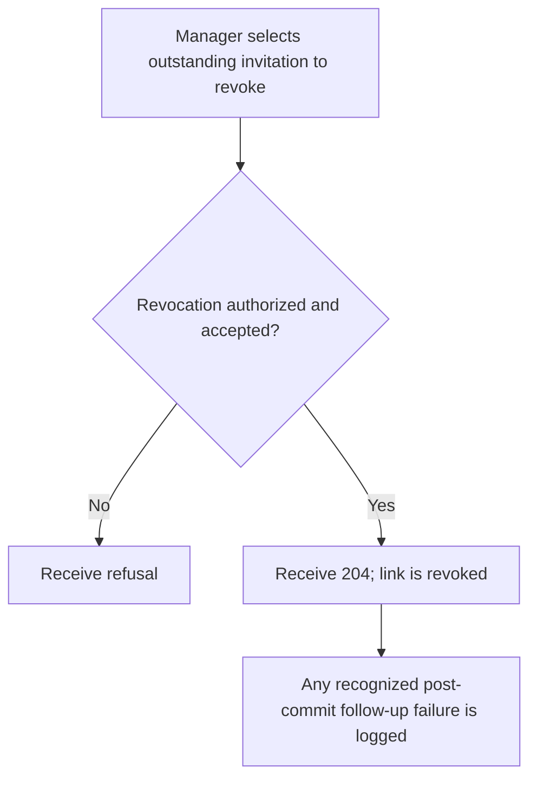
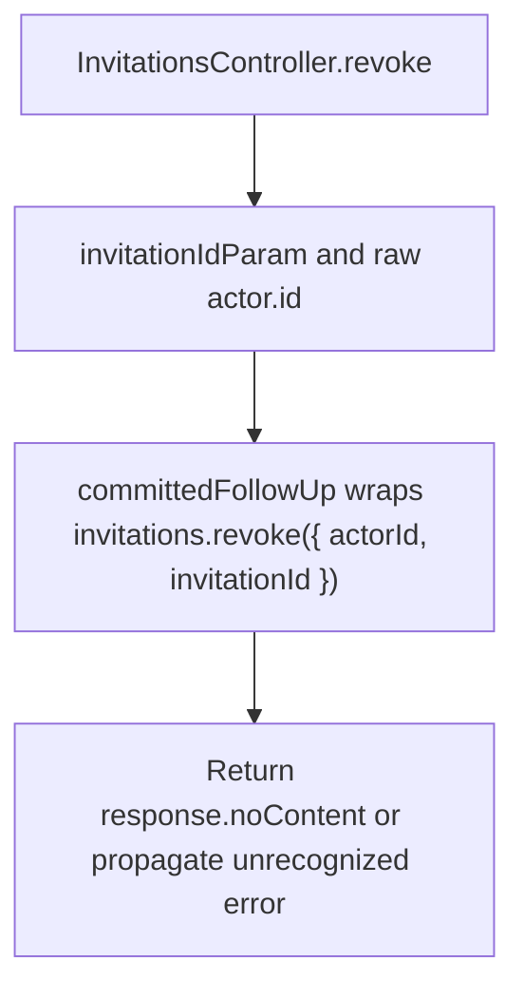

# US-API-13 — Revoke a scoped invitation

As an API scope manager, I want to revoke an outstanding invitation so that its link no longer grants acceptance.

**Status:** Current under the stated kit and configuration conditions; source-reviewed availability.
**Access:** Raw authenticated verified account authorized to manage selected invitation; blocker applies.
**Entry:** `DELETE /api/v1/account/invitations/:id`.
**Documentation:** [API app instructions](../../apps/api/README.md#api).
**Source:** [API routes](../../apps/api/start/routes.ts), [Revoke handler](../../apps/api/app/controllers/invitations_controller.ts).
**Coverage:** [Existing scenario source](../../apps/api/tests/functional/account_invitations.spec.ts).

## Acceptance criteria

- Route ID must be a positive safe integer. The controller derives `actorId` from the authenticated raw account.
- `committedFollowUp` wraps `invitations.revoke({ actorId, invitationId })`; success or a recognized post-commit failure returns 204. Recognized follow-up failures are logged rather than claiming a rollback.
- An invalid ID, authorization refusal or unexpected failure propagates. No account or existing team membership is deleted by revoking the invitation.

## User flow

## Code flow

Scope: API route and controller through the named Account Kit service boundary; the package owns its records and the handler maps the result. No runtime journey was exercised.

**Code references:** [API routes](../../apps/api/start/routes.ts), [Revoke handler](../../apps/api/app/controllers/invitations_controller.ts), [Committed follow-up mapper](../../apps/api/app/services/committed_failure_diagnostic.ts).
