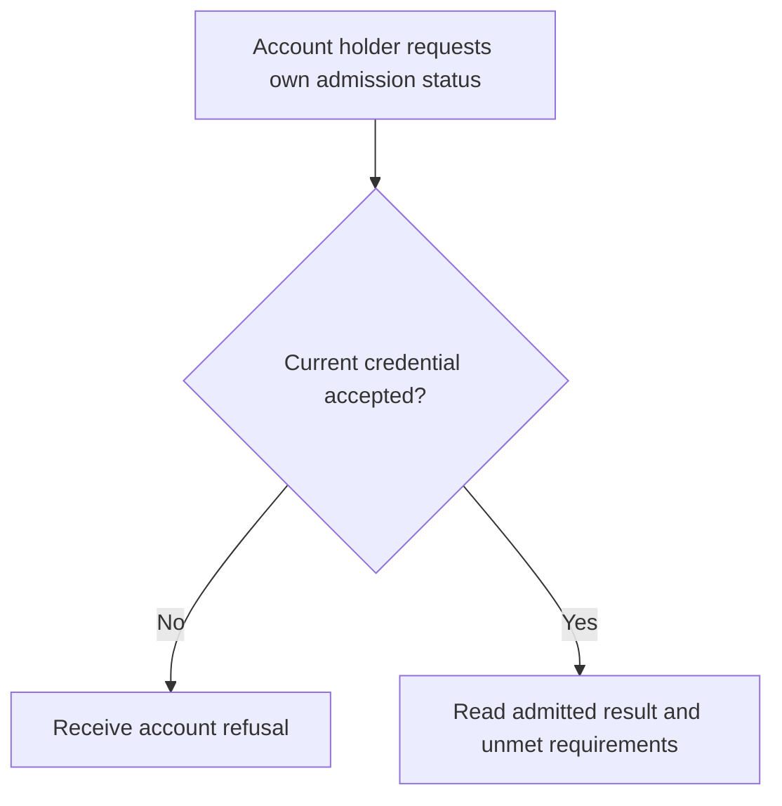
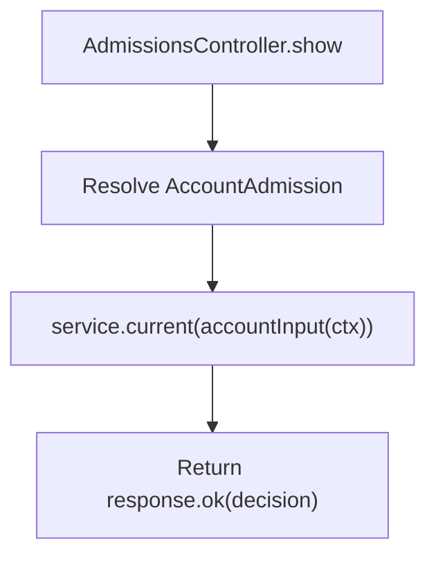

# US-API-14 — Read my admission decision

As an API account holder, I want to read my current admission requirements so that I can understand what still prevents protected-data access.

**Status:** Current under the stated kit and configuration conditions; source-reviewed availability.
**Access:** Raw authenticated account; route intentionally remains reachable while admission is pending/rejected/revoked; blocker still applies.
**Entry:** `GET /api/v1/account/admission`.
**Documentation:** [API app instructions](../../apps/api/README.md#api).
**Source:** [API routes](../../apps/api/start/routes.ts), [AdmissionsController](../../apps/api/app/controllers/admissions_controller.ts).
**Coverage:** [Existing scenario source](../../apps/api/tests/functional/admission.spec.ts).

## Acceptance criteria

- No editable input exists. `service.current(accountInput(ctx))` returns a decision; the controller returns only `decision` to the client.
- The example requires invitation evidence and owner approval, plus allowed email domain when `ACCOUNT_KIT_ADMISSION_DOMAINS` is configured. A positive individual requirement is not equivalent to an admitted overall decision.
- A stale/restricted credential can be refused by the package; being allowed to read the decision does not bypass the admitted-account gate. Decisions are learned through this status route; the admission service does not send a notification.

## User flow

## Code flow

Scope: API route and controller through the named Account Kit service boundary; the package owns its records and the handler maps the result. No runtime journey was exercised.

**Code references:** [API routes](../../apps/api/start/routes.ts), [AdmissionsController](../../apps/api/app/controllers/admissions_controller.ts), [Admission configuration](../../apps/api/config/admission.ts), [Owner authorization](../../apps/api/app/services/account_kit_authorization.ts), [Current account input](../../apps/api/app/services/account_input.ts).
