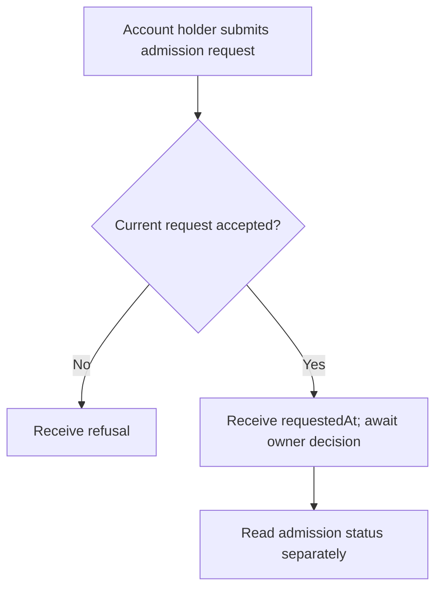
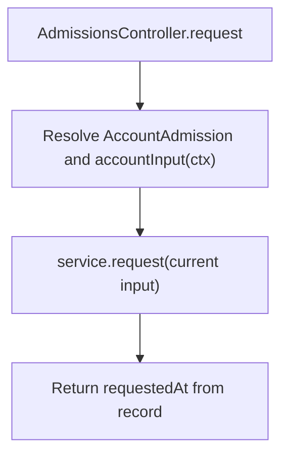

# US-API-15 — Request admission approval

As an API account holder, I want to submit my admission request so that the owner can consider approval.

**Status:** Current under the stated kit and configuration conditions; source-reviewed availability.
**Access:** Raw authenticated account even while not admitted; blocker applies. Package validates current credential context.
**Entry:** `POST /api/v1/account/admission/request`.
**Documentation:** [API app instructions](../../apps/api/README.md#api).
**Source:** [API routes](../../apps/api/start/routes.ts), [AdmissionsController](../../apps/api/app/controllers/admissions_controller.ts).
**Coverage:** [Existing scenario source](../../apps/api/tests/functional/admission.spec.ts).

## Acceptance criteria

- No operation-specific editable fields exist. The handler passes complete `accountInput(ctx)` rather than a caller-selected user ID to `service.request`.
- Success returns `{ requestedAt }`. Requesting approval does not grant approval, invitation evidence or domain eligibility.
- A refused/stale credential or inadmissible request is an error. The account holder reads US-API-14 to learn the subsequent decision; no notification is sent by this handler.

## User flow

## Code flow

Scope: API route and controller through the named Account Kit service boundary; the package owns its records and the handler maps the result. No runtime journey was exercised.

**Code references:** [API routes](../../apps/api/start/routes.ts), [AdmissionsController](../../apps/api/app/controllers/admissions_controller.ts), [Admission configuration](../../apps/api/config/admission.ts), [Owner authorization](../../apps/api/app/services/account_kit_authorization.ts), [Current account input](../../apps/api/app/services/account_input.ts).
