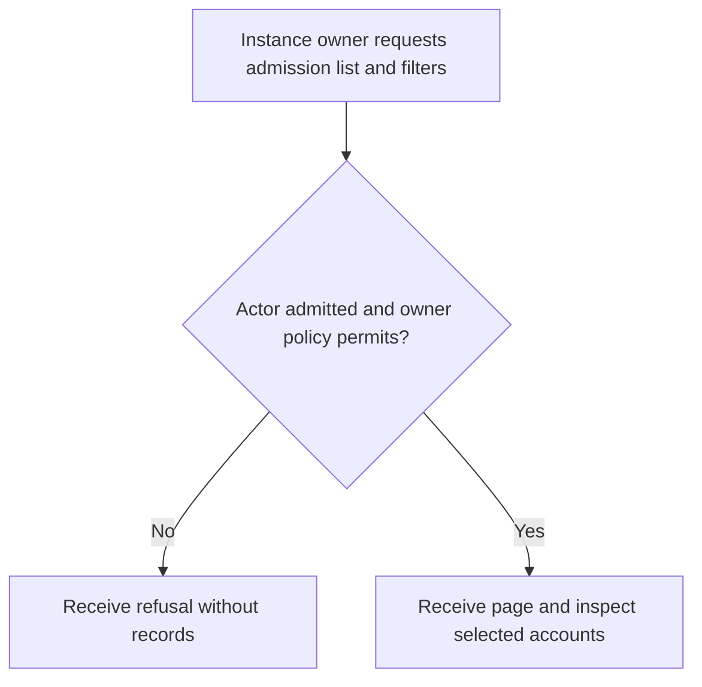
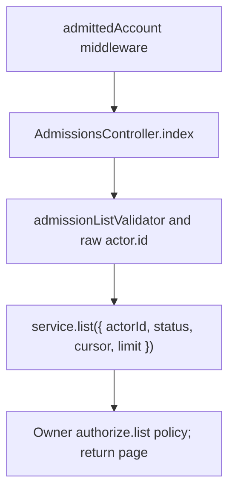

# US-API-16 — List admission records for review

As an admitted API instance owner, I want to filter and page admission records so that I can choose an account for an admission decision.

**Status:** Current under the stated kit and configuration conditions; source-reviewed availability.
**Access:** Raw authenticated account passing admittedAccount; package list callback requires instance owner role in role_assignments, separate from team owner.
**Entry:** `GET /api/v1/account/admissions`.
**Documentation:** [API app instructions](../../apps/api/README.md#api).
**Source:** [API routes](../../apps/api/start/routes.ts), [AdmissionsController](../../apps/api/app/controllers/admissions_controller.ts).
**Coverage:** [Existing scenario source](../../apps/api/tests/functional/admission.spec.ts).

## Acceptance criteria

| Input    | Type   | Required/default/conditions                           |
| -------- | ------ | ----------------------------------------------------- |
| `status` | Choice | Optional: pending, approved, rejected, revoked        |
| `limit`  | Number | Optional; from 1 to 100; package default when omitted |
| `cursor` | String | Optional opaque page continuation                     |

- `AdmissionsController.index` derives actor ID from the raw guard and passes validated filters to `service.list`. Results are the package page.
- Neither team ownership nor knowing another user ID grants this list. An unadmitted actor or a non-instance-owner is refused.
- Listing is separate from approval/rejection/revocation and does not change a record.

## User flow

## Code flow

Scope: API route and controller through the named Account Kit service boundary; the package owns its records and the handler maps the result. No runtime journey was exercised.

**Code references:** [API routes](../../apps/api/start/routes.ts), [AdmissionsController](../../apps/api/app/controllers/admissions_controller.ts), [Admission configuration](../../apps/api/config/admission.ts), [Owner authorization](../../apps/api/app/services/account_kit_authorization.ts), [Current account input](../../apps/api/app/services/account_input.ts), [List validator](../../apps/api/app/validators/admission.ts), [Admitted gate](../../apps/api/app/middleware/admitted_account_middleware.ts).
