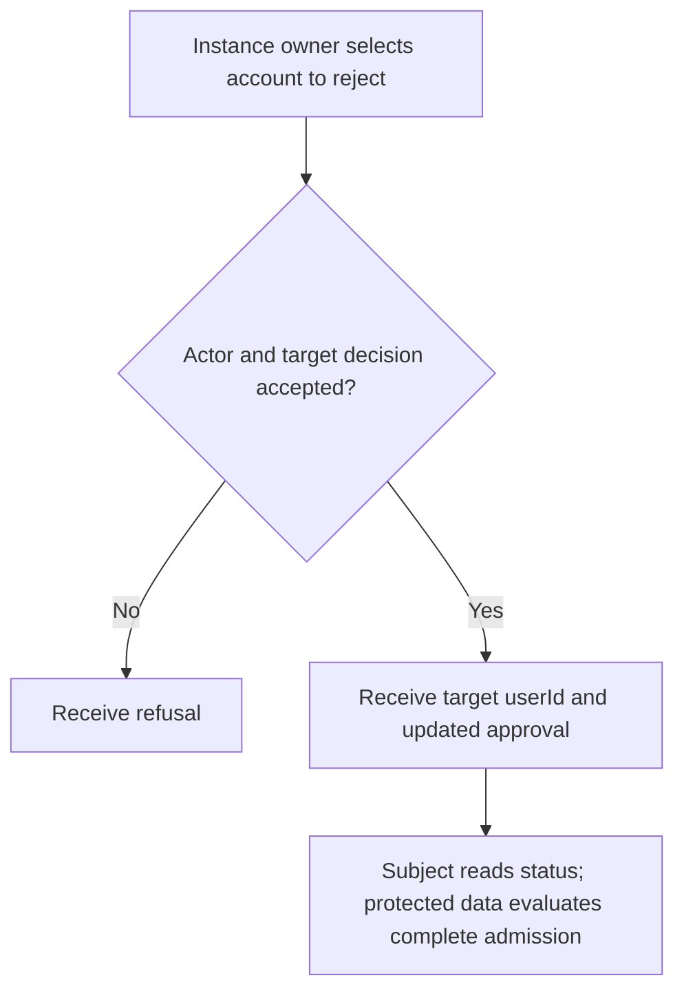
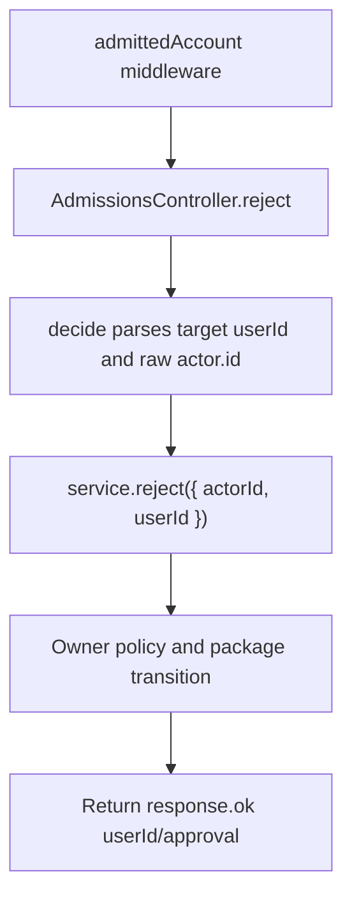

# US-API-18 — Reject an admission approval

As an admitted API instance owner, I want to reject a selected account's admission so that I can record that approval has been refused.

**Status:** Current under the stated kit and configuration conditions; source-reviewed availability.
**Access:** Raw authenticated admitted actor whose instance owner role passes admission authorize.decide; team ownership alone is insufficient.
**Entry:** `POST /api/v1/account/admissions/:id/reject`.
**Documentation:** [API app instructions](../../apps/api/README.md#api).
**Source:** [API routes](../../apps/api/start/routes.ts), [AdmissionsController](../../apps/api/app/controllers/admissions_controller.ts).
**Coverage:** [Existing scenario source](../../apps/api/tests/functional/admission.spec.ts).

## Acceptance criteria

- `id` must be a canonical positive decimal safe-integer user ID, with source spelling no longer than 64 characters. No client actor ID or approval status body is trusted by this handler.
- `AdmissionsController.reject` delegates to `decide(ctx, 'reject')`, which calls `service.reject({ actorId, userId })` and returns `{ userId, approval }`.
- This changes the approval component only. The subject can still reach its admission status/request routes; protected reports require the full current admission decision.
- Invalid ID, owner-policy refusal or package state failure is surfaced; the handler does not send a decision notification.

## User flow

## Code flow

Scope: API route and controller through the named Account Kit service boundary; the package owns its records and the handler maps the result. No runtime journey was exercised.

**Code references:** [API routes](../../apps/api/start/routes.ts), [AdmissionsController](../../apps/api/app/controllers/admissions_controller.ts), [Admission configuration](../../apps/api/config/admission.ts), [Owner authorization](../../apps/api/app/services/account_kit_authorization.ts), [Current account input](../../apps/api/app/services/account_input.ts), [Admitted route gate](../../apps/api/app/middleware/admitted_account_middleware.ts).
