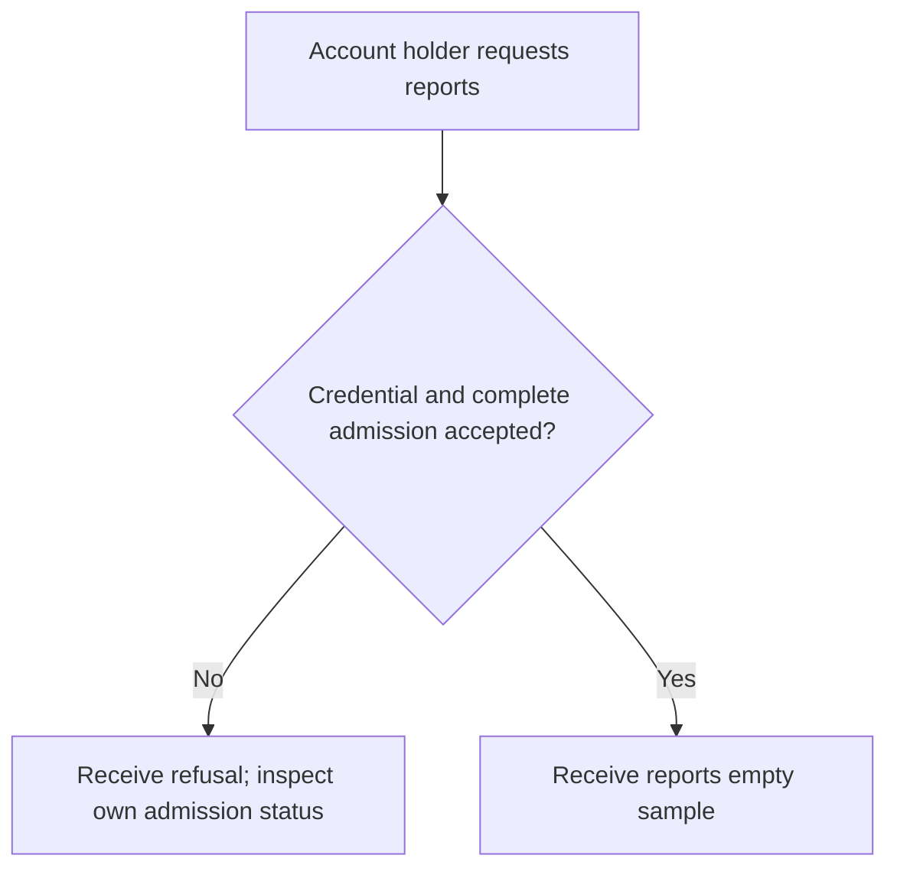
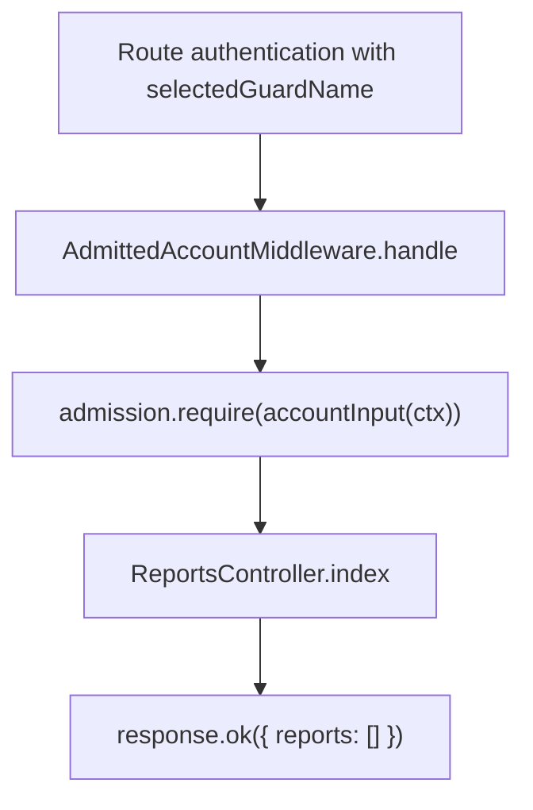

# US-API-20 — Read protected application reports

As an admitted API account holder, I want to access the protected-data sample so that I can verify the application admission boundary.

**Status:** Current under the stated kit and configuration conditions; source-reviewed availability.
**Access:** Raw authenticated account passing admittedAccount; the example rejects unmet invitation/approval/domain requirements and account restrictions.
**Entry:** `GET /api/v1/reports`.
**Documentation:** [API app instructions](../../apps/api/README.md#api).
**Source:** [API routes](../../apps/api/start/routes.ts), [ReportsController](../../apps/api/app/controllers/reports_controller.ts).
**Coverage:** [Existing scenario source](../../apps/api/tests/functional/admission.spec.ts).

## Acceptance criteria

- There are no editable fields. The current sample returns `{ reports: [] }`; it does not contain a populated report-management feature.
- Authentication runs before `AdmittedAccountMiddleware`, which invokes `AccountAdmission.require(accountInput(ctx))`. Only then does the report handler return its sample.
- An authenticated but not admitted account is refused; it can read/request its own admission through US-API-14/15. This sample uses the selected raw guard, not the team route's effective Masquerade guard.

## User flow

## Code flow

Scope: API route and controller through the named Account Kit service boundary; the package owns its records and the handler maps the result. No runtime journey was exercised.

**Code references:** [API routes](../../apps/api/start/routes.ts), [ReportsController](../../apps/api/app/controllers/reports_controller.ts), [AdmittedAccountMiddleware](../../apps/api/app/middleware/admitted_account_middleware.ts), [Admission config](../../apps/api/config/admission.ts), [Selected guard](../../apps/api/app/services/auth_strategy.ts).
