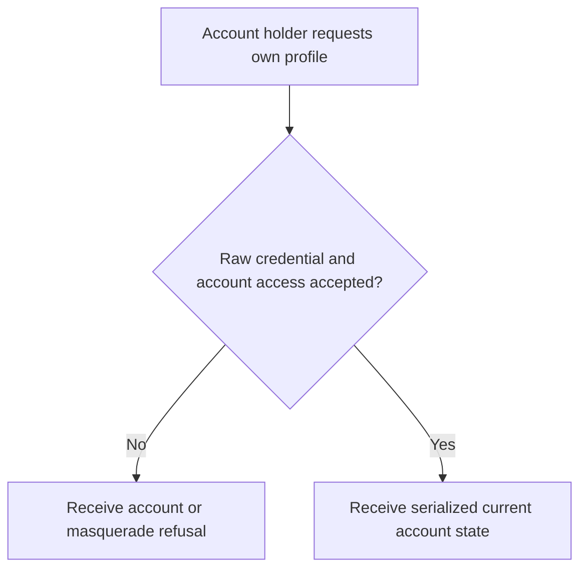
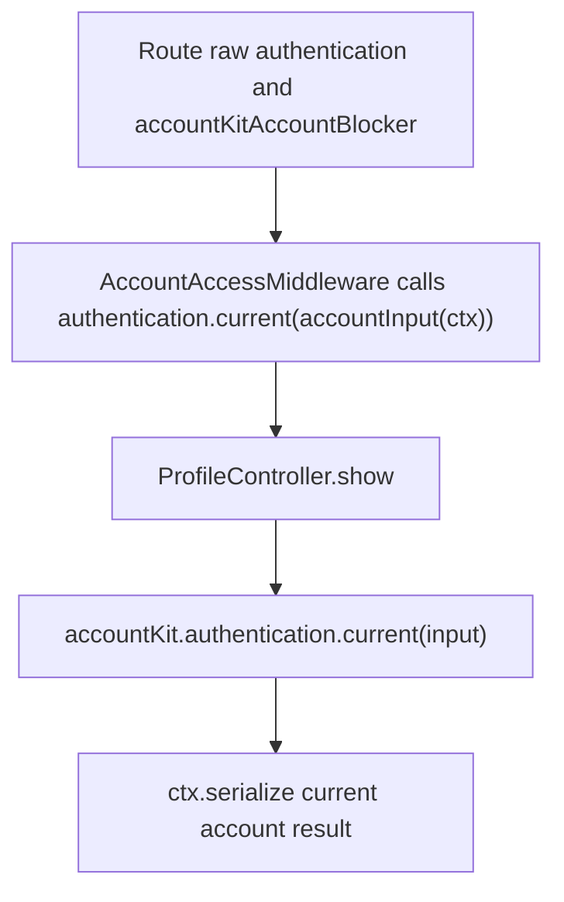

# US-API-21 — Read the current account profile

As an API account holder, I want to inspect my current account profile so that I can see the account state associated with my raw credential.

**Status:** Current in the API kit under either configured authentication strategy; source-reviewed availability.
**Access:** Raw authenticated account passing `accountAccess()` and the Account Kit blocker. Admission approval and verified-account gates are not applied to this profile-read route.
**Entry:** `GET /api/v1/account/profile`.
**Documentation:** [API app instructions](../../apps/api/README.md#api).
**Source:** [ProfileController.show](../../apps/api/app/controllers/profile_controller.ts), [API route](../../apps/api/start/routes.ts).
**Coverage:** [Profile scenarios](../../apps/api/tests/functional/account_profile_email.spec.ts).

## Acceptance criteria

- There is no editable input. `accountInput(ctx)` derives the user ID and session revision or token ID from the selected raw guard; the request does not select a different account ID.
- The controller serializes `accountKit.authentication.current(input)`. The account-access middleware checks current credentials and restrictions before the handler; stale or refused credentials do not receive a successful profile response.
- An account may inspect this profile while its address/admission is not yet sufficient for protected-data routes. Reading profile does not grant admission, verify email, or update account fields.
- Active masquerade blocks this native account operation; the endpoint does not return the target as a substitute for the credential owner.

## User flow

## Code flow

Scope: API raw-account route through current-account service and serialization; no profile mutation is performed by the handler.

**Code references:** [Route](../../apps/api/start/routes.ts), [ProfileController](../../apps/api/app/controllers/profile_controller.ts), [AccountAccessMiddleware](../../apps/api/app/middleware/account_access_middleware.ts), [accountInput](../../apps/api/app/services/account_input.ts), [strategy selector](../../apps/api/app/services/auth_strategy.ts), [profile tests](../../apps/api/tests/functional/account_profile_email.spec.ts).
