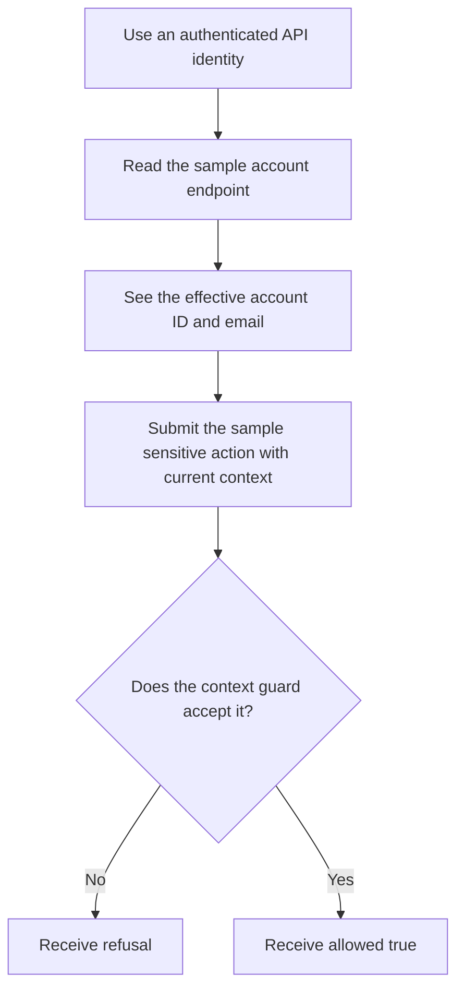
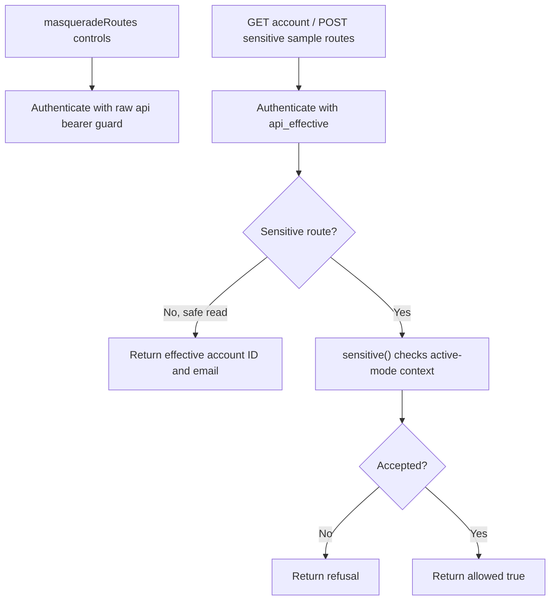

# US-API-22 — Inspect effective identity and protected sample access

As an API caller, I want to inspect the effective account and try a protected action so that I can see how the Masquerade API control guard behaves.

**Status:** Current in the API sample; source-reviewed, not runtime-tested here.
**Access:** Authenticated effective API account. Both sample routes use `api_effective` regardless of `ACCOUNT_KIT_AUTH_STRATEGY`; raw-bearer control routes use a separate guard and require `masquerade` ability in access-token mode.
**Entry:** `GET /api/v1/masquerade/account`; `POST /api/v1/masquerade/sensitive`.
**Documentation:** [API app guide](../../apps/api/README.md#api).
**Source:** [Masquerade sample routes](../../apps/api/start/masquerade_routes.ts).
**Coverage:** [Masquerade functional tests](../../apps/api/tests/functional/masquerade.spec.ts).

## Acceptance criteria

- `GET /api/v1/masquerade/account` returns effective account ID and email without changing mode.
- `POST /api/v1/masquerade/sensitive` returns `{ allowed: true }` only when the `sensitive()` guard accepts the request. In active mode, required context is enforced, including when idle.
- Business sample routes are independent of API session/access-token strategy selection. Masquerade controls authenticate the operator with the raw bearer guard and are separate from these routes.

## User flow

## Code flow

**Code references:** [Masquerade routes](../../apps/api/start/masquerade_routes.ts), [API Masquerade tests](../../apps/api/tests/functional/masquerade.spec.ts).
