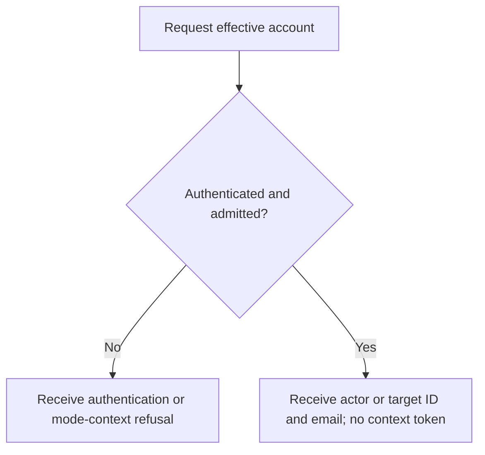
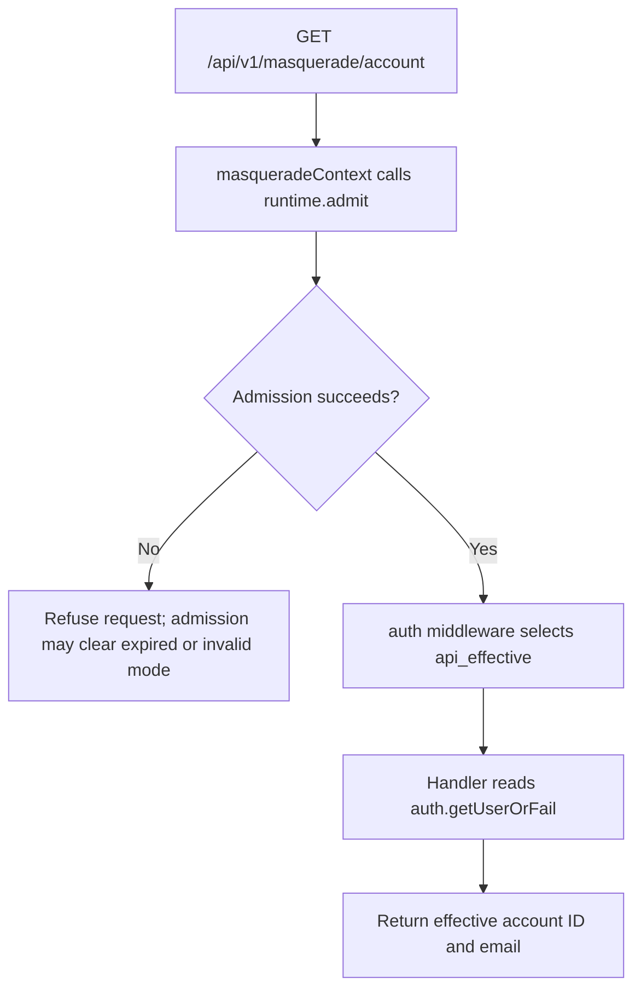

# US-API-22 — Read the effective account

As an API caller, I want to inspect the effective account so that I can see which account a business request will use.

**Status:** Current in the API sample; source-reviewed, not runtime-tested here.
**Access:** Authenticated API effective account. The sample route uses `api_effective` regardless of `ACCOUNT_KIT_AUTH_STRATEGY`.
**Entry:** `GET /api/v1/masquerade/account`.
**Documentation:** [API app guide](../../apps/api/README.md#api).
**Source:** [Masquerade sample routes](../../apps/api/start/masquerade_routes.ts), [Context middleware](../../apps/api/app/middleware/masquerade_context_middleware.ts).
**Coverage:** [Masquerade functional tests](../../apps/api/tests/functional/masquerade.spec.ts).

## Acceptance criteria

- There is no editable input. The route returns the effective account ID and email: the actor while idle or the target during a valid active mode. It does not return a context token.
- Admission may expire or invalidate an active mode and refuse the triggering request. The caller can refresh status after a refusal; the request does not retry under the actor identity.
- The business route uses `api_effective` in either API authentication strategy. Its account and effects are separate from the raw-bearer `api` guard used by Masquerade controls.

## User flow

## Code flow

Scope: the mounted effective-identity business route and its admission middleware.

**Code references:** [Mounted sample and context integration](../../apps/api/start/masquerade_routes.ts), [Context middleware](../../apps/api/app/middleware/masquerade_context_middleware.ts), [Context middleware kernel order](../../apps/api/start/kernel.ts), [API Masquerade tests](../../apps/api/tests/functional/masquerade.spec.ts).
