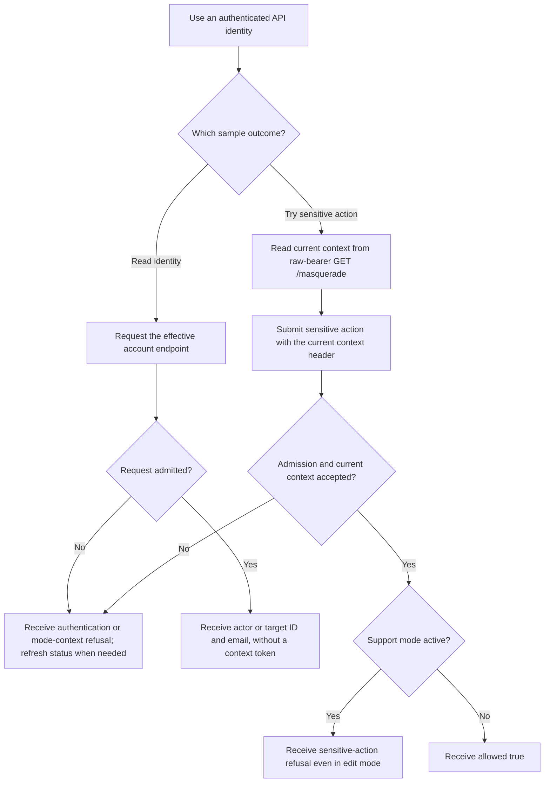
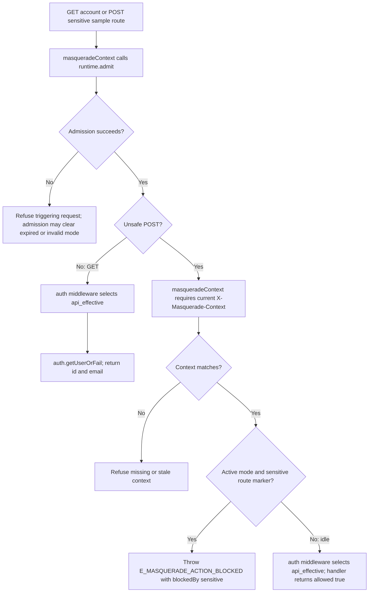

# US-API-22 — Inspect effective identity and protected sample access

As an API caller, I want to inspect the effective account and try a protected action so that I can see how the Masquerade API control guard behaves.

**Status:** Current in the API sample; source-reviewed, not runtime-tested here.
**Access:** Authenticated effective API account. Both sample routes use `api_effective` regardless of `ACCOUNT_KIT_AUTH_STRATEGY`; raw-bearer control routes use a separate guard and require `masquerade` ability in access-token mode.
**Entry:** `GET /api/v1/masquerade/account`; `POST /api/v1/masquerade/sensitive`.
**Documentation:** [API app guide](../../apps/api/README.md#api).
**Source:** [Masquerade sample routes](../../apps/api/start/masquerade_routes.ts).
**Coverage:** [Masquerade functional tests](../../apps/api/tests/functional/masquerade.spec.ts).

## Acceptance criteria

- **Effective identity read:** `GET /api/v1/masquerade/account` returns the admitted effective account ID and email: the actor while idle or target during valid active mode. Admission may expire or invalidate an active mode and refuse the triggering request; this read does not promise unchanged mode state in every case. It does not return a context token.
- **Sensitive action:** first read current context with raw-bearer `GET /masquerade`. `POST /api/v1/masquerade/sensitive` requires the current `X-Masquerade-Context` even while idle. Missing or stale context is refused. Any active mode is refused by the sensitive route marker, including edit mode with valid context; only admitted idle state with valid context reaches the handler returning `{ allowed: true }`.
- `sensitive()` marks the route. `masqueradeContext` enforces admission, context freshness and the sensitive marker before the sample handler runs; it is not a separate context-validation guard.
- Both business samples explicitly use `api_effective` regardless of `ACCOUNT_KIT_AUTH_STRATEGY`. Their authentication and effects are separate from the raw `api` bearer guard used by `/masquerade` controls. A safe identity read does not require an unsafe context header.

## User flow

## Code flow

Scope: the two mounted business routes; the raw status endpoint supplies the POST prerequisite context token.

**Code references:** [Mounted samples and sensitive marker](../../apps/api/start/masquerade_routes.ts), [Context middleware](../../apps/api/app/middleware/masquerade_context_middleware.ts), [Enforcement configuration](../../apps/api/config/masquerade.ts), [Context middleware kernel order](../../apps/api/start/kernel.ts), [API Masquerade tests](../../apps/api/tests/functional/masquerade.spec.ts).
