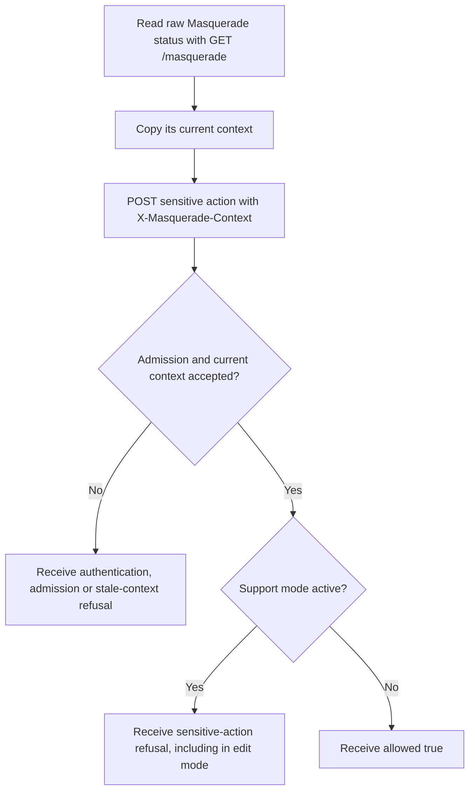
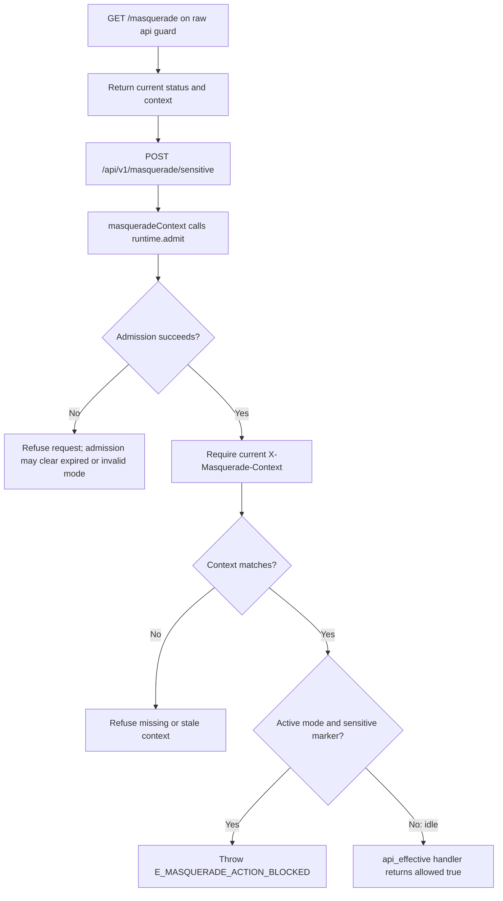

# US-API-23 — Try a sensitive action during support mode

As an API caller, I want to try a protected sample action so that I can see when Masquerade blocks sensitive work.

**Status:** Current in the API sample; source-reviewed, not runtime-tested here.
**Access:** Authenticated API effective account with a current Masquerade context. Access-token control requests also require the `masquerade` ability. The sample route uses `api_effective` regardless of `ACCOUNT_KIT_AUTH_STRATEGY`.
**Entry:** Read `GET /masquerade` with the raw bearer credential, then send `POST /api/v1/masquerade/sensitive` with its current `X-Masquerade-Context`.
**Documentation:** [API app guide](../../apps/api/README.md#api).
**Source:** [Masquerade sample route and sensitive marker](../../apps/api/start/masquerade_routes.ts), [Context middleware](../../apps/api/app/middleware/masquerade_context_middleware.ts).
**Coverage:** [Masquerade functional tests](../../apps/api/tests/functional/masquerade.spec.ts).

## Acceptance criteria

- `GET /masquerade` uses the raw bearer control guard and provides the current context. The effective-identity GET in [US-API-22](us-api-22-read-masquerade-sample.md) does not provide this token.
- The sensitive POST requires the current context header even while idle. Missing or stale context is refused.
- The route's `sensitive()` marker blocks the action whenever support mode is active, including edit mode with valid context. Only an admitted idle state with current context reaches the handler and returns `{ allowed: true }`.
- Admission can expire or invalidate a mode and refuse the triggering request. The caller must refresh the raw control status before retrying.

## User flow

## Code flow

Scope: the mounted sensitive sample route and the raw control endpoint that supplies its prerequisite context.

**Code references:** [Raw control mount and sample marker](../../apps/api/start/masquerade_routes.ts), [Context middleware](../../apps/api/app/middleware/masquerade_context_middleware.ts), [Enforcement configuration](../../apps/api/config/masquerade.ts), [Context middleware kernel order](../../apps/api/start/kernel.ts), [API Masquerade tests](../../apps/api/tests/functional/masquerade.spec.ts).
