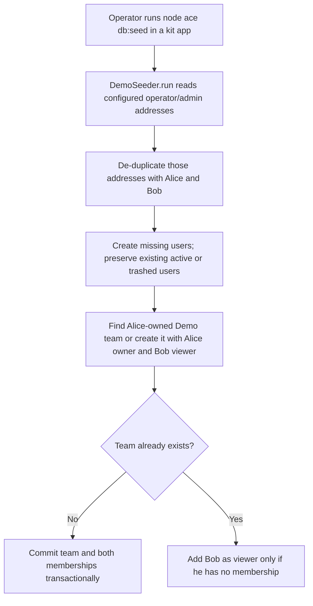
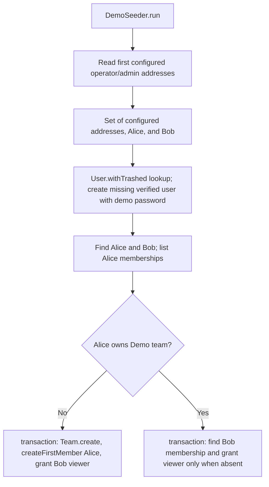

# US-DEMO-01 — Seed demo accounts and team data

As an example-app operator, I want to seed the configured demo accounts and team so that I can use the walkthrough with repeatable data.

**Status:** Demo; the seeder prepares walkthrough data, not a normal account action.
**Access:** Operator running the kit seeder against its configured Lucid database after migrations.
**Entry:** From an app directory: `node ace db:seed`.
**Documentation:** [Hypermedia quick start](../../apps/hypermedia/README.md#try-it).
**Source:** [Hypermedia demo seeder](../../apps/hypermedia/database/seeders/demo_seeder.ts).
**Coverage:** [Demo seeder functional tests](../../apps/hypermedia/tests/functional/demo_seeder.spec.ts); this link identifies source behavior coverage, not runtime verification of these docs.

## Acceptance criteria

- There are no form fields; the operator runs the seeder after database migrations.
- The seeder considers the first configured Masquerade operator address, first configured soft-delete administrator address, Alice, and Bob; duplicate addresses are de-duplicated. Existing users, including soft-deleted users, are preserved and not reset.
- Newly created addresses receive a name from the email prefix, `DemoPassword123!`, and a confirmed email. The number of created accounts depends on configured addresses and existing rows.
- Alice's owned `Demo team` is created with Bob as a viewer in one transaction when no matching team exists. If the matching owned team already exists, the seeder adds Bob as viewer only when he has no membership; an existing Bob membership is left as-is.
- Database or transaction failures surface from the seeder. The configured database is used; no in-memory storage is substituted.

## User flow

## Code flow

**Code references:** [Hypermedia seeder](../../apps/hypermedia/database/seeders/demo_seeder.ts), [Masquerade operator configuration](../../apps/hypermedia/app/services/masquerade_operators.ts), [Soft-delete administrator configuration](../../apps/hypermedia/app/services/soft_delete_admins.ts), [Access Control configuration](../../apps/hypermedia/config/access_control.ts), [Demo seeder tests](../../apps/hypermedia/tests/functional/demo_seeder.spec.ts), [React seeder](../../apps/inertia-react/database/seeders/demo_seeder.ts), [Vue seeder](../../apps/inertia-vue/database/seeders/demo_seeder.ts).
