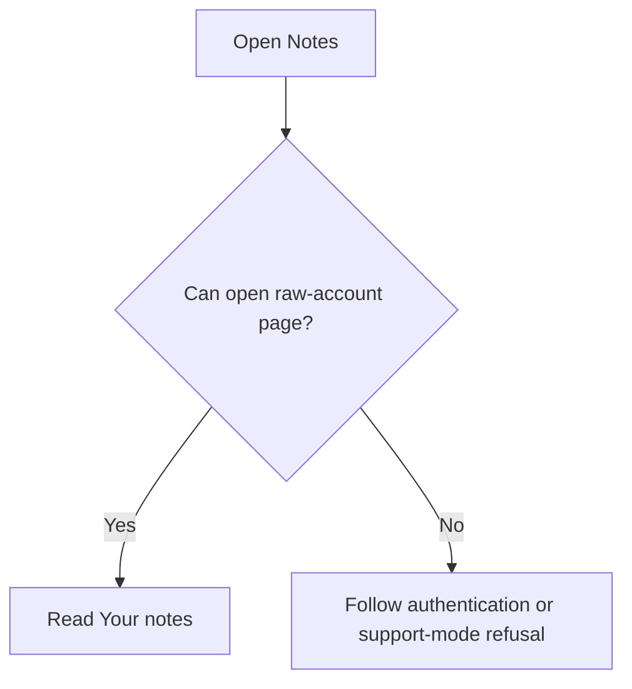
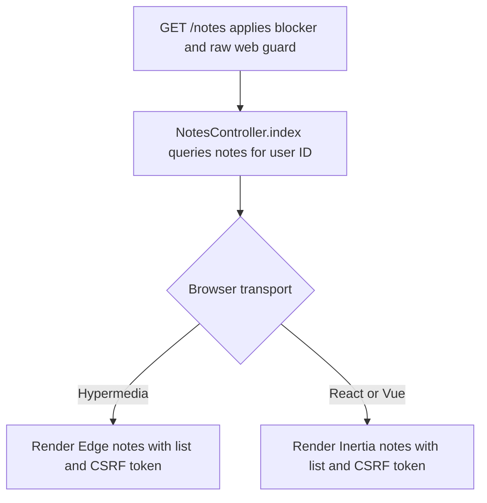

# US-NOTE-01 — Review my notes

As a signed-in browser account holder, I want to review my ordinary notes so that I can see what I have saved.

**Status:** Current
**Access:** Raw signed-in browser account. The Account Kit blocker applies during support mode.
**Entry:** Open **Notes** from the dashboard or visit `GET /notes`.
**Documentation:** [Retry-safe notes](../../docs/cookbook/duplicate-request-guard.md).
**Source:** [api](../../apps/api/app/controllers/notes_controller.ts), [hypermedia](../../apps/hypermedia/app/controllers/notes_controller.ts), [inertia-react](../../apps/inertia-react/app/controllers/notes_controller.ts), [inertia-vue](../../apps/inertia-vue/app/controllers/notes_controller.ts)
**Coverage:** [hypermedia](../../apps/hypermedia/tests/browser/notes.spec.ts), [inertia-react](../../apps/inertia-react/tests/browser/notes.spec.ts), [inertia-vue](../../apps/inertia-vue/tests/browser/notes.spec.ts), [api](../../apps/api/tests/functional/notes.spec.ts)

## Acceptance criteria

- **Your notes** lists the saved note body for the raw signed-in account. The page can be empty. Hypermedia renders the initial list without JavaScript. React and Vue require JavaScript to render it.
- The API starter exposes note creation only. Secure notes are shown separately in account settings.

## User flow

## Code flow

**Code references:** [api](../../apps/api/start/notes_routes.ts), [hypermedia](../../apps/hypermedia/start/notes_routes.ts), [inertia-react](../../apps/inertia-react/start/notes_routes.ts), [inertia-vue](../../apps/inertia-vue/start/notes_routes.ts); [api](../../apps/api/app/controllers/notes_controller.ts), [hypermedia](../../apps/hypermedia/app/controllers/notes_controller.ts), [inertia-react](../../apps/inertia-react/app/controllers/notes_controller.ts), [inertia-vue](../../apps/inertia-vue/app/controllers/notes_controller.ts). [React SSR configuration](../../apps/inertia-react/config/inertia.ts), [Vue SSR configuration](../../apps/inertia-vue/config/inertia.ts). [Package handoffs](../REFERENCE.md#package-handoffs).
