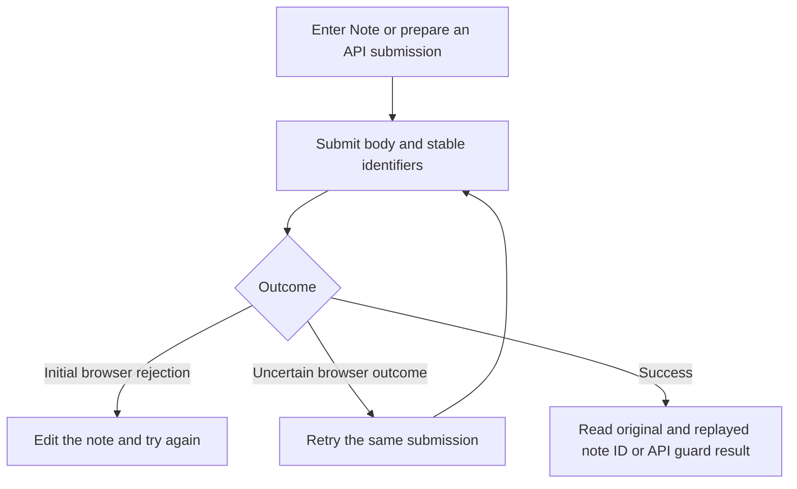
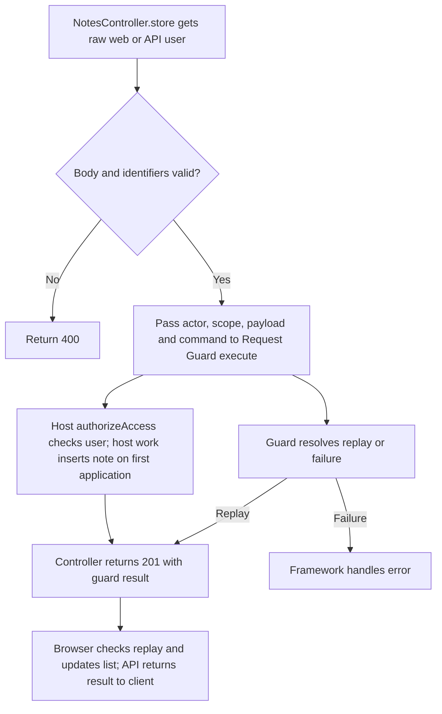

# US-NOTE-02 — Create and retry a note

As a signed-in account holder, I want to submit a note and retry that submission so that I can recover its original result without adding another copy.

**Status:** Current
**Access:** Raw signed-in browser account. The Account Kit blocker applies during support mode. The API requires an admitted account, applies the blocker and supports this example on SQLite.
**Entry:** Browser **Create and retry** at `/notes`; API `POST /api/v1/notes`.
**Documentation:** [Retry-safe notes](../../docs/cookbook/duplicate-request-guard.md).
**Source:** [api](../../apps/api/app/controllers/notes_controller.ts), [hypermedia](../../apps/hypermedia/app/controllers/notes_controller.ts), [inertia-react](../../apps/inertia-react/app/controllers/notes_controller.ts), [inertia-vue](../../apps/inertia-vue/app/controllers/notes_controller.ts)
**Coverage:** [hypermedia](../../apps/hypermedia/tests/browser/notes.spec.ts), [inertia-react](../../apps/inertia-react/tests/browser/notes.spec.ts), [inertia-vue](../../apps/inertia-vue/tests/browser/notes.spec.ts), [api](../../apps/api/tests/functional/notes.spec.ts)

## Acceptance criteria

- Browser **Note** is a required, initially empty textarea. It needs JavaScript. The page creates a command ID and a request key, then sends the same body and identifiers twice with the CSRF token. The app requires a string containing at least one non-whitespace character and stores the original body.
- API requests supply `body`, `commandId` and `requestKey` as strings. Both identifiers are required and nonempty. Reuse the original body and both identifiers for a retry. The handler responds with HTTP 201 and the guard result, including `replayed` and `result.noteId`.
- The browser verifies the second response is a replay of the first note ID and appends one item to **Your notes**. When the initial request is explicitly rejected with HTTP 400 or 413, the browser makes the note editable for correction. When the outcome is uncertain, **Retry submission** reuses the same identifiers and body while the page remains open.

## User flow

## Code flow

**Code references:** [api](../../apps/api/start/notes_routes.ts), [hypermedia](../../apps/hypermedia/start/notes_routes.ts), [inertia-react](../../apps/inertia-react/start/notes_routes.ts), [inertia-vue](../../apps/inertia-vue/start/notes_routes.ts); [api](../../apps/api/app/controllers/notes_controller.ts), [hypermedia](../../apps/hypermedia/app/controllers/notes_controller.ts), [inertia-react](../../apps/inertia-react/app/controllers/notes_controller.ts), [inertia-vue](../../apps/inertia-vue/app/controllers/notes_controller.ts). The guard contract is linked in the cookbook. [Package handoffs](../REFERENCE.md#package-handoffs).
