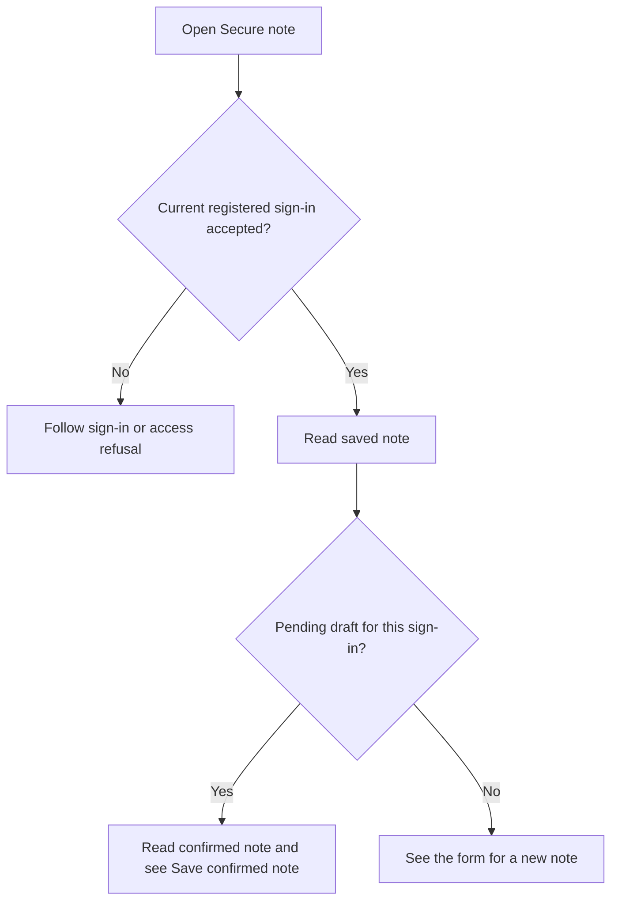
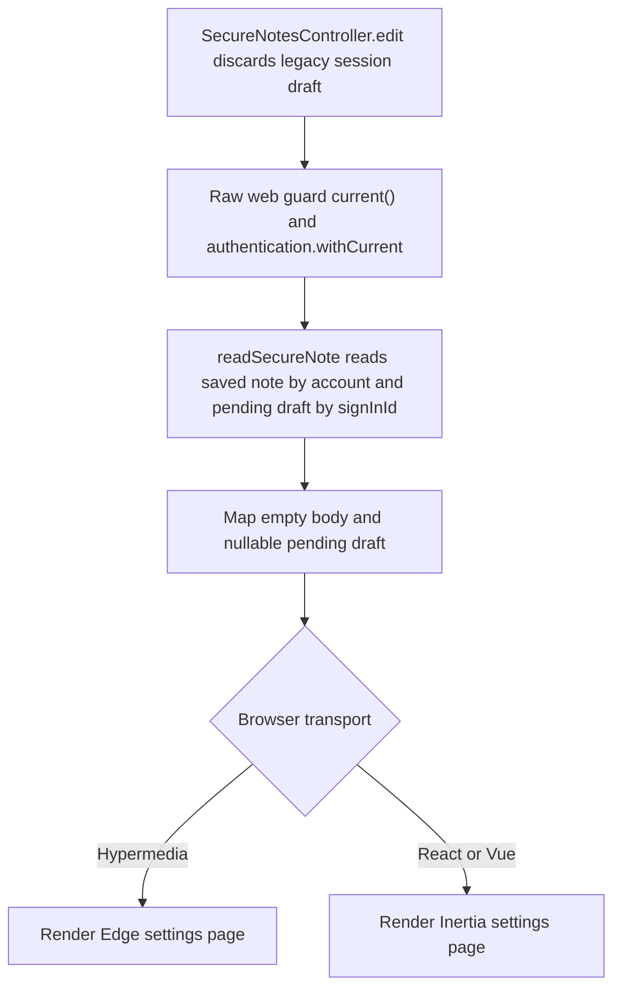

# US-NOTE-03 — Open my secure note

As a signed-in browser account holder, I want to open the secure-note settings page so that I can see my saved note and any confirmation I started in this sign-in.

**Status:** Current
**Access:** Raw signed-in browser account. The Account Kit blocker applies during support mode. Uses a current registered Account Kit sign-in.
**Entry:** Open **Secure note** at `GET /settings/secure-note` in Hypermedia, React or Vue.
**Documentation:** [Password confirmation recipe](../../docs/cookbook/password-confirmation.md).
**Source:** [hypermedia](../../apps/hypermedia/app/controllers/secure_notes_controller.ts), [inertia-react](../../apps/inertia-react/app/controllers/secure_notes_controller.ts), [inertia-vue](../../apps/inertia-vue/app/controllers/secure_notes_controller.ts)
**Coverage:** [hypermedia](../../apps/hypermedia/tests/browser/secure_note_journey.spec.ts), [inertia-react](../../apps/inertia-react/tests/browser/secure_note_journey.spec.ts), [inertia-vue](../../apps/inertia-vue/tests/browser/secure_note_journey.spec.ts)

## Acceptance criteria

- **Saved note** displays the account's saved note, or an empty value if it has never been saved.
- **Confirmed note** and **Save confirmed note** appear if a pending draft exists for the current sign-in. The page read does not itself consume or validate the draft's confirmation. A later save may ask for a new confirmation.
- **New note** starts empty. The saved value and any pending draft are displayed separately.

## User flow

## Code flow

**Code references:** [hypermedia](../../apps/hypermedia/start/secure_note_routes.ts), [inertia-react](../../apps/inertia-react/start/secure_note_routes.ts), [inertia-vue](../../apps/inertia-vue/start/secure_note_routes.ts); [hypermedia](../../apps/hypermedia/app/controllers/secure_notes_controller.ts), [inertia-react](../../apps/inertia-react/app/controllers/secure_notes_controller.ts), [inertia-vue](../../apps/inertia-vue/app/controllers/secure_notes_controller.ts). [Secure-note service](../../apps/hypermedia/app/services/secure_notes.ts). [Package handoffs](../REFERENCE.md#package-handoffs).
