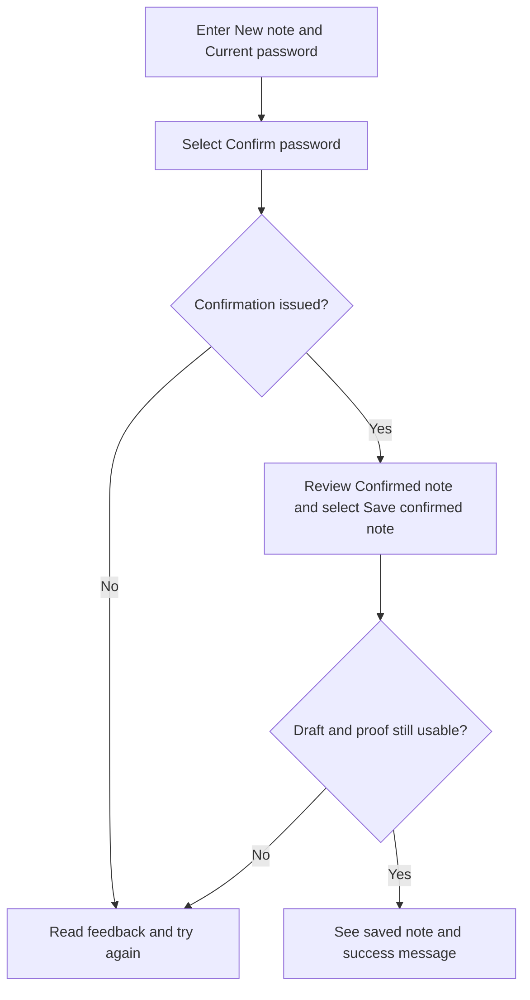
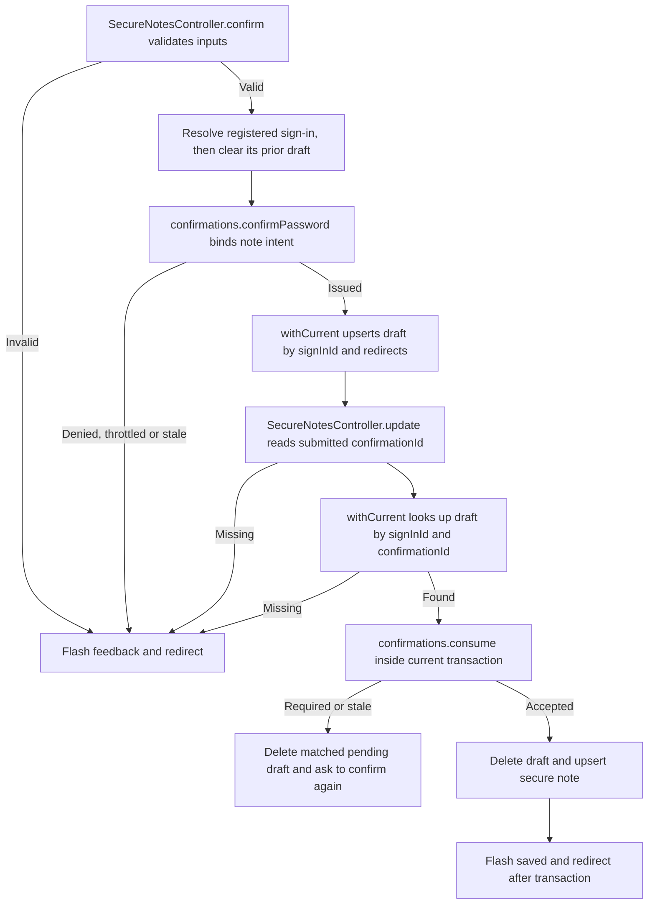

# US-NOTE-04 — Save a secure note after confirmation

As a signed-in browser account holder, I want to confirm my password and save a secure note so that the stored note matches the change I approved.

**Status:** Current
**Access:** Raw signed-in browser account. The Account Kit blocker applies during support mode. Uses a current registered Account Kit sign-in.
**Entry:** On **Secure note**, select **Confirm password**, then **Save confirmed note**.
**Documentation:** [Password confirmation recipe](../../docs/cookbook/password-confirmation.md).
**Source:** [hypermedia](../../apps/hypermedia/app/controllers/secure_notes_controller.ts), [inertia-react](../../apps/inertia-react/app/controllers/secure_notes_controller.ts), [inertia-vue](../../apps/inertia-vue/app/controllers/secure_notes_controller.ts)
**Coverage:** [hypermedia](../../apps/hypermedia/tests/browser/secure_note_journey.spec.ts), [inertia-react](../../apps/inertia-react/tests/browser/secure_note_journey.spec.ts), [inertia-vue](../../apps/inertia-vue/tests/browser/secure_note_journey.spec.ts)

## Acceptance criteria

- **New note** is an initially empty required text field, 1 to 500 characters. **Current password** is a required password field. The browser submits both to `POST /settings/secure-note/confirm`.
- A valid-shaped confirmation request clears the previous pending draft for this sign-in before asking the password confirmation service to issue a proof. Incorrect password, throttling, or a stale attempt shows feedback and offers a new attempt.
- Successful confirmation displays **Confirmed note**, a read-only draft, and **Save confirmed note**. That form sends the hidden `confirmationId` to `POST /settings/secure-note`. The handler takes the body from the matching server-side draft. Saving an older confirmation from another tab leaves a newer draft in place.
- Save consumes the proof, clears the draft and inserts or replaces the account's secure note in the same transaction. A missing draft asks for confirmation. A required or stale proof clears the stale draft and asks again. Successful save shows **Secure note saved.**

## User flow

## Code flow

**Code references:** [hypermedia](../../apps/hypermedia/start/secure_note_routes.ts), [inertia-react](../../apps/inertia-react/start/secure_note_routes.ts), [inertia-vue](../../apps/inertia-vue/start/secure_note_routes.ts); [hypermedia](../../apps/hypermedia/app/controllers/secure_notes_controller.ts), [inertia-react](../../apps/inertia-react/app/controllers/secure_notes_controller.ts), [inertia-vue](../../apps/inertia-vue/app/controllers/secure_notes_controller.ts). The cookbook links the Account Kit and password confirmation handoffs. [Package handoffs](../REFERENCE.md#package-handoffs).
