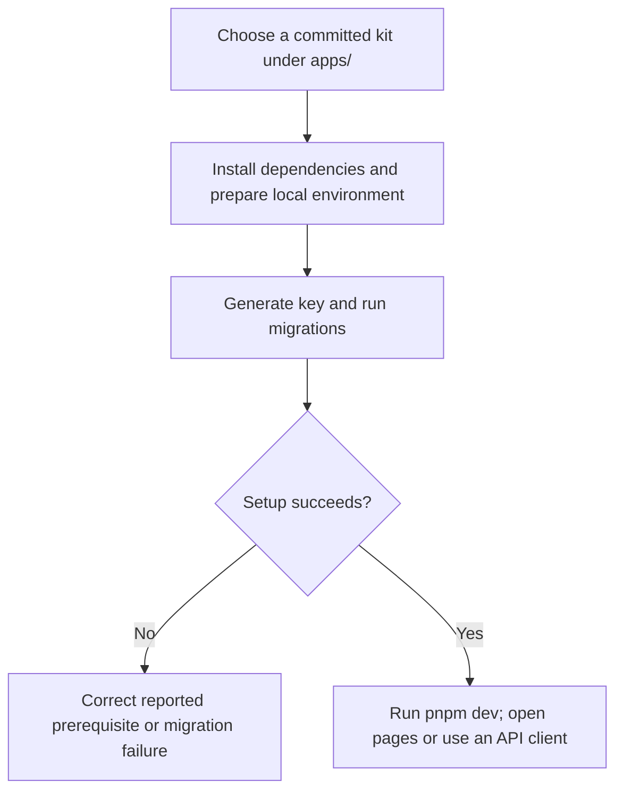
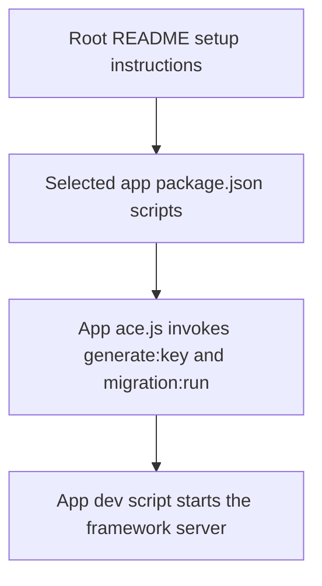

# US-OPS-01 — Run a committed app

As an app operator, I want to install and start one committed app so that I can try its configured account and business journeys locally.

**Status:** Operator; source-reviewed availability, not runtime-tested.
**Access:** App operator with the selected app, supported Node 24/pnpm toolchain and filesystem access.
**Entry:** From `apps/<kit>`: `pnpm install --frozen-lockfile`, copy `.env.example` to `.env`, `node ace generate:key`, `node ace migration:run`, then `pnpm dev`.
**Documentation:** [Run an app](../../README.md#run-an-app).
**Source:** [Hypermedia app manifest](../../apps/hypermedia/package.json), [Hypermedia Ace entry](../../apps/hypermedia/ace.js).

## Acceptance criteria

- Select `api`, `hypermedia`, `inertia-react` or `inertia-vue`. Run the documented setup sequence from `apps/<kit>` with its own environment and database settings.
- Browser kits serve their pages; the API kit exposes HTTP endpoints for a client. Starting the server does not establish that any documented journey was tested.
- After migrations, the separate demo seeder can prepare example records. A failed install, key generation, migration or startup must be corrected before continuing.
- Make app and cookbook changes in this repository's committed app directories; package repositories own package implementation and package-local checks. The root README records this ownership and release boundary.

## User flow

## Code flow

Scope: Documented host setup sequence and app-owned entry points; this story does not claim those commands or an app journey were run.

**Code references:** [App README](../../apps/hypermedia/README.md#run-it), [Hypermedia scripts](../../apps/hypermedia/package.json), [API scripts](../../apps/api/package.json), [React scripts](../../apps/inertia-react/package.json), [Vue scripts](../../apps/inertia-vue/package.json), [App Ace entry](../../apps/hypermedia/ace.js).
