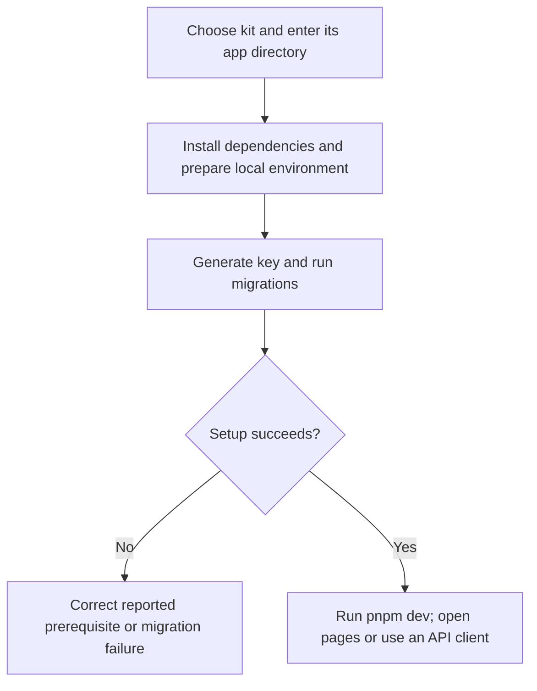
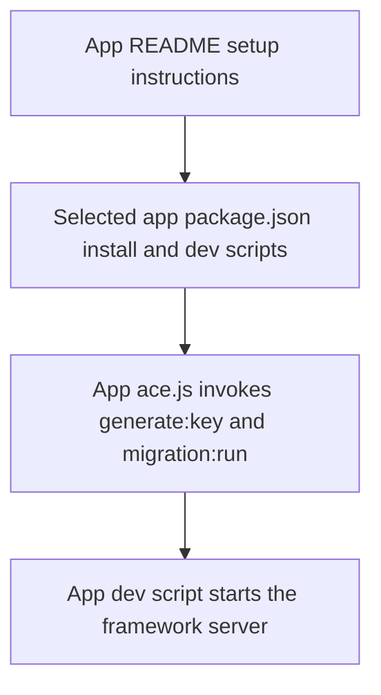

# US-OPS-01 — Run an assembled starter kit

As an application operator, I want to install and start one assembled kit so that I can try its configured account and business journeys locally.

**Status:** Operator; source-reviewed availability, not runtime-tested.
**Access:** Sandbox maintainer with the selected kit sources, supported Node 24/pnpm toolchain and filesystem access.
**Entry:** From `apps/<kit>`: `pnpm install`, copy `.env.example` to `.env`, `node ace generate:key`, `node ace migration:run`, then `pnpm dev`.
**Documentation:** [Repository instructions](../../README.md).
**Source:** [App README](../../apps/hypermedia/README.md#run-it).

## Acceptance criteria

- Select `api`, `hypermedia`, `inertia-react` or `inertia-vue`. Run the documented setup sequence from that app directory with its own environment/database settings.
- Browser kits serve their pages; the API kit exposes HTTP endpoints for a client. Starting the server does not establish that any documented journey was tested.
- After migrations, the separate demo seeder can prepare example records. A failed install, key generation, migration or startup must be corrected before continuing.
- Generated `apps/` files are assembled artifacts; make maintained changes in package examples or sandbox layers, then assemble again.

## User flow

## Code flow

Scope: Documented host setup sequence and app-owned entry points; this story does not claim those commands or an app journey were run.

**Code references:** [App README](../../apps/hypermedia/README.md#run-it), [Hypermedia scripts](../../apps/hypermedia/package.json), [API scripts](../../apps/api/package.json), [React scripts](../../apps/inertia-react/package.json), [Vue scripts](../../apps/inertia-vue/package.json), [App Ace entry](../../apps/hypermedia/ace.js).
