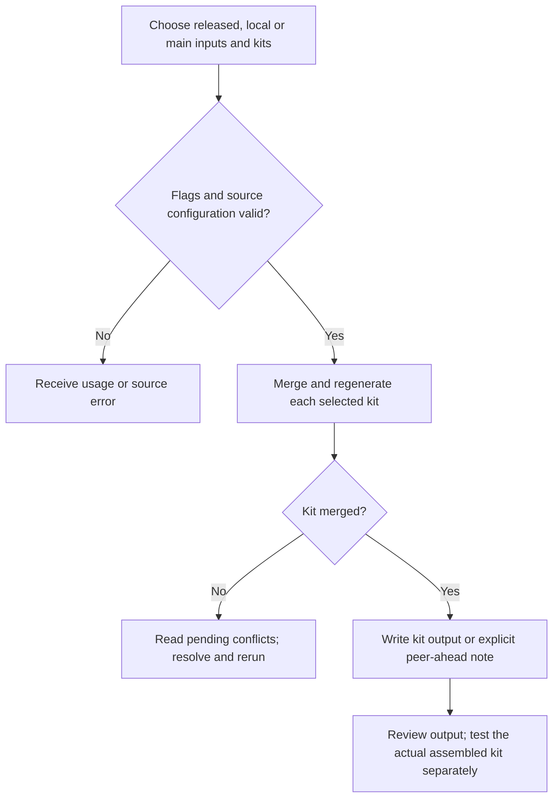
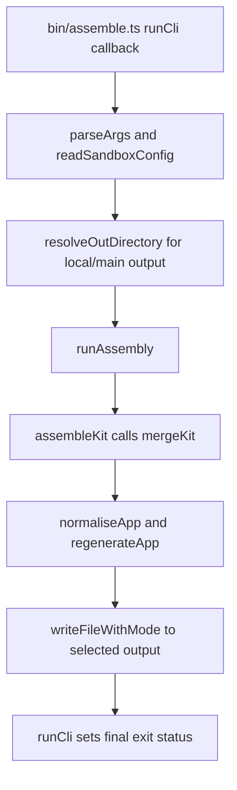

# US-OPS-02 — Assemble package examples into a kit

As a sandbox maintainer, I want to assemble configured package layers onto the pinned starter so that selected generated apps reflect the requested source combination.

**Status:** Operator; source-reviewed availability, not runtime-tested.
**Access:** Sandbox maintainer with the selected kit sources, supported Node 24/pnpm toolchain and filesystem access.
**Entry:** `pnpm assemble [--kit <kit>]...`; local and main variants require temporary output.
**Documentation:** [Repository instructions](../../docs/specification.md).
**Source:** [Assembly CLI](../../bin/assemble.ts).

## Acceptance criteria

| Option         | Type            | Required/default/conditions                                                                             |
| -------------- | --------------- | ------------------------------------------------------------------------------------------------------- |
| `--kit`        | Repeated string | Optional; all configured kits by default; each value must be in `config/sandbox.json`                   |
| `--mode`       | Choice          | `released` default or `main`; main requires `--out` and cannot combine with `--check` or `--with-local` |
| `--with-local` | Checkout path   | Optional in released mode; must be paired with `--out`; package must be configured in the sandbox       |
| `--out`        | Directory path  | Required for local/main mode; resolved path must be strictly inside repository `tmp/`                   |
| `--check`      | Boolean         | Separate comparison outcome in US-OPS-04; cannot combine with local/main mode                           |

- Released mode reads pinned base and release-tag package examples, merges their lineage, applies sandbox layers/resolutions, normalizes and regenerates each kit, then replaces that kit's output under `apps/`.
- Local mode packs one local package into temporary output; main mode builds selected packages' main revisions into temporary vendor archives and reports incompatible runtime peers.
- The loop continues after a kit failure only for `SandboxError`; an unexpected exception aborts remaining kits. A handled failed/conflicting kit makes the command nonzero even if another kit was written. Failed merges report pending conflicts rather than producing that kit's app. An interruption during output replacement can leave incomplete output; rerun after correcting the cause.
- A local package whose predecessor is ahead of released sandbox inputs may produce only an explicit peer-ahead note and return success. That is a skipped combination, not an assembled or runtime-tested app.

## User flow

## Code flow

Scope: Sandbox CLI through its implementation; generated application behavior is outside this operation.

**Code references:** [Assembly CLI](../../bin/assemble.ts), [runAssembly and assembleKit](../../src/assembly.ts), [normaliseApp](../../src/normalise.ts), [Regeneration](../../src/regenerate.ts), [Sandbox config](../../config/sandbox.json), [Assembly tests](../../tests/tooling/assembly.spec.ts).
